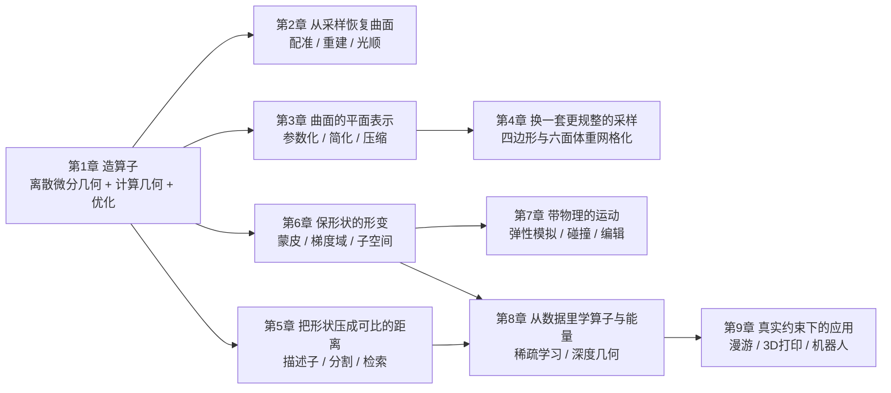

# 《离散几何处理与应用》点化学习系统

## 这本书在讲什么

这本书回答一个问题：当三维形状只能用有限个点、三角片、体素来存储时，我们怎么在计算机里对它做"微分、积分、优化、模拟"这些原本属于连续数学的事。

作者的主张很明确：离散几何处理不是连续几何的简陋版，而是有一套自己的算子（余切 Laplace、角度亏欠、离散曲率、标架场）和一套自己的判据（收敛性、鲁棒性、拓扑正确性）。全书按"先造算子（第 1 章）→ 再用算子解决四类问题：重建、表示、分析、形变与模拟（第 2—7 章）→ 最后换成数据驱动的能量（第 8 章）→ 落到真实约束（第 9 章）"这条主线展开，每一节都给里程碑方法而不是罗列文献。

## 全书心智模型

看图说明：横向三条分支对应三类目标——"恢复形状""换一种表示""比较形状"；纵向那条是"让形状动"。三条分支最后都汇进第 8、9 章：数据驱动和真实工程约束。学会看图里每一条边的两侧分别是什么，就等于记住了全书的组织逻辑。

## 学习路径（推荐顺序）

| 步骤 | 章节 | 主题 | 前置 | 检查点 |
|---|---|---|---|---|
| 01 | ch01 | 几何处理的数学基础 | 高中向量、导数、矩阵 | ch01 自测 ≥ 3/4，能写出余切权重的表达式 |
| 02 | ch02 | 点云曲面重建与光顺 | ch01 的 Voronoi/Delaunay、优化基础 | 能讲清 ICP 两步交替为什么单调下降 |
| 03 | ch03 | 参数化与多分辨率表示 | ch01 的离散 Laplace、ch02 的网格质量概念 | 能解释参数化为什么会翻转、QEM 误差怎么累加 |
| 04 | ch04 | 网格模型的重网格化 | ch03 的参数化、ch01 的整数/约束优化 | 能画出方向场奇异点与 3/5 价顶点的对应 |
| 05 | ch05 | 三维形状分析 | ch01 的曲率与 Laplace 特征值 | 能说出 HKS 为什么等距不变 |
| 06 | ch06 | 网格曲面的形变 | ch02 的光顺、ch03 的拉普拉斯坐标 | 能写出梯度域形变的最小二乘形式 |
| 07 | ch07 | 弹性运动模拟 | ch06 的形变能量、ch01 的数值积分 | 能解释 PBD 与隐式积分的关系 |
| 08 | ch08 | 基于机器学习的几何处理 | 第 1—6 章的算子、基础概率与神经网络 | 能说出 PointNet 为什么能容忍点序 |
| 09 | ch09 | 新型几何处理应用 | 全部前序章节 | 能列出 3D 打印的三类几何约束 |

依赖关系是链式为主、跨章为辅：第 2 章的重建给第 5 章提供数据，第 3 章的参数化是第 4 章的前置，第 6 章的形变能量直接是第 7 章物理模拟的特例。跳着读的唯一安全跳法是 01 → 05（形状分析主要吃第 1 章的曲率与谱），其余跳读都会在第 6 章卡住。

## 章节索引

- 第 1 章 几何处理的数学基础（难度 ★★☆，约 6 小时）→ `chapters/ch01-数学基础.md`
- 第 2 章 点云曲面重建和光顺（难度 ★★★，约 8 小时）→ `chapters/ch02-重建与光顺.md`
- 第 3 章 网格曲面的参数化和多分辨率表示（难度 ★★★，约 8 小时）→ `chapters/ch03-参数化与多分辨率.md`
- 第 4 章 网格模型的重网格化（难度 ★★★，约 6 小时）→ `chapters/ch04-重网格化.md`
- 第 5 章 三维形状分析（难度 ★★☆，约 5 小时）→ `chapters/ch05-形状分析.md`
- 第 6 章 网格曲面的形变（难度 ★★★，约 7 小时）→ `chapters/ch06-曲面形变.md`
- 第 7 章 网格模型的弹性运动模拟（难度 ★★★，约 7 小时）→ `chapters/ch07-弹性模拟.md`
- 第 8 章 基于机器学习的几何处理（难度 ★★☆，约 6 小时）→ `chapters/ch08-机器学习几何.md`
- 第 9 章 新型几何处理应用（难度 ★☆☆，约 3 小时）→ `chapters/ch09-新型应用.md`

## 前置知识（零基础缺口补讲）

| 缺口 | 补讲位置 | 学完标志 |
|---|---|---|
| 向量、点积、叉积、法向 | ch01「零基础讲解 · 概念 0」 | 能算一个三角形的单位法向 |
| 矩阵、线性方程组、稀疏矩阵 | ch01「概念 0」，概念页「稀疏线性系统」 | 能说清为什么 10 万顶点的网格方程还能解 |
| 偏导、梯度、散度 | ch01「概念 3 数值优化」 | 能解释"梯度指向上升最快方向" |
| 余切 cot 是什么 | ch01「概念 2 离散算子」附注 | 能算 30° 角的余切（≈1.732） |
| 特征值/特征向量（谱） | ch05「概念 · 热核签名」 | 能说清低频模态对应大尺度形变 |
| 概率与期望 | ch08「概念 · 稀疏编码」 | 能解释为什么 L1 会产生稀疏解 |

更细的从零推导在独立产物里：`../从零推导/` 下两篇（网格上的微分几何、梯度域形变）。这两篇把第 1.3 节和第 6.2 节的公式从初中数学一路推上来，适合在第 1 章和第 6 章卡住时对照读。

## 术语表 / 模式库 / 速查表入口

- 术语：`glossary.md`（约 70 条，按首现章节排序）
- 模式与反模式：`patterns.md`（作者反复使用的五个分析框架、六条决策规则、五个反模式）
- 速查表：`cheatsheet.md`（公式、算法流程、参数与判据）
- 测验：`quiz.md`（每章 4 题 + 综合 6 题 + 最终项目）
- 抽认卡：`flashcards.md`（每章 5 张，共 45 张）
