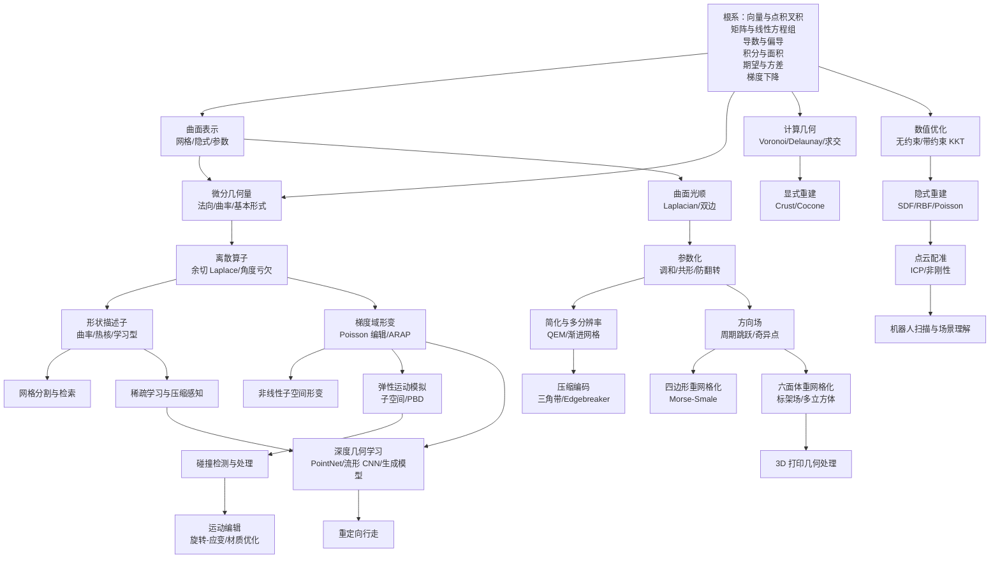

# 概念依赖图与难点地图

## 依赖图（无环，按拓扑序）

看图说明：竖线左边是"建立算子"（第 1 章），中间是"用算子解决四个基本问题"（第 2—7 章），右边是"把手工能量换成学习能量"（第 8 章）与"真实约束下的应用"（第 9 章）。任何一条右上方向的边都表示后者必须用到前者的实现细节，不是并列关系。

## 概念清单（术语 / 白话定义 / 首现章 / 难度）

难度：1 基础，2 进阶，3 高难。

| 概念 | 白话定义 | 首现 | 难度 |
|---|---|---|---|
| 多边形网格曲面 | 顶点表 + 面片表拼出的分片平面曲面 | 1.1.1 | 1 |
| 流形网格 | 每个顶点邻域都像一小块平坦圆盘、没有自交和多余薄片的网格 | 1.1.1 | 2 |
| 亏格 | 曲面上"洞"的个数，甜甜圈是 1 | 1.1.1 | 1 |
| 隐式曲面 | 用函数值为零的点集描述的曲面，没有顶点和面片 | 1.1.2 | 1 |
| 符号距离场 SDF | 每个点记"到曲面的距离 + 在内还是在外" | 1.1.2 | 1 |
| 参数曲面 | 用两个参数 (u,v) 把平面片映到空间里的曲面 | 1.1.1 | 1 |
| 三次样条 | 分段三次多项式，接缝处一二阶导数都连续 | 1.2.1 | 2 |
| Bézier 曲线 | 用控制点做加权平均得到的曲线，权重是 Bernstein 基 | 1.2.2 | 2 |
| B-样条 | Bézier 的局部化版本，改动一个控制点只影响附近几段 | 1.2.3 | 2 |
| 有理样条 NURBS | 给控制点加权重再平均，能精确表示圆和圆锥 | 1.2.4 | 3 |
| 第一基本形式 | 曲面上的"尺子"，量切向长度和夹角 | 1.3.1 | 2 |
| 第二基本形式 | 曲面上的"弯曲计"，量法向弯曲程度 | 1.3.1 | 3 |
| 主曲率 | 一点上最大和最小的弯曲程度 | 1.3.1 | 1 |
| 高斯曲率 / 平均曲率 | 两主曲率之积 / 之半和 | 1.3.1 | 2 |
| 离散 Laplace 算子 | 把"这个点与邻居平均的差"写成矩阵，逐点算 | 1.3.2 | 2 |
| 余切权重 | 离散 Laplace 里用对边所对角的余切给边加权 | 1.3.2 | 3 |
| 角度亏欠 | 顶点周围一圈三角形角度和与 2π 的差，即离散高斯曲率 | 1.3.2 | 2 |
| 离散高斯-博内定理 | 全网格角度亏欠加起来等于 2π·欧拉示性数 | 1.3.2 | 2 |
| Hausdorff 距离 | 两个点集互相"最远最近"的两个最大距离取大者 | 1.4.1 | 2 |
| Voronoi 图 | 每个点管一块"离它最近"的地盘 | 1.4.2 / 2.2.1 | 1 |
| Delaunay 三角剖分 | Voronoi 的对偶：相邻地盘的点连边 | 2.2.1 | 2 |
| 网格求交裁剪 | 三角形两两求交、切开、重连的几何运算 | 1.4.2 | 3 |
| 无约束优化 | 只要求目标函数变小，不管别的 | 1.5.1 | 1 |
| 带约束优化 / KKT | 在有等式和不等式限制下找最优，KKT 是"最优的必要条件" | 1.5.2 | 3 |
| 点云配准 | 求一个刚体变换把两片点云对齐 | 2.1.1 | 1 |
| ICP | 交替做"找最近点"和"解变换"直到收敛 | 2.1.1 | 2 |
| 非刚性配准 | 允许形变的配准，常用于人体扫描 | 2.1.2 | 3 |
| Crust / Cocone | 用 Voronoi 极点判断哪些 Delaunay 三角形该留 | 2.2.2 / 2.2.4 | 3 |
| RBF 重建 | 用一堆径向基函数叠加拟合曲面法向/距离 | 2.3.2 | 3 |
| Poisson 重建 | 解一个 Poisson 方程，让指示函数的梯度匹配采样法向 | 2.3.3 | 3 |
| Marching Cubes | 在体素格上按等值面挖出三角形 | 2.3 | 2 |
| 曲面光顺 | 把高频噪声抹掉、保留大形状 | 2.4 | 1 |
| 双边滤波 | 距离近、法向近的点才参与平均 | 2.4.2 | 2 |
| 参数化 | 把曲面摊平到平面上，给出 (u,v) 坐标 | 3.1 | 2 |
| 防翻转参数化 | 保证摊平后三角形不翻面、不自交 | 3.1.2 | 3 |
| 多片参数化 | 先把曲面切成若干片，每片单独摊平再缝合 | 3.1.1 | 2 |
| 渐进参数化 | 先摊一个粗网格，再逐点细化不改大局 | 3.1.4 | 3 |
| QEM 简化 | 用"删点后二次误差最小"决定坍缩哪条边 | 3.2.1 | 2 |
| 渐进网格 PM | 把简化过程记成可逆的边坍缩序列 | 3.2.2 | 2 |
| 三角带 / 广义三角网 | 把三角形排成一条条带子，省掉重复的顶点下标 | 3.3.1 / 3.3.2 | 1 |
| Edgebreaker | 用 5 种符号沿边遍历编码整个连通网格 | 3.3.3 | 3 |
| 重网格化 | 保持形状但换一套更规整的采样（顶点数可能变多） | 4.1 | 2 |
| 方向场 / 交叉场 | 在每个点给出 4 个互相垂直的切向，规定四边形怎么排 | 4.2.1 | 3 |
| 周期跳跃 | 方向场转过 90° 后分量翻转，跨过去要先"翻符号" | 4.2.1 | 3 |
| 奇异点 | 方向场转不回来的点，四边形网格在该处出现 3 或 5 价顶点 | 4.2.1 | 2 |
| Morse-Smale 复形 | 用标量场的梯度流把曲面分割成四边形块 | 4.2.2 | 3 |
| 标架场 | 每个点给 3 个互相垂直的方向，六面体网格的排布依据 | 4.3.2 | 3 |
| 多立方体 polycube | 用一堆轴对齐立方体拼出模型，再映射回光滑形状 | 4.3.3 | 2 |
| 形状描述子 | 把形状压成一个向量，让"像不像"能算距离 | 5.1 | 1 |
| 形状分布 D2 | 随机采样两点，统计它们距离的分布 | 5.1.1 | 1 |
| 球谐描述子 | 把形状展开成球面上的频率成分 | 5.1.1 | 3 |
| 热核签名 HKS | 热量在曲面上扩散、某点残留多少，随时间的曲线 | 5.1.2 | 3 |
| 波核签名 WKS | HKS 的振动版，用拉普拉斯特征值加权 | 5.1.2 | 3 |
| 网格分割 | 按几何或语义把网格切成几块 | 5.3 | 2 |
| 归一化割 | 切块时既让切口小、又让每块别太小 | 5.3.1 | 3 |
| 协同分割 | 一组模型一起切，对应部位切法一致 | 5.3.3 | 3 |
| 形状检索 | 按描述子距离在库里找最像的模型 | 5.4 | 2 |
| 蒙皮 | 用骨架运动带动表面，每个顶点按权重混合几根骨头的变换 | 6.1.1 | 2 |
| 线性混合蒙皮 LBS | 顶点位置 = 各骨变换后位置的加权和 | 6.1.1 | 2 |
| 自由形变 FFD | 把模型放进控制网格，动网格就带动模型 | 6.1.2 | 2 |
| 梯度域形变 | 保留每个点的微分坐标（拉普拉斯坐标），再重建全局位置 | 6.2.1 | 3 |
| Poisson 网格编辑 | 解一个 Poisson 方程，让新网格的拉普拉斯坐标尽量等于目标 | 6.2.1 | 3 |
| 体图 cage | 包住模型的低模控制网格，用它传递形变 | 6.2.2 | 2 |
| ARAP | 让每个三角形尽量只做旋转不做拉伸的形状保持能量 | 6.3.1 | 3 |
| 子空间形变 | 只在少数几个基向量张成的空间里找解，降维提速 | 6.3.2 | 3 |
| 弹性运动模拟 | 按物理方程让模型随时间演化 | 7.1.1 | 2 |
| 隐式积分 | 用后一时刻的力反推位移，允许大时间步 | 7.1.1 | 3 |
| 子空间降维模拟 | 只用最低频的几十个振动模态算运动 | 7.1.2 | 3 |
| PBD / 投影动力学 | 先按无约束预测位置，再把约束"投影"回可行集 | 7.1.3 | 3 |
| 碰撞检测 BVH | 用层次包围盒快速排除不可能碰上的三角形对 | 7.2.1 | 2 |
| 旋转-应变空间编辑 | 把形变拆成旋转和应变分别控制 | 7.3.1 | 3 |
| 稀疏编码 | 用字典里少数几个原子的组合表示信号 | 8.1.1 | 2 |
| 字典学习 | 连字典一起从数据里学出来 | 8.1.2 | 3 |
| 低秩优化 | 要求矩阵的秩尽量小，等价于"信息尽量重复" | 8.1.4 | 3 |
| 压缩感知 | 信号稀疏时，少量测量就能恢复 | 8.1 | 3 |
| 点云网络 PointNet | 逐点提特征再池化成全局特征的网络 | 8.4.2 | 2 |
| 流形卷积 | 在曲面上按测地距离聚合邻居，而非按平面网格 | 8.4.3 | 3 |
| 生成模型 | 学数据分布，能采样出新形状（VAE/GAN） | 8.4.4 | 3 |
| 重定向行走 | 在有限真实空间里让人以为走了很远（增益/转向/传送） | 9.1.1 | 2 |
| 可打印性 | 能支撑、能闭合、有足够强度、能装进打印空间 | 9.2.1 | 2 |
