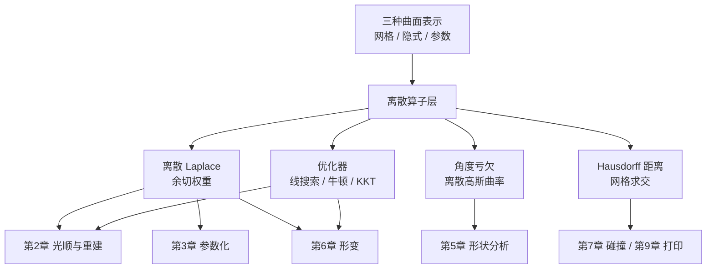

# 第 1 章：几何处理的数学基础

- **难度**：★★☆ | **预估学时**：6 小时 | **前置**：向量点积叉积、矩阵与线性方程组、偏导数、基本的求最小值经验

## 学习目标

学完本章，你能：

1. 说清多边形网格、隐式曲面、参数曲面三种表示各自"存了什么、丢了什么"，并判断一个具体任务该用哪种。
2. 写出三次样条、埃尔米特样条、Bézier、B-样条、有理样条的区别（谁连续、谁局部、谁能精确画圆）。
3. 从"这个点比邻居平均高出多少"出发，写出离散 Laplace 算子的余切权重公式，并算出一个顶点的具体数值。
4. 说明为什么把角度亏欠当离散高斯曲率，以及角度亏欠求和为什么只能是 2π 的整数倍。
5. 判断一个优化问题该用线搜索、牛顿、拟牛顿还是带约束的 KKT/投影方法。

## 一句话核心

连续几何在计算机里只能被采样，因此所有"微分、积分、距离、最优化"都必须先改写成**只依赖顶点坐标和邻接关系的离散公式**；这套改写就是本书的算子层，后面八章都在消费它。

## 零基础讲解

### 概念 0：三件必须先有的工具

**向量**：一根有方向和长度的箭头，本书用 (x, y, z) 三个数字记它。

**点积**：a·b = ax bx + ay by + az bz，结果是**一个数**，含义是"a 在 b 上投影的长度 × b 的长度"。用它算夹角：cos θ = a·b / (|a||b|)。余切（cot）就是 cos/sin，等于"邻边除以对边"，30° 的余切约 1.732——记住这个数，本章后面算算子要用。

**叉积**：a×b 结果是**一个向量**，垂直于 a 和 b 张成的平面，长度等于平行四边形面积。三角形 (p0, p1, p2) 的单位法向就是：

```
n = (p1 − p0) × (p2 − p0) / |(p1 − p0) × (p2 − p0)|
```

叉积长度的一半正好是三角形面积，所以网格每个三角形的面积不用另算。

**偏导数**：把其他变量当常数、只对一个变量求导。∂f/∂x 就是"只动 x 时 f 变多快"。

**梯度 ∇f**：把所有偏导装成一个向量 (∂f/∂x, ∂f/∂y, ∂f/∂z)。它的方向是函数**上升最快**的方向，长度是上升速率。所以要让函数变小，就往 −∇f 走。

### 概念 1：三种曲面表示，各存了什么

**多边形网格曲面**（难度：基础）。用两个表描述：**顶点表**记坐标，一行一个顶点；**面片表**记"哪几个顶点围成一个面"，一行一个面。加上**边表**（哪两个顶点相连）就是完整拓扑。

为什么必须单独记拓扑？因为坐标只是位置，"谁和谁相邻"是另一份信息。同一堆顶点，连法不同就是不同形状：可以是球，也可以是一团自交的乱面。

如果每个顶点的邻域摊平后都像一小块圆盘、网格没有自交也没有多余薄片，这个网格叫**流形网格**。流形是绝大多数算法的隐含前提：Laplace 算子、参数化、形变都要求"每个顶点周围是一圈有序的三角形"。

**亏格**数曲面上洞的个数：球是 0，甜甜圈是 1，双环把手是 2。亏格不是画出来的细节，它是拓扑不变量——你怎么揉都不能把甜甜圈揉成球而不撕开。

**隐式曲面**（难度：基础）。不存点，存一个函数 f(x, y, z)，曲面就是 f = 0 的那些点。最常用的是**符号距离场**（SDF）：每个点记"到曲面的距离"，外加一个符号表示在内部还是外部。它的好处是内外判定只要看符号、求交只要比较值；坏处是"曲面上有哪些点"要靠 Marching Cubes 这类算法挖出来，精度受格子分辨率限制。

**参数曲面**（难度：基础）。用两个参数 (u, v) 把一张平面片贴到空间里：S(u, v) = (x(u, v), y(u, v), z(u, v))。好处是曲面上的运算可以退化成平面上的运算（比如纹理坐标天然就是 (u, v)）；坏处是复杂拓扑贴不上一张平面片，必须切成多片。

三者不是竞争关系，而是流水线上的不同工位：扫描仪给点云 → 重建算法给网格（第 2 章）或 SDF → 参数化把网格摊成 (u, v)（第 3 章）→ 设计软件里用样条（本节后面）做精确造型。

### 概念 2：样条家族——从"分段多项式"到"能精确画圆"

先说一个动机。用一条高次多项式去穿过 100 个点，会出现剧烈振荡（龙格现象）；用 100 段直线去连，又会有折角。**样条**的思路是：用很多段**低次**多项式拼接，并强迫接缝处足够光滑。

**三次样条**（难度：进阶）。每两个相邻控制点之间放一段三次多项式 p(u) = a u³ + b u² + c u + d，要求接缝处函数值、一阶导、二阶导都连续（即 C² 连续）。设共有 n+1 个控制点、n 段曲线，每段 4 个未知系数，共 4n 个未知数。约束来自两处：每段两端要穿过自己的两个控制点（2n 个方程），每个内部接缝要求一阶、二阶导相等（2(n−1) 个方程）。加起来 4n−2 个方程，比未知数少 2 个，所以还要补两个**边界条件**。最常见的是自然边界条件：首末两点二阶导取 0。

它的毛病是**不局部**：所有段的系数由一个整体线性系统联立求解，动一个控制点，整条曲线都得重算。

**埃尔米特（Hermite）样条**（难度：进阶）。在控制点上额外给出切向量（斜率），每段曲线只由它自己的两个端点位置和两个切向决定：

```
p(u) = p_k h00(u) + p_{k+1} h01(u) + d_k h10(u) + d_{k+1} h11(u)
h00 = 2u³ − 3u² + 1,  h01 = −2u³ + 3u²
h10 = u³ − 2u² + u,   h11 = u³ − u²      （0 ≤ u ≤ 1）
```

因为完全局部，改一段不影响别段。代价是斜率先得知道——对交互设计不友好。

**Bézier 曲线**（难度：进阶）。给定 m+1 个控制点，曲线是它们的加权平均：

```
p(u) = Σ_{k=0}^{m} p_k B_{k,m}(u),   0 ≤ u ≤ 1
B_{k,m}(u) = C(m,k) u^k (1−u)^{m−k}
```

权重 B 叫**伯恩斯坦多项式**，所有 B 加起来恒等于 1（所以曲线一定落在控制点的凸包里，这叫**凸包性**）。u=0 时只有 B_{0,m}=1，曲线正好从 p_0 出发；u=1 时落在 p_m。也就是说曲线**端点插值、其余点只"吸引"不穿过**。

数值上不直接算高次幂，用**de Casteljau 算法**：反复把相邻控制点按 u : (1−u) 的比例取分点，取 m 轮，最后剩下的那一点就是曲线上的点。3 个控制点、u=0.5 时，依次取中点两次，得到的正是三角形中线中点——这一步可以手算验证。

**B-样条**（难度：进阶）。Bézier 的局部版。控制点权重改成"只在局部非零"的基函数，于是改一个控制点只影响相邻几段；代价是不再插值端点，曲线被"拉"在控制点附近。

**有理样条（NURBS）**（难度：高难）。给每个控制点加一个权重 w_k，再归一化：

```
p(u) = Σ w_k p_k B_{k,m}(u) / Σ w_k B_{k,m}(u)
```

权重越大，曲线越靠近那个控制点；所有权重取 1 时退回普通 B-样条。它有两个别的样条给不了的能力：**精确表示圆和椭圆**（普通多项式样条只能逼近，永远差一点），以及在**投影变换下保持不变**（因为分子分母同阶，投影后仍是有理形式）。这就是为什么工业 CAD 标准是 NURBS 而不是 B-样条。

### 概念 3：曲面上到底"弯了多少"——微分几何量与离散化

**第一基本形式**（难度：进阶）。它是曲面上的尺子。记两个切向偏导 S_u、S_v，则

```
E = S_u·S_u,  F = S_u·S_v,  G = S_v·S_v
```

曲面上一条参数曲线的长度就是 ∫√(E du² + 2F du dv + G dv²)。E、F、G 就是全部"度量信息"：知道它们，就能算长度、角度、面积。

**第二基本形式**（难度：高难）。它是弯曲计。记单位法向 n，则

```
L = S_uu·n,  M = S_uv·n,  N = S_vv·n
```

直观上：第一基本形式问"沿切向走多远"，第二基本形式问"走的时候偏离切平面多少"。

**主曲率**（难度：基础）。在一点上，沿不同切方向弯曲程度不同。使法曲率取最大和最小的两个方向互相垂直，对应的曲率 k1、k2 就是主曲率。它们的组合给出两个最有用的量：

```
高斯曲率  K = k1 · k2      （乘起来：球面为正，马鞍为负，柱面为 0）
平均曲率  H = (k1 + k2) / 2
```

欧拉定理说，任一方向的法曲率满足 κ(θ) = k1 cos²θ + k2 sin²θ，所以平均曲率确实是所有方向法曲率的平均。

为什么这两个量重要？因为**极小曲面**（肥皂膜）就是 H = 0 的曲面，而 K 决定局部形状类型（球面片 K > 0，马鞍 K < 0，可展面 K = 0）。第 2 章的光顺、第 6 章的形变能量，写的都是 H 或 K 的离散版本。

**离散 Laplace 算子**（难度：进阶）。连续情形下，Laplace 量 Δx 衡量"这一点和周围平均差多少"。在网格上取顶点 i 的一环邻域（所有直接相连的顶点 j），标准做法是：

```
Δx_i = (1 / (2 A_i)) Σ_j (cot α_ij + cot β_ij) (x_j − x_i)
```

其中 A_i 是顶点 i 的**混合面积**（一圈三角形面积的加权和），α_ij、β_ij 是边 (i, j) 两侧正对着这条边的两个角（**余切权重**）。

为什么是余切？一句话：要让这个离散算子在"把网格细分得更密"时收敛到真正的连续 Laplace，权重必须等于这条边两侧角的余切之和——这是从三角形上的分片线性函数的积分直接算出来的结果，不是凑出来的经验公式。代价是：钝角（大于 90°）的余切是负数，所以钝角三角形会让权重变负，网格质量差时算子会失稳。这解释了为什么第 3、4 章要死死盯着三角形质量。

它的一个变形是**平均曲率法向算子**：

```
H(x_i) = (1 / (4 A_i)) Σ_j (cot α_ij + cot β_ij)(x_j − x_i)
```

方向就是法向，长度是平均曲率。第 2 章的光顺就是反复沿这个方向挪一点点。

**角度亏欠**（难度：进阶）。绕着顶点 i 一圈三角形的内角和记为 Σθ，则

```
K_i = 2π − Σθ_i
```

这个差叫角度亏欠，直接当离散高斯曲率用。为什么合理？平面上绕一点一圈角度和正好 2π，亏欠为 0；球面上绕一点一圈角度和不足 2π（球面"多出来"的面积要靠这个亏欠补上），所以亏欠为正；马鞍处角度和超过 2π，亏欠为负。符号与连续高斯曲率一致，这是它被采用的根本理由。

**离散高斯-博内定理**（难度：进阶）。把全网格所有顶点的角度亏欠加起来：

```
Σ_i K_i = 2π χ,   χ = V − E + F（欧拉示性数）
```

球面 χ = 2，所以总亏欠恒为 4π，不管你把球剖成多少个三角形。这是一个"无论怎么离散都成立"的拓扑恒等式，也是判断网格有没有多余洞、有没有丢面的硬指标：算出来的总亏欠不是 2πχ，就说明拓扑坏了。

### 概念 4：算两个曲面差多少——Hausdorff 距离与求交

**Hausdorff 距离**（难度：进阶）。定义是双向的"最坏情况"：

```
d_H(A, B) = max( sup_{a∈A} inf_{b∈B} |a − b| ,  sup_{b∈B} inf_{a∈A} |a − b| )
```

翻译：A 上每个点到 B 的最近距离里取最大，B 到 A 同样取最大，两者取大。它衡量的是"最不像的地方差多远"，不是平均误差——这正是重建质量评估要的：平均误差可以很小，但局部破一个洞就是不能用。

精确算很贵，实用做法是按三角形估上下界：三角形 A 到网格 B 的距离，下界用 A 的顶点到 B 的最近距离，上界用顶点距离加三角形尺寸修正，于是得到全局上下界，可用来做保守判断。

**网格求交裁剪**（难度：高难）。两个网格做布尔运算（并、交、差）的底层操作：找出所有相交的三角形对、算出交线段、沿交线把三角形切开、再把碎片重新连成闭合网格。它真正的难点不在几何求交，而在**数值鲁棒性**：浮点误差会让本应共面的两个三角形一会被判相交一会判不相交，结果是网格出现裂缝或非流形边。第 9 章的 3D 打印、第 7 章的碰撞处理都绕不开它。

### 概念 5：怎么把"最小化某个能量"真的算出来

几何处理的绝大多数问题最后都写成 min_x f(x)。

**无约束优化**（难度：基础）。核心是**线搜索**：每次先定一个下降方向 p_k，再定沿这个方向走多远（步长 α_k）。下降方向的标准形式：

```
p_k = −B_k⁻¹ ∇f(x_k)
```

B_k 取单位矩阵就是**最速下降法**（沿负梯度走，稳但慢，接近最优时会来回锯齿）；取 Hessian ∇²f 就是**牛顿法**（用二阶信息一步跳到二次近似的最小点，快但要算 Hessian 且要求它正定，否则方向可能不下降）；取 Hessian 的近似（用梯度差更新）就是**拟牛顿法**（BFGS/L-BFGS），在两者之间取平衡，是网格优化里最常用的默认选项。

步长不能乱取，否则"方向对但仍可能上升"。**Wolfe 准则**给两个条件：一是函数值要下降够多（Armijo 条件），二是新点的斜率要明显变缓（曲率条件），防止步子太小。

**带约束优化**（难度：高难）。几何问题常带约束：顶点不能跑到模型外（边界约束）、体积不能变（等式约束）、三角形不能翻（不等式约束）。

等式约束的标准工具是拉格朗日乘子：把约束乘上乘子加进目标，最优解处目标梯度与约束梯度平行。不等式约束再加上**互补松弛**：约束要么不起作用（乘子为 0），要么正好压在边界上（约束值为 0），二者必居其一。这三条合起来就是 **KKT 条件**，它是"最优的必要条件"，也是很多求解器的收敛判据。

工程上最常遇到的是**带边界约束的二次规划**：

```
min ½ xᵀA x − bᵀx   subject to  x ≥ l
```

它就是"每个顶点有自己的活动范围"的形变/碰撞问题。书里给的典型解法 MPRGP（改进的投影梯度法）思路很朴素：把梯度分成"还在可行域内部、可以自由走"的部分和"已经顶到边界、必须截断"的部分，只沿自由部分下降，必要时用共轭梯度加速。

## 图示



看图说明：图中所有箭头都从"表示"流向"算子"再流向具体章节。看这张图要抓住一点——本书后面每一章的能量函数里出现的 Laplace、曲率、距离、优化器，都出自本章；如果某章读不懂，八成是这里某个算子没吃透。

## 类比与实例

**类比**：把网格想成一张渔网。顶点是网结，三角形是网眼。第一基本形式是"网眼有多大、线有多长"，第二基本形式是"网面拱起来多少"。往网结上轻轻一拉，网眼跟着变形——这就是离散 Laplace 在做事。**类比失效的边界**：渔网只能有四边形网眼且不能自交，而真实网格允许任意多边形、允许复杂拓扑（多个洞），也能容忍局部退化。

**实例（可手算）**：取一个正四面体的四个顶点，边长为 1，全是等边三角形（每个角 60°）。

- 每个顶点周围有 3 个三角形，内角和 Σθ = 3 × 60° = 180° = π。
- 角度亏欠 K_i = 2π − π = π ≈ 3.1416。
- 四个顶点总亏欠 = 4π，与 2πχ 对照：四面体 V=4、E=6、F=4，χ = 4 − 6 + 4 = 2，2πχ = 4π。对得上。

再算余切权重：等边三角形每个角 60°，cot 60° = 0.5774。某条边两侧各有一个 60° 角，所以权重 w = 0.5774 + 0.5774 = 1.1547。若该顶点有 3 个邻居、混合面积取每个三角形面积的 1/3（等边三角形面积 = √3/4 ≈ 0.4330），则 A_i ≈ 0.4330，于是

```
Δx_i = (1 / (2 × 0.4330)) × 1.1547 × Σ_j (x_j − x_i) ≈ 1.333 × Σ_j (x_j − x_i)
```

对你的球面网格，Σ_j(x_j − x_i) 会指向内部（邻居平均在"里面"），所以 Δx_i 指向内——这就是为什么光顺时 x ← x + εΔx 会把形状往内收缩一点点（第 2 章会看到收敛面）。

## 常见误解

- **别以为"网格越密就一定越准"**——实际上精度取决于算子是否**收敛**到连续量。余切 Laplace 在网格质量差（大量钝角三角形）时，权重变负，加密反而放大误差；均匀、近等边的网格才是前提。
- **别以为"样条比网格高级，所以样条更准"**——两次都错在对象不同。样条擅长用少量参数表达光滑形状，但对带精细细节、复杂拓扑的形状表达力不足；网格擅长任意拓扑与细节，但不光滑。这也是全书反复要在两者间转换的原因。
- **别以为"高斯曲率可以为任意实数，所以角度亏欠也可以"**——离散角度亏欠的值受拓扑约束：全网格求和只能是 2π 的整数倍。单个顶点的亏欠可以很负，但总和固定。算出来不对，说明网格拓扑错了。
- **别以为"牛顿法一定比最速下降快"**——牛顿步要求 Hessian 正定。形变能量在接近翻转的三角形附近 Hessian 会不定，此时牛顿方向可能**上升**；所以工程实现都加"是否下降"的检查并回退。
- **别以为"带约束优化加上惩罚项就够了"**——罚函数法把约束变成大惩罚，精度受罚系数限制，且系数太大导致病态。真正保证可行的是投影法或 KKT 类方法，这也是 MPRGP 那类算法存在的原因。

## 自测题（答案）

1. （单选）一个球面网格的离散高斯曲率（角度亏欠）之和应该是多少？
   A. 0　B. 2π　C. 4π　D. 取决于剖分密度
   **答案**：C。**解析**：球面 χ = 2（V−E+F = 2），由离散高斯-博内定理，总亏欠 = 2πχ = 4π，与剖分密度无关。

2. （单选）下列哪种表示**能精确**表示一个圆？
   A. 三次样条　B. B-样条　C. 有理样条（NURBS）　D. Bézier 曲线
   **答案**：C。**解析**：多项式的非有理样条只能逼近圆锥曲线；有理样条分子分母同为多项式，能精确表达圆、椭圆，并在投影变换下保持形式。

3. （填空）一个顶点有 3 个邻居，每条边的余切权重和为 1.2，混合面积 A_i = 0.4，则离散 Laplace 前面的系数 1/(2A_i) 等于 ＿＿，整个 Δx_i 等于 ＿＿ × Σ_j(x_j − x_i)。
   **答案**：1.25；1.5。**解析**：1/(2×0.4) = 1.25；再乘 1.2 得 1.5。

4. （简答）为什么三次样条虽然 C² 连续，却"缺乏局部控制能力"？
   **答案要点**：因为求系数要联立一个覆盖全部控制点的线性系统，改一个控制点会改变整个方程组的右端项，因此所有段的系数都要重解（相当于整条曲线重算）。对比埃尔米特样条，每段只由自己两个端点的位置与切向决定，才能局部修改。

5. （简答）说明 Wolfe 准则中的两个条件各自防的是什么问题。
   **答案要点**：Armijo 条件（函数值下降够多）防"步子太小、几乎不动"的伪收敛；曲率条件（新点斜率明显变缓）防"步子太大、越过谷底又爬上来"。两个条件一起，才能保证线搜索既真的下降又不会白走。

## 复习锚点

- 三种表示：网格存拓扑、隐式存函数、参数存 (u, v)；选择看"要不要任意拓扑""要不要内外判定""要不要精确造型"。
- 样条谱系一句话：三次样条 C² 但全局；埃尔米特局部但要切向；Bézier 凸包但全局；B-样条局部但不插端点；NURBS 能精确画圆且投影不变。
- 离散算子两个招牌：Δx_i 用余切权重（钝角会变负）、K_i 用角度亏欠（总和只能是 2πχ）。
