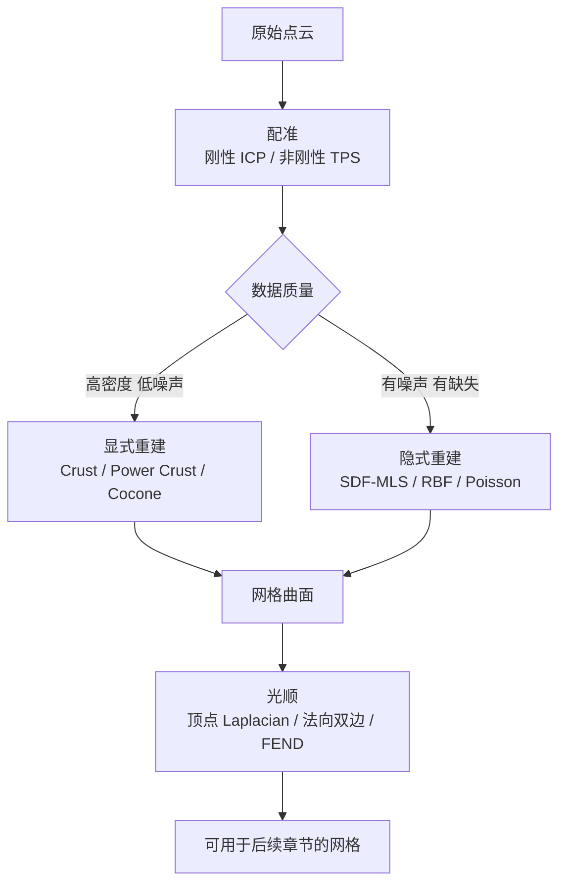

# 第 2 章：点云曲面重建和光顺

- **难度**：★★★ | **预估学时**：8 小时 | **前置**：第 1 章的 Voronoi/Delaunay、Hausdorff 距离、最小二乘；向量叉积

## 学习目标

学完本章，你能：

1. 说清点云配准为什么必须"找对应点"和"解变换"交替做，并解释 ICP 为什么只会收敛到局部最优。
2. 区分显式重建（Crust/Cocone 一类）与隐式重建（SDF/RBF/Poisson）的适用场景：什么数据该用哪一类。
3. 解释 Poisson 重建在做什么（求一个函数，使它的梯度等于采样法向场），以及为什么它比单纯拟合距离更稳。
4. 说出曲面光顺里"顶点位置光顺"和"法向光顺"的区别，以及双边滤波为什么能保特征。
5. 给出一份带噪声、带缺失的扫描点云的处理方案并说明理由。

## 一句话核心

重建的本质是**把"曲面在哪"这个问题的答案从"点"变成"函数"**：显式方法直接连三角形，隐式方法先求一个覆盖全空间的场再挖等值面；而无论哪种，都得先让点云与目标对齐、并把噪声压下去。

## 零基础讲解

### 概念 1：点云配准——先把两片点云摆到一起

扫描一件文物，通常要转着扫好几圈，每次得到一个局部点云。要把它们拼成完整模型，第一步是**配准**：求一个变换，把源点云摆到目标点云的坐标系里。

**刚性配准**（难度：基础）。只允许旋转加平移，不允许拉伸。数学上就是求 R（3×3 旋转）和 t（平移向量），使

```
min_{R,t}  Σ_i | R x_i + t − y_i |²
```

其中 x_i 是源点，y_i 是它在目标点云里的对应点。这个式子有闭式解：先把两片点云的质心移到原点，再求使"交叉协方差矩阵"最优的旋转（用 SVD 或单位四元数都行），最后把质心平移回去。**关键难点不是解这个方程，而是"y_i 是谁"**——点云没有顶点编号，对应关系本身未知。

**ICP（迭代最近点）**（难度：进阶）。解法就是交替两件事：

1. 用当前变换把源点云变换过去，为每个点找目标点云里**最近**的点当对应点；
2. 固定这批对应点，解上面那个闭式最小二乘，得到新变换。

再重复，直到误差变化小于阈值。书里明确指出：**ICP 只能保证在欧氏度量下单调收敛到局部最小**，不保证全局最优。原因很直白：第一步"找最近点"在错误的变换下会配错，配错的对应点又把变换拉向错误方向，于是卡在局部坑里。工程上的补救是先用特征（FPFH 之类）做粗配准给出初值，再上 ICP 精修；或者用随机采样一致性（RANSAC）反复抽三对点、算变换、用一致程度打分，选最好的初值。

点云稀疏时还有个改进（Chen 等）：不用"点到点"距离，而用"源点沿法向投到目标曲面的交点"作为对应，度量改成点到切平面的距离，收敛更快。

**非刚性配准**（难度：高难）。人体、软组织、表情扫描这类数据不能只用刚体变换。三种典型路线：

- **薄板样条（TPS）**：把形变写成一个"弯曲能量最小"的插值函数。薄板能量 ʃʃ[(∂²f/∂x²)² + 2(∂²f/∂x∂y)² + (∂²f/∂y²)²] 衡量函数弯得有多厉害，能量最小意味着"用最不弯的方式把对应点拉过去"。它适合做全局平滑的大形变。
- **带锚点的非刚性配准**：少量人工指定的对应点当锚点，约束整体不被拉歪，再用形变场拟合其余点。书里给了三阶段权重安排（先只按锚点预变形、再加配准误差项、最后降锚点权重微调），本质是"先粗对齐、再让数据说话"。
- **拟刚体变形**：把模型切成若干块，每块只允许近似刚体运动，块与块之间的连接处允许少量拉伸。这样既能贴合大幅动作，又不会把局部形状揉烂——这就是后面第 6 章 ARAP 思想的前身。

### 概念 2：显式重建——直接连三角形

先复习两个基本对象（第 1 章提过，这里要用）：

- **Voronoi 图**：给每个采样点分一块地盘，地盘内的任意位置离这个点最近。
- **Delaunay 三角剖分**：Voronoi 的对偶图——地盘相邻的采样点之间连边，形成三角剖分。

Delaunay 有几条必须记住的性质：二维下剖分唯一（除非四点共圆）；三角形外接圆内不含其它采样点；结果满足**最小角最大化**（三角形尽量接近正三角形）。最后一条是它在网格生成里不可替代的原因。

**Crust 算法**（难度：高难）。思路是"用 Voronoi 顶点当帮手"。二维情形：把采样点集 P 的 Voronoi 顶点也加进去，得到 P ∪ V 的 Delaunay 剖分；只保留两端点都来自 P 的边，这些边组成 Crust。直观解释：Voronoi 顶点位于"两个采样点地盘的交界"，也就是曲面中轴附近；把它们加入后，中轴附近的边会被"抢走"，剩下的边就贴着曲面。

三维要难一些：对每个采样点 p，它所在 Voronoi 单元里离它最远的两个顶点（分居曲面两侧）叫**极点** p⁺、p⁻。算法步骤是：算 Voronoi 图；对不在凸包上的 p 取最远 Voronoi 顶点作为 p⁺ 方向；对在凸包上的 p 用相邻三角形外法向平均作为 p⁺；再取与 p⁺ 点积为负且最远的作为 p⁻；最后把极点加入采样集重算 Delaunay，只保留三个顶点都属于原始点集的三角形。

再加一步**法向滤波**：极点向量 (p⁺ − p) 近似垂直于曲面，若某个三角形的法向与对应极点向量差太多，就丢掉。递归删掉"锐边"相邻的三角形，剩下的就是重建曲面。

**Power Crust**（难度：高难）：用带权 Voronoi（Power 图）处理采样密度不均匀的情况，每个点带一个半径，等于它到最近邻距离的一部分。**Cocone**（难度：高难）：用"锥形条件"筛三角形——三角形的对偶 Voronoi 边必须落在一个以极点方向为轴的窄锥内，这样能保证输出是流形、且法向收敛。

这类方法（统称 Delaunay 基重建）有理论保证：采样足够密、噪声足够小时，重建结果与真实曲面同胚。代价是三维 Delaunay 三角化的复杂度高、实现难，而且**怕噪声、怕缺失**——一点噪声就让 Delaunay 结构改变，一个扫描盲区就让输出不封闭（不水密）。所以它们适合"高质量、高密度、低噪声"的点云。

### 概念 3：隐式重建——先求场，再挖面

隐式重建不直接连面，而是先构造一个定义在全空间的函数 f，让 f = 0 正好是曲面，然后用 Marching Cubes 之类的方法把零等值面挖成三角形。

**符号距离场（SDF）+ 移动最小二乘**（难度：进阶）。最直接的想法：f(x) = 到最近采样点的距离，符号由法向定。但这样 f 在每个采样点处是尖的（不可导），且对法向噪声极敏感。改进是**移动最小二乘法（MLS）**：在查询点 x 附近取一圈邻居，局部拟合一个平面或二次曲面，用拟合值当 f(x)。书里写作

```
f̂_x = argmin_f Σ_i θ(|x − p_i|) (f(p_i) − g_i)²
```

θ 是随距离衰减的权重。MLS 把"符号敏感"的问题缓和了（局部平均），是目前点云处理的基础工具（PCL 里的标配）。

**径向基函数（RBF）**（难度：高难）。把 f 写成一组"钟形"函数的叠加：

```
f(x) = G(x) + Σ_i λ_i φ(|x − p_i|)
```

G 是低次多项式（保证精度），φ 是径向对称的基（常用 φ(r) = r³ 或 r² log r）。未知系数 λ_i 由插值条件定：曲面采样点处 f = 0，再在法向方向上取偏移点让 f 等于偏移量。φ 是全局支撑的，所以解的是一个**稠密**线性系统——点数上万就难算，通常要 Fast Multipole 加速。

**Poisson 重建**（难度：高难）。这是隐式重建里工程上最成功的一个。核心观察：如果 f 是"内部为 1、外部为 0"的指示函数，那么它的梯度 ∇f 在曲面处是一个指向内法向的"脉冲场"——也就是采样法向场。所以反过来：**已知法向场 V，求 f 使 ∇f ≈ V**。

∇f = V 是一个超定问题（三个分量方程对一个未知函数），最小二乘解正好是 Poisson 方程：

```
Δf = ∇·V
```

左边是 Laplace 算子，右边是法向场的散度。做法是：把法向场 V 用八叉树的节点基函数（每个节点一个平滑的"盒式滤波"函数）表示，得到稀疏的散度向量；解一个稀疏线性系统（可以用多重网格，因为八叉树的层次天然对应多尺度）；最后对 f 取某个等值（通常用采样点的平均值）做 Marching Cubes。

它比 SDF 稳的原因很实在：**它拟合的是梯度，不是数值**。梯度对常数偏移不敏感，所以不需要知道"离曲面多远"这种容易估错的量；它把所有采样点当成一个整体求一个全局一致解，噪声被平均掉。它也有代价：过度平滑细节、把薄结构糊掉，且对法向估计错误非常敏感（法向错了梯度就错了）。后来的"筛选 Poisson"（Screened Poisson）加了一个"解要靠近采样点"的项，才把细节找回来。

**多层单元剖分（MPU）**（难度：高难）。把空间切成八叉树小格，每格用三类局部函数之一拟合：一般光滑部分用二元二次多项式、边缘用两片二次曲面拼接、拐角用三片。适合超大点集和带尖锐特征的模型，缺点是对噪声不友好。

### 概念 4：曲面光顺——把噪声压下去但别把特征磨平

扫描数据必然带高频抖动。光顺（smoothing）的目标是：把抖动去掉，但边缘、尖角、棱线要留下。

**顶点位置光顺**（难度：基础）。最简单的做法直接用第 1 章的离散 Laplace：

```
x_i ← x_i + ε Δx_i,   ε 取很小（例如 0.001—0.01）
```

这叫**显式 Laplacian 光顺**，等价于热传导：噪声（高频）衰减快，大形状（低频）衰减慢。它的两个问题：一是网格整体向内收缩（Laplace 方向指向内部，见第 1 章的例子）；二是步长稍大就爆炸。修法是**Taubin 光顺**：交替做一次正向（λ 倍）和一次反向（μ 倍，μ 为负且绝对值更大），让收缩和膨胀抵消，只留高频衰减。

**法向光顺**（难度：进阶）。不动顶点位置，只修正每个面/顶点的法向，再用新法向重建位置。好处是保体积、保特征更自然。做法核心是**双边滤波**：对某个面片 f，取其邻域 N(f) 内的面片 g，加权平均它们的法向：

```
n̂_f = (1/W) Σ_{g∈N(f)} w_s(|c_f − c_g|) · w_r(|n_f − n_g|) · n_g
```

w_s 是空间核（离得近权重大），w_r 是值域核（法向差别小的权重大）。两项一乘，**跨过棱线时法向差别大，值域权重趋于 0，于是另一侧的三角形几乎不参与平均**——这就是"保特征"的机制。图像上的双边滤波同理：颜色差别大的像素不互相平滑，所以边缘留住。

**数据驱动的法向滤波**（难度：高难）。手工核函数的参数（σ_s、σ_r）不好定，于是把"某个面片及其若干次双边滤波结果"拼成一个描述子（FEND，面法向滤波描述子），送进神经网络，让网络输出滤波后的法向。本质是把"该平滑多少"这个判断从人手交给数据。

## 图示



看图说明：图里的分叉点是"数据质量"，这是全章最重要的决策。看这张图要记住：显式方法给理论保证但要干净数据，隐式方法能容噪声但会过平滑；光顺永远放在最后一步，因为它会改变几何，先光顺再配准会破坏对应关系。

## 类比与实例

**类比**：显式重建像"沿着人群的外轮廓把相邻的人用绳子连起来"——必须先看清谁挨着谁，人群一乱（噪声）绳子就乱连。隐式重建像"用雾气把整个人群包起来，再按等浓度面切出形状"——即使有人站位错乱，雾的形状整体还是对的；代价是细节被雾糊掉。**失效边界**：雾不能太浓（过度平滑会吃掉薄壁和手指这类细结构），也不能太稀（噪声就重新显形）。

**实例（可手算的 ICP）**：设目标点云是三点 (0,0)、(2,0)、(0,2)；源点云是把它们绕原点旋转 30° 得到的 (0,0)、(1.732,1)、( −1,1.732)。已知"编号对应"时，闭式解给出的旋转正好是 30°，残差为 0。但如果初值是旋转 0°，第一次"找最近点"会把源点 (1.732, 1) 配到目标 (2, 0)（距离 ≈ 1.03，比配到 (0,2) 的 1.9 小），解出的旋转约 24°；下一轮对应点不变，旋转被拉到 30°。这说明两件事：对应关系在小旋转下会被逐步纠正（单调收敛），而初值偏差大时就会配错并卡住（局部最优）。

**实例（双边滤波保特征）**：设某面片法向为 (0,0,1)，邻居里有一半法向 (0,0,1)、一半法向 (1,0,0)（代表一个 90° 棱）。若 σ_r 取 0.1，则跨棱邻居的 w_r = exp(−|差|²/(2×0.1²)) = exp(−50) ≈ 0，完全不参与；若 σ_r 取 1.0，则 w_r = exp(−0.5) ≈ 0.61，跨棱邻居参与一半权重，棱就被磨圆了。**这就是 σ_r 必须按模型的棱角尺度来定的原因。**

## 常见误解

- **别以为"ICP 一定能找到全局最优"**——实际上它只是交替下降，每步都下降但不保证到全局最小。这就是所有工业流程都要先做粗配准（特征匹配/RANSAC）给初值的原因。
- **别以为"点云越密，重建一定越好"**——实际上显式方法的理论保证要求"采样密度相对于特征尺寸足够高"，即**局部特征尺度**采样定理。一个薄壁结构上点再密，若跨壁两侧的点混在一起，Delaunay 会把两壁连成一片，结果是实心块而不是薄壳。
- **别以为"Poisson 重建比 Crust 先进，所以一律用 Poisson"**——实际上 Poisson 拟合梯度，天然会平滑掉小于八叉树最细层的细节，且对法向噪声敏感；数据干净、要求拓扑精确时，Cocone 一类仍更可靠。
- **别以为"隐式重建的输出天然是水密的"**——实际上只有采样覆盖完整时才是。扫描盲区会让场在缺口处没有约束，Marching Cubes 会补出一层"假面"，或者干脆留洞。
- **别以为"光顺只是去噪，不改形状"**——实际上 Laplacian 光顺一定收缩（因为 Δx 指向内部），大曲率区域收缩更明显。做尺寸敏感的应用（如 3D 打印配合）时必须用体积保持或 Taubin 类方法。

## 自测题（答案）

1. （单选）ICP 的每一次迭代包含哪两步？
   A. 求特征 + 分类　B. 找最近点对应 + 解闭式最优变换　C. 三角化 + 抽等值面　D. 估法向 + 双边滤波
   **答案**：B。**解析**：ICP 的核心就是"对应—求解"交替；特征与分类属于学习型方法，三角化属于重建，双边滤波属于光顺。

2. （单选）Poisson 重建求解的方程是？
   A. ∇f = 0　B. Δf = ∇·V　C. f = 距离场　D. ∇×V = 0
   **答案**：B。**解析**：由"求 f 使 ∇f ≈ V"的最小二乘正规方程得到 Δf = ∇·V，左边 Laplace、右边法向场散度。

3. （填空）Delaunay 三角剖分满足"最小角最大化"，含义是＿＿＿＿；它带来的实际好处是＿＿＿＿。
   **答案**：在所有可能的三角剖分中，让最小内角尽可能大；三角形更接近正三角形，网格质量好，离散算子（如余切 Laplace）不会因钝角出现负权重。

4. （简答）为什么显式重建方法"怕噪声、怕缺失"？
   **答案要点**：显式方法依赖 Delaunay 结构判断"哪些三角形该留"，而 Delaunay 由采样点的精确位置决定；噪声会改变点位置从而改变剖分结构，导致筛掉的三角形错位；缺失会让局部没有采样，重建结果不封闭、不水密。隐式方法把约束摊到全空间的场上，单点噪声被平均，所以更稳。

5. （简答）双边滤波里"空间核"和"值域核"分别起什么作用？去掉其中一个会怎样？
   **答案要点**：空间核限制平滑的邻域范围（远处的面片不参与），保证局部性；值域核按法向差异降权，使跨棱的面片不互相平均，从而保特征。去掉值域核就退化成普通高斯/邻域平均，棱被磨圆；去掉空间核则全模型互相影响，等于全局平均，形状会被拉平。

## 复习锚点

- 配准永远在"对应"与"变换"之间交替；ICP 是局部方法，初值靠粗配准。
- 显式重建（Crust/Power Crust/Cocone）要干净数据，给理论保证；隐式重建（MLS/RBF/Poisson）能容噪声，代价是过平滑。
- Poisson 重建的关键词是"梯度拟合"：解 Δf = ∇·V，八叉树基函数让系统稀疏可解。
- 光顺的两条路线：动位置（Laplacian/Taubin，会收缩）与动法向（双边/FEND，更保特征）。
