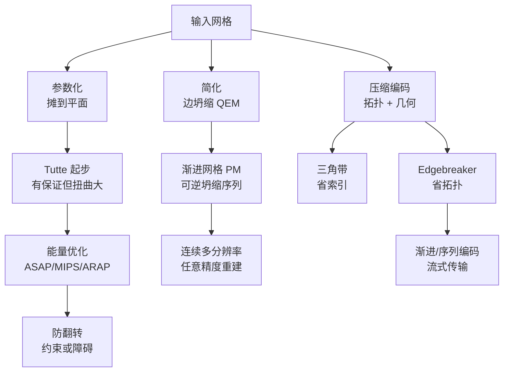

# 第 3 章：网格曲面的参数化和多分辨率表示

- **难度**：★★★ | **预估学时**：8 小时 | **前置**：第 1 章的离散 Laplace 与余切权重、第 2 章的网格质量概念；矩阵最小二乘

## 学习目标

学完本章，你能：

1. 说清参数化要满足什么条件，以及"无翻转"为什么必须专门处理。
2. 写出调和参数化的最小二乘形式，并解释为什么固定边界后它一定有唯一解。
3. 说明保角与保面积为什么不能同时做到，ASAP 与 MIPS 各自在优化什么。
4. 用 QEM 判断一条边该不该坍缩，并说明渐进网格如何把简化过程存成可逆记录。
5. 说出三角带和 Edgebreaker 各压缩了哪部分冗余，压缩比大致来自哪里。

## 一句话核心

参数化是"把曲面摊平"——它把三维形状变成一张二维图，代价是必然产生扭曲；整个第 3 章的技巧，都在**选择让哪种扭曲小一点、并保证摊平后不翻面**。

## 零基础讲解

### 概念 1：为什么要把曲面摊平

两件真实需求：贴纹理需要每个顶点有 (u, v) 坐标（GPU 按二维坐标采样图片）；传输和绘制需要更少的数据量（简化与压缩）。这三件事（参数化、多分辨率、压缩）看起来无关，其实都在回答同一个问题：**这个网格里哪些信息是必要的、哪些是冗余的**。

### 概念 2：参数化——摊平，但不能翻面

**参数化**（难度：进阶）就是给每个顶点算一个平面坐标 (u_i, v_i)，要求这个映射是**一一对应**的（同胚）：不重叠、不撕裂、不翻面。

**调和参数化**（难度：进阶）。思路是让内部顶点在平面上的位置等于其邻居的平均——这正是第 1 章的离散 Laplace 取零：

```
Δu_i = 0,  Δv_i = 0  （对所有内部顶点）
```

用余切权重展开就是

```
Σ_j w_ij (u_j − u_i) = 0,   w_ij = cot α_ij + cot β_ij
```

边界顶点的坐标是已知量（比如把边界固定在一个圆或正方形上），于是这变成一个线性方程组：内部顶点的 u（和 v）是未知量，边界是已知项。写成矩阵形式 A x = b，A 是对称正定（在合适权重下）的稀疏矩阵，所以解存在且唯一。

**Tutte 定理**（难度：进阶）是这一步的理论靠山：如果网格同胚于圆盘、边界映射到**凸**多边形上、且所有权重为**正**，那么这个调和映射一定是双射（不重叠、不翻转）。这条定理解释了为什么参数化总从"Tutte 嵌入"起步——它是唯一有保证的起点。

但它有代价：余切权重可以为负（钝角三角形），一旦出现负权重，Tutte 的保证就失效；而且固定成圆形边界会带来巨大的**面积扭曲**（圆盘被压成圆，中间被挤、边缘被拉）。

**保角与保面积**（难度：高难）。理想的摊平应该"既不改变角度也不改变面积"，但高斯告诉我们：曲面摊到平面不可能等距（除非它本来就是可展面，比如柱面、锥面）。所以只能二选一或折中：

- **保角（共形）**：每个三角形在平面上保持原角度，形状像但大小变。数学条件是映射的 Jacobian 矩阵是两个奇异值相等的相似变换。
- **保面积**：每个三角形面积不变，形状被剪歪。

实际纹理贴图更在意保角（角度失真看起来像拉伸，最刺眼），所以主流是 LSCM、ARAP、ASAP 这些"尽量保角"的能量。

**ASAP**（难度：高难）。它的能量写成

```
E = Σ_t A_t | J_t − Z_t |²_F     （F 为 Frobenius 范数）
```

其中 J_t 是三角形 t 的 Jacobian（从三维局部坐标到二维的参数化线性变换），Z_t 是"与 J_t 最接近的相似变换"：把 J_t 做奇异值分解 J = U Σ Vᵀ，取 σ̄ = (σ1 + σ2)/2，则 Z = U σ̄ I Vᵀ。于是它惩罚的是"每个三角形偏离相似变换的量"，也就是纯粹的**形状扭曲**，不惩罚大小。求解是交替的：固定 Z 解最小二乘求顶点坐标，再固定坐标对每个三角形重算 Z——这就是后面第 6 章 ARAP 的局部-全局迭代，套路完全一样。

**MIPS 能量**（难度：高难）用的是"两个奇异值的比" σ1/σ2，比值等于 1 才最优，无穷大表示退化（三角形被压成线）。它的优点是**自带防翻转**：翻转时带符号面积为负，能量趋于无穷，所以优化过程不会跨过翻转状态。

**局部防翻转参数化**（难度：高难）。真正工业级的需求是"给我一些固定点（比如特征点必须落在纹理指定位置），其余尽量平顺，且不许翻转"。做法分两类：

1. **显式约束优化**：把"三角形有向面积 > 0"直接当约束（内点法/障碍函数法），能支持任意形变能量，但问题非凸，容易停在局部解。
2. **能量自带障碍**：用 MIPS 或伸缩能量，翻转时能量爆炸，优化自然避开。实现简单，但收敛慢、需要好的初值（通常先用 Tutte 起步）。

**多片参数化**（难度：进阶）。复杂拓扑（多个洞）摊不成一整片平面，必须先切开（cut）成若干同胚于圆盘的片，各自摊平，再在接缝处对齐。切缝的选择直接影响扭曲：要沿曲率大的地方切（比如把圆柱沿母线切），切口会藏在视觉不敏感处。

**渐进参数化**（难度：高难）。从 Tutte 起步的扭曲往往很大，而扭曲能量高度非凸。渐进参数化的做法很巧：**不用原始网格作为参考**，而是构造一串中间"参考三角形"，让当前参数化结果与这串参考之间的仿射变换扭曲有界、同时逐步靠近原网格。等于把一个大跳变成了很多小步，从而避免一开始就在能量很高的地方打转。

### 概念 3：简化与多分辨率——少画几个三角形也不变样

**QEM（二次误差度量）**（难度：进阶）。简化最常用的操作是**边坍缩**：把一条边的两个端点合并成一个，删掉退化的三角形。问题是怎么选边。QEM 给每个顶点维护一个二次型：

```
Q_i(x) = xᵀ A_i x + 2 b_iᵀ x + c_i = Σ_{planes p ∈ P(i)} (n_pᵀ x + d_p)²
```

含义是"点 x 到与该顶点相关的所有平面的距离平方和"。把边 (i, j) 坍缩到一个新位置 x̄ 时，误差近似为 (Q_i + Q_j)(x̄)，而 x̄ 的最优位置由 ∇(Q_i + Q_j) = 0 解出（一个 3×3 线性系统，可预先把 4×4 的齐次矩阵 Q 相加）。于是选边的规则就是：**算每条边坍缩后的最小误差，选最小的那条**，用优先队列维护。

它的好处是把"形状变化"量化成了一个可累加的二次型：坍缩后的新顶点继承 Q_i + Q_j，后续误差自动包含历史损失。这就是为什么 QEM 几十年都是默认方案。

**多分辨率表示**（难度：进阶）。两种做法：

- **离散多分辨率**：预先生成几套不同精度的模型，绘制时按需切换。问题是切换会"跳"（同一位置三角形配置完全不同），观感突变。
- **连续多分辨率（渐进网格 PM）**：只存最粗的模型 + 一串**顶点分裂**记录（每条记录包含新顶点位置和受影响的三角形）。想看精细就逐个做分裂，想粗就合并。这样任意精度都能构造出来，切换平滑。

书里特别指出：渐进网格的价值不是"省存储"，而是**任意分辨率都可重建 + 误差可控**。分解（粗化）和重建（细化）是同一套操作的正反两向。

### 概念 4：压缩编码——冗余到底在哪

**三角带**（难度：基础）。网格里每个三角形存 3 个顶点索引，相邻三角形共享一条边，于是每新增一个三角形其实只需要 1 个新顶点。**三角带（triangle strip）**就是按"每加一个顶点生成一个新三角形"的顺序排列，平均每三角形约 1 个索引，压缩比接近 3:1。交替左右绕向能一直连下去（锯齿带）。

**广义三角带**（难度：进阶）。真实网格的三角形无法排成一条长带（有分支、有孔洞）。广义三角带用几个控制字来维护顶点缓存：

- **Restart**：结束当前带，另起一条；
- **Reset Reverse**：翻转三角形绕向；
- 另外还有"只用一个新顶点"、"复用缓存里第 n 个顶点"之类的指令。

配合一个 16 项的顶点缓存（LRU），大多数网格能做到接近理论的 0.5—1 索引/三角形。这就是 GPU 里 index buffer 优化的基本原理（微软的 Direct3D 与后来的 meshoptimizer 都是这个思路）。

**单网格压缩（Edgebreaker）**（难度：高难）。拓扑编码的经典：沿着网格的边做一个"深度优先"遍历，每经过一个三角形，用一个符号记录它的第三种情况：

- **C**：下一个三角形还没访问过，继续深入；
- **L / R**：左边或右边的邻居已访问，转向；
- **S**：遇到分叉（自相交的边界），需要记录一个"栈"位置；
- **E**：走到尽头，结束一个连通分支。

只用 5 个符号（约 2 bit/三角形）就能编码任意连通网格的**拓扑**，几何（顶点坐标）再单独量化压缩。理论下界约 3.24 bit/顶点，Edgebreaker 在 4—5 bit/顶点量级，是目前最简洁的方案之一。

**渐进压缩与序列编码**（难度：高难）。把"渐进网格"和"熵编码"结合起来：先传最粗模型，再逐层传细化记录，接收端可以随时停止解码得到一个可用模型。**渐进式森林分裂**是处理大网格并行的方案：把网格切成树的形状，各子树独立编码、独立解码，从而支持流式加载和随机访问。**网格序列压缩**则针对动画序列（顶点数不变、每帧位置变化），利用帧间相关性做预测编码。

## 图示



看图说明：三条分支分别对应"平面化""变少""变短"。要抓的联系是：参数化的产物（(u, v) 坐标）是压缩与纹理的前提；简化的产物（坍缩序列）是多分辨率传输的前提；两者最终在第 4 章汇合——重网格化其实就是"用更好的参数化 + 更好的采样重排一遍"。

## 类比与实例

**类比**：把网格摊平像给橘子剥皮后压平。皮一定得撕开几道口子（切缝），压平后有些地方被拉长（靠近切口处），有些地方被挤出皱纹（中间）。想让它尽量平整，就要选好从哪儿撕。**失效边界**：橘子皮是近似可展的（球面只能近似摊平），而复杂模型上还会有"必须在三维里才能表达的部分"（比如薄壁两面的贴合），这时切缝再多也无法完全避免重叠。

**实例（可算的调和参数化）**：取一个正方形网格，4 个角点是边界，内部只有一个中心顶点，四条边中点也在边界上。中心顶点与四个角点相连。设所有权重为 1（等权 Laplacian），4 个角点固定在 (0,0)、(1,0)、(1,1)、(0,1)。

中心顶点的方程是 4u_c − (0 + 1 + 1 + 0) = 0，得 u_c = 0.5；同理 v_c = 0.5。于是中心落在正方形正中——这正是"等权平均"的几何含义：位置等于邻居的平均。如果改用余切权重，且四个角对应的三角形形状不同，中心会被拉向角更尖的一侧。这就是余切权重"更符合连续几何"的直观体现。

**实例（QEM 判一条边）**：一个平面上的正方形网格（z = 0），所有顶点都在同一平面。某条边坍缩后的误差是 0（因为新点仍在平面上，到所有平面距离仍为 0）。这解释了为什么平面区域的简化会先被压平得很厉害——误差为零的边可以无限坍缩，直到没有平面区域可删。相反，两个法向差别很大的面（比如 90° 的角）上，某个坍缩点的误差约等于"它偏离两个面各多远"的平方和，数值上明显大于 0，于是优先队列会最后才动它。**这就是"平面先被简化、特征被保留"的机制。**

## 常见误解

- **别以为"参数化就是投影"**——实际上投影（比如沿 z 方向压到 xy 平面）在有回折的曲面上会产生重叠，不是双射。参数化要求拓扑上的一一对应，必须解一个全局方程，而不是逐点投影。
- **别以为"保角和保面积可以同时优化到零扭曲"**——实际上只有可展曲面能做到等距。一般曲面必须接受某种扭曲，选择标准取决于应用：纹理看重保角，测量/统计看重保面积。
- **别以为"Tutte 参数化一定不翻转"**——实际上定理的前提是"边界凸 + 权重全为正"。余切权重在钝角处为负，直接用就会翻。工程上要么用正权重（比如均匀权重或重心权重），要么换成带障碍的能量。
- **别以为"简化就是把顶点删掉，删得越多越好"**——实际上删点必须更新拓扑和误差，且要维护特征（边界、锐边）。QEM 之所以成功，是因为误差可累加、可选位置最优；随手删点会很快毁掉形状。
- **别以为"压缩就是 zip"**——实际上网格压缩是"去掉结构冗余"：三角带去掉重复索引，Edgebreaker 去掉拓扑描述，几何量化去掉坐标精度。通用的熵编码只是最后一步贴补。

## 自测题（答案）

1. （单选）Tutte 定理保证参数化不翻转的条件是？
   A. 权重全为正且边界映射到凸多边形　B. 网格是闭合的　C. 使用余切权重　D. 三角形都接近正三角形
   **答案**：A。**解析**：Tutte 定理要求边界为凸且权重为正；闭合网格、余切权重、等边性都不是该定理的条件（闭合曲面本身还得先切开）。

2. （单选）QEM 选边的依据是？
   A. 边最长　B. 边所在三角形面积最大　C. 坍缩后到相关平面距离平方和最小　D. 顶点度数最高
   **答案**：C。**解析**：QEM 用二次型度量"新顶点到原平面族的距离平方和"，选误差最小的边坍缩。

3. （填空）Edgebreaker 用 5 个符号编码拓扑，其中 C 表示＿＿，S 表示＿＿。
   **答案**：继续深入到一个未访问的三角形；遇到分叉、需要压栈记录。

4. （简答）为什么参数化的扭曲能量普遍很难优化？给出两个原因。
   **答案要点**：一是能量高度非线性且非凸（含奇异值、比值等），存在大量局部极小；二是防翻转要靠障碍或约束，可行域边界附近能量趋无穷，优化步长必须很小。这也解释了为什么工程上都先用 Tutte 给初值、或用渐进参考三角形把大跳分解成小步。

5. （简答）连续多分辨率表示相比"预生成几套模型"的优势是什么？
   **答案要点**：它保存的是可逆的细化/粗化记录，因此可以在任意分辨率重建（不局限于预设的几档），误差可量化控制；切换时是连续变化，不会出现三角形配置突变造成的视觉跳变。代价是需要维护层次结构与依赖关系。

## 复习锚点

- 参数化三件套：Tutte 起步（凸边界+正权重）→ 能量优化（ASAP 保角、MIPS 防翻转）→ 切缝与多片。
- 简化的核心是误差能否累加，QEM 用二次型做到这一点，渐进网格把它存成可逆序列。
- 压缩分两层：拓扑（Edgebreaker，约 2 bit/三角形）与几何（量化 + 预测），三角带省的是索引冗余。
