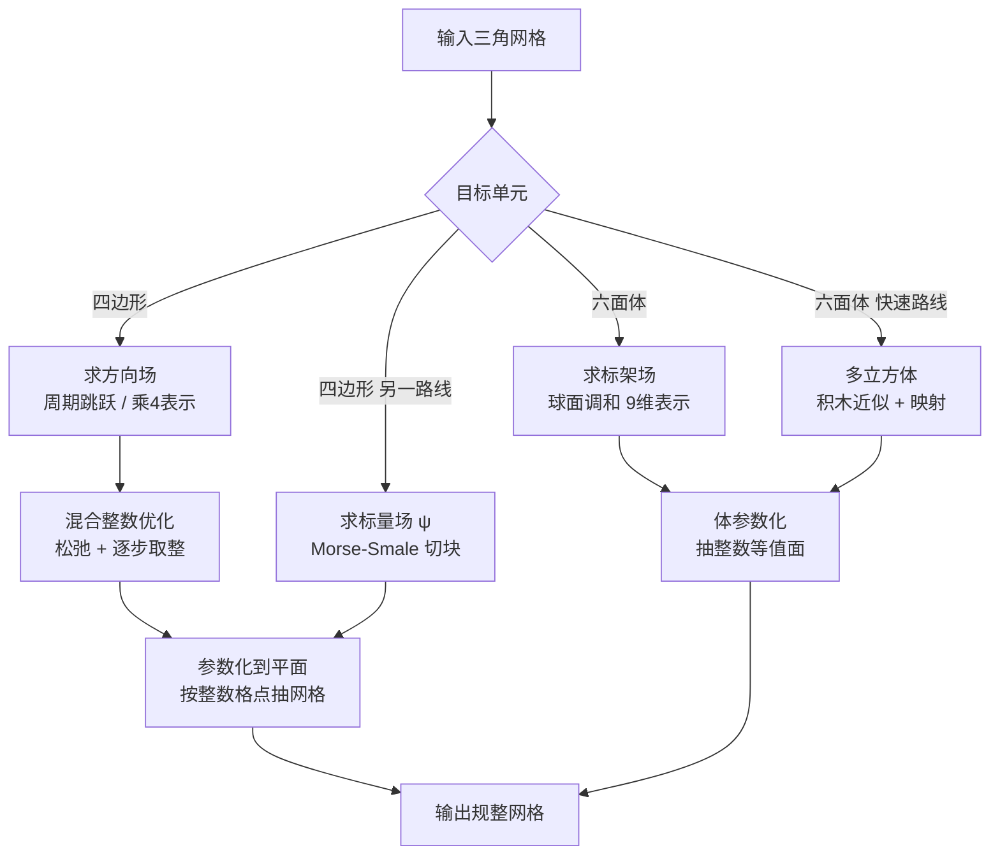

# 第 4 章：网格模型的重网格化

- **难度**：★★★ | **预估学时**：6 小时 | **前置**：第 3 章的参数化与切缝；第 1 章的带约束优化；向量场的基本概念

## 学习目标

学完本章，你能：

1. 说清重网格化与简化、与参数化的区别，并列出至少四类"网格需求"。
2. 解释方向场为什么有"周期跳跃"，并说明为什么用 cos(4θ)、sin(4θ) 可以消掉整数变量。
3. 说明奇异点是怎么产生的，以及它为什么对应四边形网格里的 3 价或 5 价顶点。
4. 对比三类六面体网格化路线（晶格覆盖/八叉树、标架场参数化、多立方体）的适用条件。
5. 判断一个给定的模型该走"四边形路线"还是"六面体路线"。

## 一句话核心

重网格化要回答的是"用什么样的单元、按什么方向、以什么密度重新铺一遍表面或体"——所有方法的技术核心都是**先求一个场（方向场/标量场），再按这个场抽网格**。

## 零基础讲解

### 概念 1：重网格化到底在换什么

第 3 章的简化是"减少顶点"，参数化是"摊平"。重网格化是第三件事：**保持形状，换一套更规整的采样**。顶点数可以变多（比如把扫描得到的乱三角网格换成整齐的四边形网格），拓扑也可以全变。

为什么要换？因为不同应用要的东西不一样。书里列的典型需求：

1. **形状误差小**，关键特征（棱线、尖角）不能糊；
2. **单元形状好**——三角形接近等边、四边形接近正方形，因为有限元求解的精度与条件数直接依赖单元形状；
3. **单元数量可控**——仿真算力和误差都跟单元数挂钩；
4. **拓扑结构规整**——四边形网格的边能连成"网格线"（edge flow），这对纹理、曲面拟合、六面体铺层都是前提；
5. **特征对齐**——棱线要落在网格线上，而不是横穿单元。

所以书里说得很直白：**不存在"最好的网格"，只存在"适合某个需求的网格"**。三角形/四面体网格靠 Delaunay 就能做到成熟稳定，但四边形/六面体在"结构规整"上有天然优势，因此成为本章重点——也正因为难，才需要方向场、整数规划这些重武器。

### 概念 2：四边形化 = 参数化 + 取整数格点

四边形化最经典的路线是**全局参数化法**：把曲面切成若干片（chart），每片摊到平面得到 (u, v)；然后在平面上按**整数格点**（u、v 都取整数）连出正方形网格，再映回曲面。

这里立刻出现一个相容性问题：两个相邻片 M_i、M_j 在公共边界上必须画出**同一套**四边形顶点。书里给出的必要条件是：跨过公共部分的映射，必须能通过 **90° 的整数倍旋转**加**整数平移**互相对应。换成坐标语言：u、v 在片与片之间的变换必须是

```
u' = a u + b v + m,   v' = c u + d v + n
```

其中 (a b; c d) 是 90° 的整数倍旋转（四种：0°、90°、180°、270°），m、n 是整数。这就是**周期跳跃**的源头：不是"坐标系旋转了 90°，向量就真的转了 90°"，而是"跨片时参数坐标要经过一次离散变换"。

### 概念 3：方向场与周期跳跃

**方向场（交叉场）**（难度：高难）。四边形网格的走向由每点的两个正交方向决定（实际存 4 个方向，因为 ±u、±v 等价）。麻烦在于：方向场是"无朝向"的——你把 u 换成 −u，铺出来的四边形一样。所以在相邻两点之间做插值时，得先约定"怎么对齐这 4 个方向的编号"。

数学上常用两种写法：

1. **带整数变量的写法**：在每条边上记一个整数 k_e，表示跨过这条边时方向编号要循环移动 k_e 步。优化时 k_e 是整数变量，于是问题变成**混合整数规划**——求解昂贵。
2. **三角函数写法**：把角度乘以 4 再取 (cos 4θ, sin 4θ)。因为旋转 90° 对应 θ 加 π/2，乘 4 后就是加 2π，三角函数值不变——**整数变量自动消失了**。这也是书里强调的"利用周期性去除变量"。

**奇异点**（难度：进阶）。想象你站在一个顶点上，绕它走一圈回到原处，方向场的值必须和出发时一致。如果方向场在这一圈里累积的旋转不是 90° 的整数倍（在乘 4 的表示里不是 2π 的整数倍），那它就不可能连续地对齐回来——这个点就是**奇异点**。

奇异点无法避免，而且正是四边形网格里那些"不能四根边都接上"的顶点。用**价**（n，连出去的边数）来记账，指数定义为

```
index = (4 − n) / 4
```

- **3 价顶点**：指数 +1/4（四个这样的顶点凑成 +1）；
- **5 价顶点**：指数 −1/4；
- **4 价顶点**：指数 0，就是普通规则顶点。

**Poincaré-Hopf 定理**（离散版）说：闭合网格上所有顶点指数之和等于欧拉示性数 χ。球面 χ = 2，所以

```
Σ (4 − n_i)/4 = 2
```

一个球面的四边形网格因此**至少要 8 个 3 价顶点**（8 × 1/4 = 2），或者用"5 价与 3 价混合、净和仍为 2"的方式凑。你不可能铺出一个完全没有奇异点的四边形球面——这就是为什么所有四边形模型上都能看到几个"三条边交会"或"五条边交会"的点。

（顺带一个能自查的例子：四面体的三角网格所有顶点都是 3 价，若直接当四边形骨架，指数和 = 4 × 1/4 = 1 ≠ 2，说明它的拓扑配不上球面的四边形网格，必须细分并补入更多奇异点。）

**混合整数求解**（难度：高难）。带整数变量的能量通常这样处理：先把整数当连续变量松弛，解一个二次规划；然后把最接近整数的变量固定，再优化剩下的，反复迭代。书里指出这个细节很关键：**一次把所有整数都固定会得到很糟的方向场（奇异点过多），逐步迭代凑整才能得到光顺结果**。

**特征对齐与度量定制**（难度：高难）。四边形网格要沿棱线走，还要按需要加密。前者靠给方向场加"对齐约束"（在特征边上要求方向与该边一致，或成 45°）；后者靠改**度量**：定义每个点的 2×2 对称正定矩阵 g，用它替代欧氏度量去量长度。g 的特征向量给方向、特征值给该方向的密度。麻烦在于 g 必须对称正定（g11 g22 − g12² > 0、迹为正），直接优化很难保持；技巧是写 g = exp(G)，G 是任意对称矩阵，指数映射自动保证正定，就把不等式约束消掉了。

### 概念 4：另一条路——用标量场的等值线切块

**Morse-Smale 复形法**（难度：高难）。不用方向场，用一个标量函数 ψ 在曲面上的"地形"来切块：

- ψ 的**极大点**、**极小点**、**鞍点**是关键点；
- 沿 ψ 的梯度流走，会形成分界线（separation lines）；
- 这些分界线把曲面切成一块块四边形区域，每块对应一个鞍点，从而生成四边形网格。

为什么这能给出四边形？因为一个鞍点连着两条上行的流线和两条下行的流线，四条边界围出一块——正好四条边。控制质量的办法是设计 ψ 的性质：让它的一阶方向（特征向量）对齐棱线（特征对齐）、让它的二阶导数条件成立（避免关键点退化）、并让两个方向的密度变化均衡（书里写作要求 ∂²ψ/∂x∂y 的符号条件，避免鞍点挤在一起）。

实际求解 ψ 用的是**周期向量场 + Dirichlet 能量**：先求一个光滑的向量场，要求它在特征线处满足整数约束（u、v 坐标在特征角点处必须是整数）、在对角线约束处满足 ψ0 ψ3 − ψ1 ψ2 的关系，能量写成

```
E(ψ) = ʃ |∇ψ|²  subject to  特征约束
```

求解分两步：先不管非线性约束、用变量替换消掉线性约束，把问题化成最小特征值问题（这是谱方法的标准套路，第 5 章的 Laplace 特征值也是同一批工具）；再用 Gauss-Newton 在约束下迭代修正。

### 概念 5：六面体网格化——三维的同类问题，难一档

把表面换成体，四边形换成六面体。三条主要路线：

**晶格覆盖 / 八叉树**（难度：进阶）。用规则的立方体格（或八叉树的变尺寸格）盖住模型，边界处的格子裁剪成贴合的六面体。优点是简单、自动；缺点很致命：**边界附近的单元质量差**（被裁过的格子形状歪、体积悬殊），而有限元恰恰最在意边界附近。

**标架场参数化**（难度：高难）。把四边形化的"方向场"升级成**标架场**：每点给 3 个互相垂直的方向（相当于一个局部坐标系）。然后求一个映射，把它拉回到整数格点，抽取整数等值面（isosurface）得到六面体。技术难点有两个：

1. 对称标架的**表示**：三个方向无顺序（旋转、交换都会给出同一个标架），所以不能直接存三个向量。做法是用球面调和函数把这个对称性编码成一个 9 维向量，在 R⁹ 里定义距离、做光顺。
2. **奇异结构**：三维的奇异结构不再是孤立点，而是"奇异线"（一整条线上的某个邻域都转不回来），这让整数约束的组合爆炸。

**多立方体（polycube）**（难度：进阶）。先用一堆轴对齐的立方体拼出模型的粗近似（有点像乐高），再把这个"积木模型"光滑地映射回原形状。因为积木模型本身就是六面体网格，映射回原形状就得到六面体网格。优点是全局结构极其规整、自动；缺点是近似阶段会丢细节，且拼出来的形状与原模型差异大时映射会严重扭曲。

## 图示



看图说明：四条入口对应四条技术路线，但都收敛到"参数化 + 抽整数格点"这一个出口。看图要抓住：**方向场/标量场/标架场的作用都是把"网格怎么铺"变成一个可以事先求解的场**，之后的抽取都是机械操作。

## 类比与实例

**类比**：四边形重网格化像贴瓷砖。瓷砖必须按格子贴，墙面有拐角、有弧形，你就得先决定"每个区域的砖缝朝哪"（方向场），再决定"砖从哪块整砖开始"（整数平移）。两个区域接缝处的砖缝必须对得上，否则会错缝——这就是周期跳跃。**失效边界**：瓷砖是刚性的，而四边形网格允许单元被轻微拉伸，所以实际允许一定变形，只要不翻。

**实例（周期跳跃必须出现）**：在平面上取一个环形区域，绕中心一圈。方向场在每点都取"沿半径方向和沿切向方向"。绕中心走 360° 回来，径向方向转过了 360°，而方向场只认 4 个等价方向（转 90° 视为同一个），所以 360° 相当于 4×90°，回到原值——`k` 累积为 4。这不产生奇异点（4 是整数，指数 0）。

换成"沿 45° 方向"（把方向场扭半格），绕一圈累积 360°，但 45° 不属于 4 个等价方向，累积不是 90° 的整数倍，中心必须放一个奇异点：此处方向场绕一圈净转 90°，对应指数 +1/4，也就是一个 3 价顶点。**这就是"扭转方向场必然产生奇异点"的可验证例子。**

**实例（奇异点计数）**：一个四面体的三角网格，每个顶点都是 3 价。若直接把它当四边形骨架，按 index = (4 − n)/4 每个顶点是 +1/4，四个顶点之和 = 1，而球面要求 2，缺口意味着"至少还得补 4 个 +1/4"。这解释了为什么把模型换成四边形网格时，顶点数、价数会被迫改变（Catmull-Clark 一类细分加密操作就是在补这个缺口）。

## 常见误解

- **别以为"重网格化 = 简化"**——实际上重网格化可以增加顶点（把粗糙的扫描网格换成密集规整的四边形），它换的是"单元类型、方向、密度"，不是数量。
- **别以为"四边形网格越规整越好，奇异点越少越好"**——实际上奇异点数量受拓扑下界约束（球面至少要有总指数 +4 的奇异点）。追求"零奇异点"是不可能的，能做的是把它们放到不显眼的位置，并让它们均匀分布。
- **别以为"方向场的整数变量只是实现细节"**——实际上它决定了跨片语义能否一致：整数变量没处理好，片与片的四边形格点就会错位，出现裂缝。
- **别以为"八叉树六面体已经够用"**——实际上边界单元质量差是它的结构性缺陷，有限元在边界处的应力集中恰恰最需要好单元。这就是标架场参数化这类重方法存在的理由。
- **别以为"多立方体是最省事的自动方法，所以选它"**——实际上它牺牲了形状逼近（积木近似），对细节多、形状细长的模型会严重失真。

## 自测题（答案）

1. （单选）四边形化的全局参数化法要求相邻片之间的坐标变换属于哪一类？
   A. 任意仿射变换　B. 90° 的整数倍旋转 + 整数平移　C. 只允许平移　D. 相似变换
   **答案**：B。**解析**：只有 90° 整数倍旋转 + 整数平移才能保证两边公共边界上的整数格点重合，从而四边形顶点对得上。

2. （单选）为什么用 (cos 4θ, sin 4θ) 表示方向场能消掉整数变量？
   A. 因为三角函数是周期函数，旋转 90° 对应 θ 加 π/2，乘 4 后加 2π，值不变　B. 因为角度被归一化到 [0, 2π)　C. 因为它把方向场变成了标量场　D. 因为 θ 的取值范围被限制
   **答案**：A。**解析**：这是"利用周期性去除整数变量"的标准手法，等价于把 4 个等价方向压成一个点。

3. （填空）四边形网格的顶点指数按 index = (4 − n)/4 定义，则 3 价顶点指数为＿＿，5 价顶点为＿＿；球面上指数之和必须为＿＿。
   **答案**：+1/4；−1/4；2（等于球面欧拉示性数 χ，因此至少需要 8 个 3 价顶点）。

4. （简答）Morse-Smale 复形法为什么能产生四边形块？
   **答案要点**：标量场的一个鞍点有两条上行流线和两条下行流线，构成四条边界，围出一块四边形区域；极大点/极小点/鞍点与分界线的组合把曲面分割成这样的块。网格质量靠设计 ψ 的特征向量（对齐棱线）和二阶条件（避免关键点退化）来控制。

5. （简答）三类六面体路线的最大缺点分别是什么？
   **答案要点**：晶格/八叉树——边界单元质量差（裁过的格子形状失真）；标架场参数化——奇异结构是线状，整数约束组合爆炸，求解难且可能失败；多立方体——形状逼近差，细节与细长结构容易失真。

## 复习锚点

- 重网格化 = 形状不变 + 单元/方向/密度可变；需求决定方案，没有最好的网格。
- 四边形化必过三关：方向场（周期跳跃）、整数相容（90° 旋转 + 整数平移）、奇异点（受拓扑下界约束）。
- 六面体化是同一套思路升一维：标架场代替方向场，体参数化代替面参数化，代价是奇异结构变线、求解更难。
