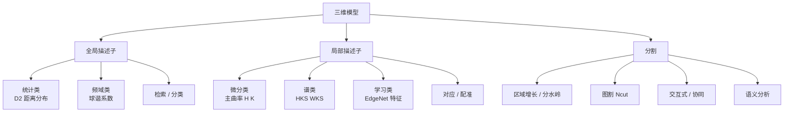

# 第 5 章：三维形状分析

- **难度**：★★☆ | **预估学时**：5 小时 | **前置**：第 1 章的曲率与离散 Laplace；矩阵特征值的基本概念；基本的聚类与距离度量

## 学习目标

学完本章，你能：

1. 区分全局描述子与局部描述子的用途，并为"检索"和"找对应点"各选一种合适的描述子。
2. 解释为什么 D2 形状分布对旋转不敏感，以及它丢了什么信息。
3. 说清热核签名（HKS）为什么等距不变，并写出它的定义式。
4. 写出归一化割（Ncut）为什么不能简单用"切口最小"，并说明它如何避免把模型切成一个小碎片。
5. 判断一个分割任务该用区域增长、图割还是交互式方法。

## 一句话核心

形状分析的核心动作是**降维**：把"一个有几万个顶点的三维形状"压成一个几十到几百维的向量或一条曲线，让"像不像"变成"距离近不近"。

## 零基础讲解

### 概念 1：描述子的两类用法

**形状描述子**（难度：基础）就是把形状（或形状的某个局部）映射成一个向量的函数。

- **全局描述子**：整个模型 → 一个向量。用于分类、检索、粗配准（先按描述子筛候选，再精配）。
- **局部描述子**：某个顶点（及其邻域）→ 一个向量。用于找对应点（"这个模型的鼻子对应那个模型的哪个点"）、局部相似性判断。

一个合格的描述子要满足几条朴素要求：**对不该变的东西不敏感**（旋转、平移、尺度、采样密度），**对该变的东西敏感**（形状差异）。这几条之间是矛盾的，所以描述子的设计永远在做权衡。

### 概念 2：人工定义的全局描述子

**D2 形状分布**（难度：基础）。做法极简单：在模型表面随机采两个点，量它们之间的距离 d；重复很多次（比如 10 万次），统计 d 的分布（直方图），这个直方图就是描述子。

为什么它对旋转不敏感？因为距离在旋转下不变，随机采样也不区分方向。所以两个"只差一个旋转"的模型，D2 分布几乎相同。缺点也很清楚：**它只知道距离分布，不知道这些距离长在哪儿**。一个球和一个排列巧合的哑铃可能有相近的 D2，但形状完全不同。

**球谐描述子**（难度：高难）。把模型看作一个"球面上的信号"（例如某方向上的半径函数或体素指示函数），展开到球谐基 Y_l^m 上，取低阶系数当特征：

```
f(θ, φ) = Σ_{l=0}^{L} Σ_{m=−l}^{l} c_l^m Y_l^m(θ, φ)
```

低阶系数刻画整体形状（像椭球还是像圆柱），高阶系数刻画细节。只保留前若干阶就得到旋转不变的粗描述（因为对系数按 l 取模，旋转只改变同阶系数的组合）。它对"星形"模型（从某个中心看，每个方向只有一层表面）很有效，对复杂拓扑或非星形模型要先做分解，否则投影会丢结构。

**其他经典全局描述子**：光场/深度图像（从若干视角渲染深度图再统计）、形状直方图、基于体素的占据率等，思路一致——选一种"投影方式"，统计其分布。

### 概念 3：局部描述子与谱方法

**曲率类描述子**（难度：基础）。最直接的局部特征就是第 1 章的主曲率 (k1, k2)，或者它们的组合（H、K、曲率比值）。它对噪声敏感，需要先在多尺度上平滑再算。

**旋转图像（Spin Image）**（难度：进阶）。给一个顶点 p 和它的法向 n，建立一个"圆柱坐标系"：沿 n 方向记高度 α，垂直 n 的方向记径向距离 β。把 p 邻域内的点都投影到这个 (α, β) 平面上，累加成一张二维图——这就是旋转图像。它旋转不变（因为坐标系跟着 n 转），但**对法向误差很敏感**，且不区分正负方向（正反两面会混）。

**热核签名（HKS）**（难度：高难）。这是本章最漂亮的一个构造。想象在顶点 x 上放一滴热水，热量会沿着曲面扩散。经过时间 t 后，x 处还剩多少热量？写成数学式：

```
HKS(x, t) = Σ_{i=1}^{∞} exp(−λ_i t) φ_i(x)²
```

其中 λ_i 和 φ_i 是**离散 Laplace 算子的第 i 个特征值和特征向量**（第 1 章的余切 Laplace 就在这里派上用场），φ_i(x) 是第 i 个特征向量在顶点 x 的分量。把 t 从很小变到很大，得到一条曲线，这条曲线就是 x 点的签名。

为什么等距不变？因为热扩散只依赖曲面**内在的度量**（沿曲面走多远），不依赖它在空间里怎么弯曲。你把一张纸卷成筒，纸上任意两点的测地距离不变，热扩散完全一样。这就是 HKS 的核心价值：**它区分不了"卷起来的纸"和"平铺的纸"，但这对"找对应点"恰恰是优点**——人做同一个动作，姿势变了但对应部位不变。

曲线还有直观解释：

- t 很小：热量还没扩散出去，HKS 主要由局部几何决定（近似与平均曲率有关）；
- t 很大：热量扩散到全曲面，HKS 趋于常数（只由总面积和低频模态决定）。

书里强调的就是这个多尺度性质：小 t 抓细节，大 t 抓全局。

**波核签名（WKS）**（难度：高难）。HKS 的"振动版"。把热扩散方程换成正弦波动，权重变成对特征值的另一种采样（在 log 尺度上给一个高斯窗），于是每个特征值的贡献是 gaussian(λ) 而非 exp(−λt)。好处是对尺度差异更鲁棒、能量集中在特定频段。两者思路相同：**用 Laplace 谱构造一个与坐标无关的局部签名**。

### 概念 4：学习型描述子

手工描述子的设计依赖人的先验（选什么尺度、怎么归一化）。学习型路线直接让网络学：

- 输入可以是局部的**几何描述子**（如多个尺度的曲率、法向滤波描述子 FEND 第 2 章提过、深度图像 patch）；
- 网络（多层感知机、EdgeNet 这种在网格边上卷积的结构）输出一个新的特征向量；
- 训练目标是"同一个部位在不同模型/不同姿态下特征接近，不同部位远"。

书里举的 EdgeNet 属于这一类的早期代表：它在网格的**边**上做聚合，把顶点特征沿边传递，再拼成局部描述子。这与第 8 章的图神经网络是同一脉络，只是第 5 章还停留在"小网络 + 手工输入"阶段。

### 概念 5：网格分割

**网格分割**（难度：进阶）就是按几何或语义把模型切成若干块。四类典型做法：

**区域增长 / 分水岭**（难度：进阶）。先算每个顶点的主曲率和主方向，把"曲率极小"的等高线当分水岭的"谷线"，从种子点往外生长，遇到谷线就停。书里提到的贪心分水岭就是这个思路：为了避免过分割，先在每个顶点的邻域上做形态学操作生成"标识集"，再用方向曲率高程图当梯度做分水岭。它快、直观，但对噪声敏感，且需要调种子。

**聚类**（难度：基础）。把顶点按 (|k_min|, |k_max|) 这样的特征向量做 k 均值聚类，再接区域增长合并。简单，但不保证块连通。

**归一化割（Ncut）**（难度：高难）。把网格看成图：顶点是节点、边权是"两个顶点有多像"（比如距离与曲率相似度）。切分就是把图分成两块 A、B，切口代价是跨块的边权和。如果只最小化切口，最优解往往是"切下一个孤立顶点"——因为切一刀就完事。所以要加入"块要够大"的约束：

```
Ncut(A, B) = cut(A, B)/assoc(A, V) + cut(B, A)/assoc(B, V)
```

分母 assoc(A, V) 是 A 与全图的连接总量，于是"块太小"会因分母小而被惩罚。求解 Ncut 的松弛形式会变成一个**广义特征值问题**（用拉普拉斯矩阵），取第二小特征向量做二分——这与谱聚类是同一个数学对象。这也说明第 1 章的 Laplace 矩阵在第 5 章又出现了一次。

**交互式分割**（难度：进阶）。用户刷几笔（前景/背景），算法把这些笔刷当硬约束，其余用随机游走或图割补齐。随机游走法很直观：从每个未标记顶点出发随机游走，先碰到哪个标记就归哪类；其解也等价于解一个 Laplace 方程（又一次用到余量 Laplace）。

**协同分割**（难度：高难）。给一组同类模型（比如十把椅子），要求"切出来的块在所有模型上一一对应"。做法是把所有模型的特征放在一起做联合聚类/联合图割，使切法一致。它是"分割"和"对应"两个问题的合体。

### 概念 6：匹配与检索

**检索**（难度：进阶）。流程是：算描述子 → 建索引（如 KD 树）→ 查询最近邻。真实系统的关键是**多描述子融合**：D2 抓整体比例、球谐抓低频形状、HKS/曲率抓局部。融合方式有加权距离、或者用 boosting 学一组弱描述子的权重。

**匹配（对应）**（难度：高难）。在两张网格间找点对点对应，通常三步：算局部描述子 → 按描述子相似度给候选 → 用形变或图匹配做全局一致化（防止"左手配到右手"这类局部合理的错误）。

## 图示



看图说明：左边是"压缩成向量"，右边是"切成块"。两条路最后都服务于"理解形状"。看图要认出：HKS、Ncut、随机游走三个看似无关的方法，底层都是同一个 Laplace 算子——这是第 1 章算子层在本书里复用最密集的一章。

## 类比与实例

**类比**：描述子像给人拍照做身份识别。D2 相当于只记录"身上各部位之间距离的统计"——双胞胎身高体重一样就分不开；HKS 相当于记录"热量从某点扩散的快慢"——它对人怎么摆姿势不敏感（等距不变），但每个人身上的"扩散曲线"不同，所以能认人。**失效边界**：HKS 分不开镜像对称的部位（左右手），因为它只看距离不看朝向；这也是实际系统要再叠一层"朝向/法向"特征的原因。

**实例（球面的 HKS 可算）**：单位球面上，离散 Laplace 的特征值是 λ_l = l(l+1)，每个特征值的重数是 2l+1，特征向量在球面上均匀分布，于是 φ_i(x)² 的平均值是 1/(4π)。所以

```
HKS(x, t) = Σ_{l=0}^{∞} (2l+1)/(4π) exp(−l(l+1) t)
```

取 t = 1：l=0 贡献 1/(4π) ≈ 0.0796；l=1 贡献 3/(4π) × e^{−2} ≈ 0.2387 × 0.1353 ≈ 0.0323；l=2 贡献 5/(4π) × e^{−6} ≈ 0.3979 × 0.00248 ≈ 0.00099；l≥3 已小于 10^{-5}。合计约 0.113。取 t = 10：l=1 项变成 0.2387 × e^{−20} ≈ 5×10^{-10}，几乎只剩 l=0 的 0.0796。**这个数字演示了两件事：t 越小保留的高阶（细节）越多；t 大到一定程度后签名退化成常数。** 所以 HKS 必须用"多条 t 的曲线"一起当特征，单点值没有信息。

**实例（Ncut 为什么不能只看切口）**：一条由 100 个顶点组成的细长走廊（每对相邻顶点连边，边权为 1）。切下最末端 1 个顶点，切口代价 = 1；把走廊从中间切成两半，切口代价 = 1。两种切法的 cut 完全相同，但前者把模型切成了 1 个点 + 99 个点，语义上毫无意义。Ncut 的分母 assoc(A,V) 对前者约等于 1，对后者约等于 50，于是前者得分 ≈ 1/1 + 1/99 ≈ 1.01，后者 ≈ 1/50 + 1/50 = 0.04——**后者更优**。这就是"归一化"的作用。

## 常见误解

- **别以为"描述子越复杂越好"**——实际上描述子的价值在于"该忽略的忽略、该敏感的敏感"。一个 20 维的 D2 在粗筛阶段往往比 500 维的深度特征更可靠，因为它对噪声和采样差异不敏感。
- **别以为"HKS 是旋转不变的，所以它完全不变"**——实际上 HKS 是**等距不变**（弯曲不变），不是旋转不变那么弱。但正因为只看内在度量，它区分不了镜像（左右手），也区分不了"鼓起来"和"凹下去"这类只改外在形状的差异。
- **别以为"球谐描述子对任何模型都适用"**——实际上它要求先把模型映射到球面（球参数化）。对非星形、多孔洞的模型，映射本身就有扭曲，系数会失真。
- **别以为"分割就是找切口最小的地方"**——实际上最小切口会把模型切成碎片，必须加"块大小/块均衡"约束（Ncut 的分母）才有语义。
- **别以为"协同分割等于分别分割再对齐"**——实际上分别分割的结果往往互不一致（同一部位切法不同），协同分割必须在优化里就共享信息（联合特征、联合图割），一致性是求解出来的，不是事后修补出来的。

## 自测题（答案）

1. （单选）HKS 的等距不变性来源于？
   A. 它用了法向　B. 它只依赖 Laplace 算子的特征值/特征向量，而它们只由内在度量决定　C. 它对坐标做了归一化　D. 它取的是曲率
   **答案**：B。**解析**：热扩散由曲面内在度量决定，离散 Laplace 由余切权重（只与边长角度有关）构造，因此弯曲纸面不改变签名。

2. （单选）Ncut 相比"最小切口"多了什么？
   A. 加了体积约束　B. 用 assoc 归一化，惩罚过小的块　C. 用了深度网络　D. 强制块数固定
   **答案**：B。**解析**：Ncut 的两项分母是块与全图的连接量，块越小分母越小、得分越大，从而被抑制。

3. （填空）HKS 的 t 很小时主要由＿＿决定，t 很大时趋于＿＿。
   **答案**：局部几何（高阶特征模态/细节）；常数（只剩最低频模态，与总面积有关）。

4. （简答）D2 形状分布为什么对旋转不敏感，又丢了什么？
   **答案要点**：它统计的是采样点对之间的距离，距离在旋转下不变；但它不记录"这段距离位于模型的哪个位置、哪个方向"，所以空间分布信息全丢，不同形状可能撞分布。

5. （简答）协同分割为什么不能"各切各的再对齐"？
   **答案要点**：各模型独立分割时，切法由各自局部几何与噪声决定，同一语义部位可能被切成不同形状、不同块数，事后对齐没有可靠依据；协同分割在特征空间或图割层面联合优化，让"对应部位的切法一致"成为求解约束，从而得到可对应的分块。

## 复习锚点

- 描述子 = 降维 + 选择性忽略；全局用于检索，局部用于对应。
- 谱方法三兄弟（HKS、WKS、Ncut/谱聚类）都建立在第 1 章的 Laplace 上：前者用特征值当"频率"，后者用特征向量当"切分方向"。
- 分割的难点不是切得开，而是切得**均衡且语义一致**；Ncut 归一化、交互约束、协同联合优化都是在补这一点。
