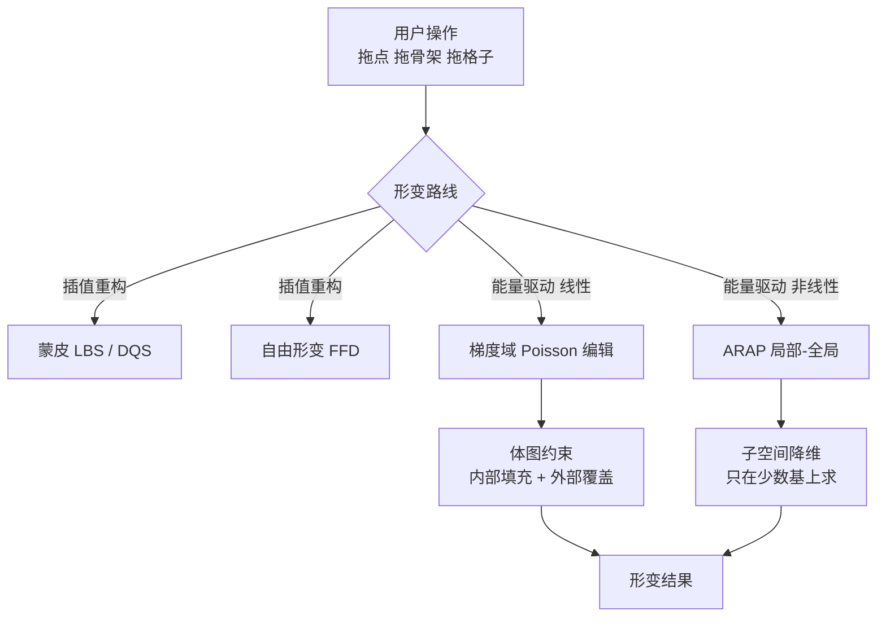

# 第 6 章：网格曲面的形变

- **难度**：★★★ | **预估学时**：7 小时 | **前置**：第 2 章的光顺（Laplacian 收缩）、第 3 章的局部-全局迭代（ASAP）、第 1 章的 Laplacian 与最小二乘

## 学习目标

学完本章，你能：

1. 说出插值重构类与能量驱动类形变的根本区别，并各举两个方法。
2. 解释线性混合蒙皮（LBS）为什么会出现"糖纸收缩"（candy-wrapper）现象。
3. 写出梯度域形变的最小二乘目标，并说明为什么它等价于解一个 Poisson 方程。
4. 说明 ARAP 的局部-全局迭代两步各在做什么，以及它为什么比纯 Laplacian 形变更保形状。
5. 判断一个编辑需求（大幅弯曲、保体积、局部细节）该用哪类方法。

## 一句话核心

形变要同时满足两件互相拉扯的事：**跟住用户的操作**（位置要动到目标处）和**保住原有形状**（局部细节不能被揉烂）。所有方法都是在"用多少自由度去描述形变"上做文章：自由度越少越稳、越不自由。

## 零基础讲解

### 概念 1：两条技术路线

**插值重构**（难度：进阶）：用户给出参数（骨点位置、控制格点位移、权重），算法按固定的规则**直接算出**形变后的顶点位置。速度快、可交互，但形变质量由规则本身决定，用户无法提高。

抽象地写作 P' = f(P, 参数)，f 是事先定义的插值函数。

**能量驱动**（难度：高难）：定义形变质量的度量（能量），把"用户操作"当约束，最小化能量。质量可控，但每次编辑要解一个优化问题（通常几秒）。第 3 章的 ASAP 已经是这个套路，本章把它做到极致。

### 概念 2：蒙皮——用骨架带动表面

**蒙皮**（难度：进阶）是动画里的标准做法：模型内部有一副骨架，每个顶点绑定到若干骨头上（有权重 w_ij，表示第 i 个顶点受第 j 根骨头影响多少），骨头一动，顶点跟着动。

**线性混合蒙皮（LBS）**（难度：进阶）的公式朴素到极点：

```
v_i' = Σ_j w_ij (R_j v_i + t_j)
```

即：对每根骨头算它自己的旋转 R_j 和平移 t_j，把顶点变换过去，再按权重加起来（权重满足 Σ_j w_ij = 1）。

它快、可微、几乎所有游戏引擎都用它。但它有一个著名的病：**糖纸收缩**。举个可算的例子：一根前臂骨和一根上臂骨，肘部某顶点对两根骨头的权重各 0.5。把前臂绕肘旋转 90°，顶点在前臂骨下的位置 P1 = R(90°)v，在上臂骨下的位置 P0 = v（不动），LBS 给出 (P0 + P1)/2。若 v 到肘关节的距离为 r，则 |P1 − P0| = r√2，取平均后新位置到关节的距离变成 r√2/2 ≈ 0.707r——**顶点被拉向关节，形状像糖纸被拧紧**。这就是"权重平均不是旋转平均"造成的体积损失。

修法有三层：

1. **对偶四元数蒙皮（DQS）**：不平均变换后的位置，而是先平均"旋转+平移"的 4D 表示（对偶四元数），再作用到顶点上。旋转被"正确地插值"，糖纸现象大幅减轻（代价是对某些旋转会出现"凸起"）。
2. **学习骨骼**：自动从动画序列里学出骨骼和权重（书里提到用均值漂移聚类把顶点聚成若干簇，每簇当一根骨头；把 9 维仿射矩阵的旋转部分投影回 SO(3)，再用最小二乘求平移）。
3. **加形状修正**：在 LBS 结果上再叠一个"姿态修正"项（学出来的），把被压扁的部分撑回来。

### 概念 3：自由形变（FFD）

**FFD**（难度：进阶）。把模型装进一个控制晶格（三维的格子），用户拖动格点，模型跟着变。数学上是三线性（或 B-样条）插值：

```
v' = Σ_{lattice nodes c} B_c(v) · d_c
```

B_c 是控制格点的基函数（离得近的格点权重大），d_c 是格点的位移。优点是不用处理模型本身的拓扑，任何模型都能用；缺点是格点必须包住模型、对局部细节控制力弱，且格点数一多就不好拖。

### 概念 4：梯度域形变——保留"局部怎么弯"的信息

这是本章的核心技术。先回顾第 1 章：拉普拉斯坐标 δ_i = Δv_i 描述的是"这个顶点比邻居平均高出多少"，也就是**局部形状**（微分信息）。而顶点坐标是**全局位置**。梯度域形变的思路是：

> 编辑时，我只改动少数控制点；对未被直接控制的顶点，我希望它们的**局部形状（δ）保持原样**，然后重新解出全局位置。

写成最小二乘：

```
min_{v'}  Σ_i | Δv'_i − T_i δ_i |²  +  约束项（用户指定的顶点要落在目标位置）
```

这里的 T_i 是一个局部旋转，把原来的 δ 旋到新姿态（否则形状"朝向"不对，会扭曲）。解这个最小二乘，就是解一个线性系统：

```
L v' = b
```

L 是 Laplace 矩阵（第 1 章的余切权重），b 由目标微分坐标和约束共同构成。矩阵是稀疏的，几万顶点也能解（用 Cholesky 或共轭梯度）。

**为什么等价于 Poisson 方程**：在连续形式下，目标是求 f 使得 ∇f ≈ 给定的向量场 u。数学上有**Helmholtz-Hodge 分解**：任何向量场都能唯一分解为

```
u = ∇ψ + ∇×ω + h
```

三部分分别是"梯度场（无旋）"、"旋转场（无散）"、"调和场（既无旋又无散）"。向量场里只有梯度部分是"能被某个函数求导出来的"。所以求 f 使 ∇f ≈ u，就要先**把 u 的旋转部分和调和部分去掉**，只留梯度部分，这等价于解

```
∇²φ = ∇·u     （即 Poisson 方程）
```

离散版本就是上面那个 L v' = b。这是"梯度域"这个名字的由来：不是直接在位置空间编辑，而是在**梯度（微分）空间编辑**，再积分回位置。

**体图（cage）约束**（难度：进阶）。只保表面梯度会出问题：一个大变形（比如把手臂抬起来）会让靠近关节的部位塌陷（书里图 6.5 的例子：只靠表面梯度驱动，腿部会塌）。原因是表面梯度只约束了"表面怎么弯"，没约束"内部体积怎么变"。解法是在模型内部放一个**填充图**（防止体积变化）、在外部放一个**覆盖图**（防止局部自交），两者的顶点也参与形变、并把它们的变换传给表面顶点。这是"用低维的控制结构去约束高维形状"的典型做法，和 FFD 一个思路，只是图是任意形状的。

### 概念 5：非线性子空间梯度域形变

梯度域漂亮，但有两个残留问题：

1. 它用**旋转的近似**（把 δ 按某个估计的旋转转一下）。旋转估计得不准，细节就保不住。
2. 它是**线性**方法，大幅形变时"线性化误差"积累，会出现明显的体积/长度偏差。

**ARAP（As-Rigid-As-Possible）**（难度：高难）。它的能量直接定义在每个三角形上：

```
E = Σ_t  (1/2) Σ_{edges (i,j) in t}  w_ij  | (v'_i − v'_j) − R_t (v_i − v_j) |²
```

含义：每个三角形 t 有一个自己的最优旋转 R_t，要求形变后的边向量等于"原来的边向量转一下"，尽量不拉伸。R_t 怎么求？把三个边向量算出来，求使它们最接近旋转的那个 R（这叫 **Procrustes 问题**，用 SVD 解：对协方差矩阵做 SVD 得 U Σ Vᵀ，R = V Uᵀ；若 det 为负则修正一列）。

求解用**局部-全局迭代**：

- **局部步**：固定顶点位置 v'，对每个三角形单独算最优 R_t（SVD）；
- **全局步**：固定所有 R_t，解一个稀疏线性系统求新的 v'（就是上面那个最小二乘，矩阵不变，可预先分解）。

两步交替，能量单调下降。这与第 3 章 ASAP 的结构完全一样——ASAP 是二维版本（参数化），ARAP 是三维版本（形变）。

**子空间形变**（难度：高难）。ARAP 的未知量还是全部顶点（几万个），每步都要解大系统。既然形变通常只由少数几种"运动模式"组成（弯曲、扭转、拉伸），就可以预先算一组基（比如低频 Laplace 特征向量、或者从一组样本形变里做 PCA），只在基张成的**子空间**里求系数：

```
v' = v + Σ_{k=1}^{K} c_k B_k     （K 远小于顶点数，比如 30 对 30000）
```

未知量从 3N 个降到 K 个，且可以预先算好高维矩阵的投影。书里进一步把"骨架约束"（用户拖某根虚拟骨架）和"体积约束"都写进这个子空间优化里，于是可以做到：拖一根骨架、保持体积、保住细节，交互帧率还够用。

## 图示



看图说明：四条线路的区别就是"用多少自由度 + 是否显式优化能量"。看图要记住：LBS/FFD 是"一次算完"，梯度域/ARAP 是"每帧解方程"，子空间是"把方程缩小后再解"。选择依据是"要交互速度还是要形状质量"。

## 类比与实例

**类比**：形变像捏橡皮泥。LBS 是"按骨架的伸缩比例把每块泥巴缩放"——快，但关节处的泥会被挤扁；梯度域是"记下每块泥巴原来凸起多少，挪动后再按记录重新鼓起来"——形状保得住，但大幅挪动时体积会塌；ARAP 是"规定每块泥巴只许转不许拉"——最保形状，但要反复迭代。**失效边界**：真实橡皮泥是不可压缩的，ARAP 只约束边长，对"体积必须严格不变"的要求还得额外加体积项。

**实例（梯度域解一个具体系统）**：一条 1D 的"网格"（4 个顶点排成一线，坐标 0、1、2、3），拉普拉斯坐标（用简单差分）δ = (1, 0, 0, −1)。现在把第 1 个顶点固定在 0、第 4 个固定在 2（即整体压缩到原来长度的 2/3）。

重建方程是：内部顶点的 δ 保持 0，边界为 0 与 2。对内部顶点 x2、x3 有：

- 2x2 − x1 − x3 = 0（x1 = 0）
- 2x3 − x2 − x4 = 0（x4 = 2）

解得 x2 = 2/3、x3 = 4/3。位置均匀分布——正说明"内部 δ 保持 0"就是"保持均匀"，形变被均匀摊到了整条线上。

如果改用"保边"（ARAP）思路，则要求边长都等于原长 1，总长 3 塞进区间 [0,2] 是做不到的（矛盾），求解会得到"最小二乘意义下最接近"的结果：边长 ≈ 2/3。这个对比正好说明：**梯度域保的是"局部二阶结构"，ARAP 保的是"边长"，目标不同，结果不同。**

**实例（LBS 糖纸的数值）**：接概念 2 的算例，v 距关节 r = 1，旋转 90°：新位置到关节距离 0.707。若把权重改成 0.9/0.1，则新位置 ≈ 0.9 × (旋转后) + 0.1 × (原位置)，到关节距离 ≈ 0.905——权重越"软"（越接近 0.5/0.5），关节处收缩越明显。**这就是为什么蒙皮权重必须"硬"、且关节附近要专门做修正。**

## 常见误解

- **别以为"梯度域形变是万能的，随便怎么拖都不会坏"**——实际上它只保局部微分，不保体积、不保全局尺度；大幅动作会让关节附近塌陷，必须加内部体图或体积约束。
- **别以为"LBS 只是精度差一点，本质没问题"**——实际上它的错误是结构性的：位置平均不等于旋转平均，所以肘、膝这类大角度关节必然收缩，不是调参数能解决的。
- **别以为"ARAP 一定收敛到全局最优"**——实际上局部-全局迭代只保证能量单调下降，可能停在局部极小；初值（通常用 LBS 或梯度域结果）与约束方式会影响最终形状。
- **别以为"子空间方法精度低所以不值得用"**——实际上多数交互编辑的自由度本来就很低（用户只拖一两个点），子空间足够表达；它的价值是把求解时间从秒级降到毫秒级，从而把"批处理"变成"实时手工调整"。
- **别以为"Helmholtz 分解只是数学装饰"**——实际上它解释了"为什么直接对向量场积分不可行"：旋转部分和调和部分积不出来，必须投影掉，这一步正是梯度域方法稳健的原因。

## 自测题（答案）

1. （单选）LBS 出现糖纸收缩的根本原因是？
   A. 权重没归一化　B. 对"变换后的位置"做线性平均，而不是对旋转做插值　C. 骨骼数量太少　D. 网格分辨率不够
   **答案**：B。**解析**：两个 90° 差别的旋转，其变换后位置的中点会落到关节内侧，等价于长度缩为原来的 0.707 倍；DQS 正是为了修这一点。

2. （单选）梯度域形变最终要求解的方程是？
   A. ∇×u = 0　B. L v' = b（离散 Poisson，L 为 Laplace 矩阵）　C. v' = Σ w_j R_j v　D. 特征值问题
   **答案**：B。**解析**：把"局部微分保持"写成最小二乘，正规方程就是 Laplace 矩阵乘以新坐标等于目标散度项。

3. （填空）ARAP 的局部-全局迭代中，局部步固定＿＿、求每个三角形的＿＿；全局步固定＿＿、解一个＿＿线性系统。
   **答案**：顶点位置；最优旋转（用 SVD 解 Procrustes）；所有旋转；稀疏。

4. （简答）为什么"直接让 ∇f = u"往往无解，必须先做 Helmholtz 分解？
   **答案要点**：任意向量场 u 一般含有旋转（无散）和调和（既无旋又无散）分量，而梯度场必然无旋（∇×∇f = 0）。所以只有当 u 的无旋分量被提取出来后，才存在 f 使 ∇f 等于它；这一步等价于解 ∇²φ = ∇·u，即先取散度再积分。

5. （简答）在什么情况下你会选子空间形变而不是完整 ARAP？
   **答案要点**：交互式编辑（需要毫秒级响应）、形变自由度低（拖少量骨架/点）、可接受预先计算一组基（如低频模态或样本 PCA）的场合。若要求严格保体积、形变幅度极大且需要精确接触，则应保留完整非线性求解（或加体积约束的完整版本）。

## 复习锚点

- 两条主线：插值重构（快、质量由规则定）与能量驱动（慢、质量可优化）；LBS/FFD 属前者，梯度域/ARAP 属后者。
- 梯度域的关键词是"保微分、解 Poisson、体图防塌陷"；ARAP 的关键词是"逐三角形最优旋转 + 局部全局迭代"。
- 子空间是把大系统投影到少数基上，用精度换交互速度；它不改变能量形式，只改变求解空间。
