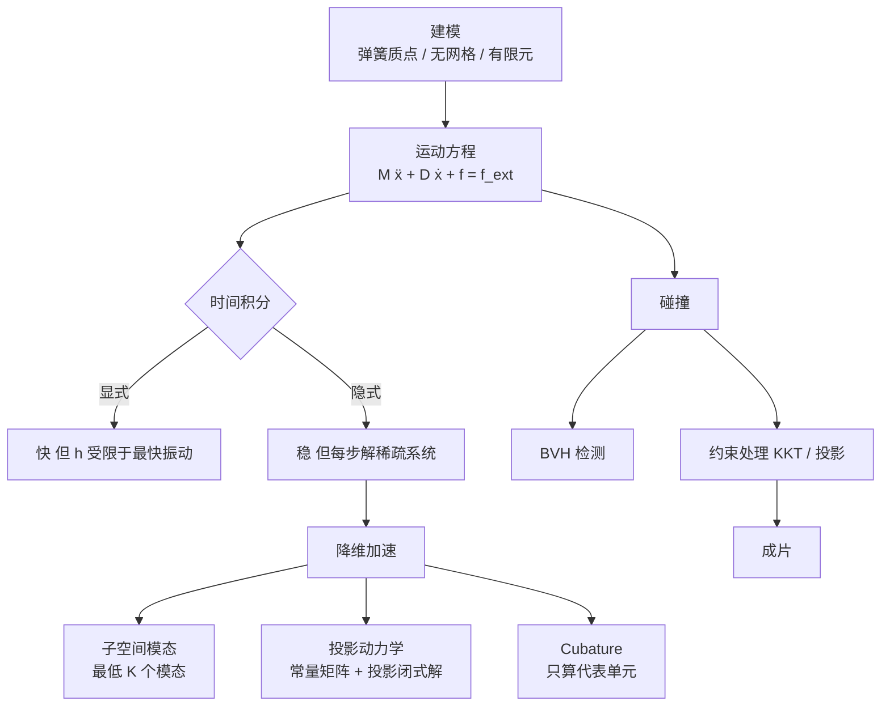

# 第 7 章：网格模型的弹性运动模拟

- **难度**：★★★ | **预估学时**：7 小时 | **前置**：第 6 章的形变能量、第 1 章的数值优化与 Newton 法；基本的力学（力、加速度）

## 学习目标

学完本章，你能：

1. 写出弹性体的运动方程，并说清三项（惯性、阻尼、内力）各自的物理含义。
2. 解释为什么显式积分的时间步受限于"最快振动周期"，而隐式积分不受。
3. 说明子空间模拟怎么把"几万个自由度"降到几十个，以及它的适用边界。
4. 说清 PBD/投影动力学与"解隐式积分方程"的关系（为什么它也收敛到同一个解）。
5. 给出一个含自碰撞的布料模拟的基本流程，并指出最容易出错的两处。

## 一句话核心

模拟就是在每个时间步回答一个问题："在重力和碰撞约束下，这一堆顶点接下来该到哪里？"——效率的关键在于**怎么在不牺牲稳定性的前提下，少算一点**。

## 零基础讲解

### 概念 1：三种建模方式与运动方程

**弹簧质点模型**（难度：基础）。把物体看作一堆质点（顶点），质点之间用弹簧连接，弹性内力由每条边的长度变化定义。它简单、直观，但"弹簧刚度"与"材料硬度"没有直接对应关系，网格越密模型越硬（因为边变短了），需要额外校正。

**无网格模型**（难度：进阶）。不建网格，用一圈邻域内的点做局部拟合（类似第 2 章的 MLS），适合碎裂、流体这类拓扑会变的场景。

**有限元（FEM）**（难度：高难）。把物体剖成四面体（或六面体），每个单元内用形函数插值位移，从应变能导出内力。它的优点是物理参数（杨氏模量、泊松比）与材料真实属性对应；缺点是计算量大、需要好质量的网格——这就是第 4 章六面体重网格化存在的工程理由。

无论哪种模型，运动方程都一样：

```
M ẍ + D ẋ + f_int(x) = f_ext
```

- M 是质量矩阵（对角，通常就是每个顶点的质量）；
- D 是阻尼矩阵，常用 Rayleigh 阻尼 D = α_m M + α_k K（K 是刚度矩阵），α_m 抑制整体慢速运动、α_k 抑制高频抖动；
- f_int 是弹性内力（势能对位移的负梯度）；
- f_ext 是外力（重力、用户拖拽）。

### 概念 2：时间积分——为什么模拟会"炸"

把方程离散到时间轴上有两种基本做法。

**显式积分**（难度：进阶）。用当前时刻的力算加速度，直接推出下一时刻位置：

```
x_{n+1} = x_n + h v_n + h² a_n / m
```

快、简单，但**稳定性受条件限制**。以最简单的单弹簧为例，其振动频率 ω = √(k/m)。数学上可以证明：显式积分稳定要求

```
h ≤ 2 / ω_max
```

ω_max 是全模型最高频（最硬的弹簧、最小的质量、最短的边）。网格加密时 ω_max 会随边长变短而升高（弹簧振子频率与 1/边长 同阶），于是 h 必须越来越小，步数越来越多。这就是"网格越细模拟越慢"的根源，也是布料模拟里最硬的现实约束。

**隐式积分**（难度：高难）。用**未知的下一时刻**的力来写方程：

```
M (x_{n+1} − 2x_n + x_{n−1}) / h² + D (…) + f_int(x_{n+1}) = f_ext
```

因为 f_int 非线性，要 Newton 迭代，每步解一个稀疏线性系统。代价是每步贵，收益是**无条件稳定**（多大的 h 都不炸，虽然太大时会"过度阻尼"显得黏）。工业级模拟基本都用隐式（或其变体）。

### 概念 3：子空间降维——只用几十个自由度

**模态分析**（难度：高难）。线性化后，系统的自由振动满足

```
K φ = λ M φ
```

这是一个广义特征值问题，解出 λ_k（振动频率的平方）和 φ_k（振动模态）。低频模态是大尺度的整体摆动（比如整个人体的晃动），高频模态是局部抖动。

**子空间模拟**（难度：高难）。既然动画里看得见的运动主要是低频的，就只在最低的 K 个模态张成的空间里求解：

```
x = x_0 + Σ_{k=1}^{K} q_k φ_k
```

未知量从 3N 个（N 是顶点数）降到 K 个（常见 K = 20—60）。把运动方程投影到模态坐标上，得到一个 K×K 的小系统，可以实时求解。

代价有三个：一是**非线性内力无法精确投影**（模态基是线性化得到的，大变形时失效）；二是**局部碰撞无法表达**（低频模态摆不出"衣角被桌子挡住"这种尖锐的局部形状）；三是需要预先算特征值分解（几万顶点做一次，可以离线）。

### 概念 4：PBD 与投影动力学——"先乱跑，再拉回来"

**PBD（基于位置的动力学）**（难度：高难）。思路非常工程化：

1. 先不管约束，按外力自由预测位置（x_pred = x + h v + h² f_ext/m）；
2. 然后把每个约束（边长、体积、碰撞）**投影**：把顶点挪到"刚好满足约束"的最近位置；
3. 用挪动后的位置反推速度（v = (x_new − x_old)/h）。

它极其稳定（因为约束总是被强制满足）、极易实现，是游戏和实时布料的主流。缺点是"刚度"依赖迭代次数：迭代少则物体软，迭代多则硬，物理参数不直接。

**投影动力学（Projective Dynamics）**（难度：高难）。它把 PBD 和隐式积分统一起来：把内力写成一组"投影问题"的和，每个投影都有一个闭式解（比如"把这条边拉回原长"就是把两端点沿边方向各挪一半）。于是隐式积分的每一步变成：

```
解 (M/h² + Σ w_i S_iᵀ S_i) x = b(x_pred, 投影目标)
```

左边矩阵**常量**（可以预分解一次，后续每步只做回代），右边每步更新。这解释了为什么它能做到"每步只解一个固定稀疏系统"，速度比完整 Newton 快一个量级，而收敛到的解与隐式积分一致（在收敛时两者满足同一组最优性条件）。

书里还提到用 **Poisson 重建**求解位移：把形变梯度 G 与目标旋转/应变比较，最小化

```
min Σ_e V_e | G_e − g(y_e) |²_F
```

其正规方程是 ∇²u = Gᵀ∇g(y)，系数矩阵只与未变形形状有关、恒定不变——同一个套路（第 6 章的梯度域）在物理模拟里再次出现。

**Cubature 采样**（难度：高难）。完整模拟要对每个四面体算内力，太贵。Cubature 的做法是从大量单元里选一小部分"代表单元"（用训练数据拟合，使整体内力误差最小），只在代表单元上算。它能在保持视觉精度的前提下把单元计算量降一个数量级。代价是：牺牲的单元上无法产生局部细节（比如某个局部被压扁），所以对"精细接触"要慎用。

### 概念 5：碰撞检测与处理

模拟里真正让人头疼的往往不是弹性，而是碰撞。

**碰撞检测**（难度：进阶）。暴力做法是每帧检查所有三角形对，复杂度 O(n²)——几万个三角形根本不可行。实用方案是**层次包围盒（BVH）**：把三角形按空间位置组织成树（每个节点是一个包住其子树所有三角形的盒子），查询时先比大盒子、再比小盒子，只对可能相交的叶子做精确三角形求交。整体复杂度降到接近 O(n log n)。

连续碰撞检测更难：物体在两步之间可能"穿透"（穿过薄墙），所以还需要检查"扫掠体"（这一步到下一步的运动轨迹扫过的空间），或者用自适应步长/时间二分。

**碰撞处理**（难度：高难）。检测到相交后要消除穿透，常用三招：

1. **位置修正**：把穿进去的顶点沿法向推出表面（简单但会让物体"抖"）；
2. **约束求解**：把"不许穿透"写成不等式约束（第 1 章的 KKT / MPRGP 就在这里出场），在隐式积分里一起解，能得到物理上合理的响应；
3. **摩擦与粘滞**：切向的相对运动加摩擦约束，否则物体永远在滑。

书里还强调**自碰撞**（布料自己叠自己）的处理：需要区分"相邻三角形"（本来就接触，要排除）和"真碰撞"，否则布料会自己粘住不动。

### 概念 6：复杂弹性体的运动编辑

**旋转-应变（RS）坐标**（难度：高难）。前面提过：任意形变可以分解为"旋转 + 拉伸"（极分解）。把每个单元形变后的梯度写成 G = R S（R 是旋转，S 是对称的应变），就得到两组可独立编辑的参数：调 R 就是改姿势，调 S 就是改胖瘦。书里用这种表示做运动编辑：用户给定关键帧的 RS 参数，中间帧通过插值求解（用 Cubature 拟合降维），得到"姿势对、胖瘦也对"的动画。

**材质优化**（难度：高难）。反过来：给定一段真实拍摄的运动（比如视频里旗帜的飘动），反推材料的弹性参数（杨氏模量、阻尼系数），使模拟结果与观测一致。这是一个参数拟合问题，通常用梯度下降（对参数求导可用伴随法），把"模拟出来的形状与观测的差"作为损失。

## 图示



看图说明：横向是"建模→积分→加速→碰撞"，其中"降维加速"是本章的技术核心。要看出的关系是：子空间、投影动力学、Cubature 三者不冲突，可以叠用（子空间降自由度、Cubature 降单元数、投影动力学降每步求解成本）。

## 类比与实例

**类比**：模拟像给一群人手拉手传递"该往哪走"的指令。显式积分是"每个人按上一秒的指令立刻迈一步"——指令传得快时（网格细），有人会踩到别人脚上（数值发散）；隐式积分是"每个人先协商出一个大家都同意的下一步"——慢，但不会乱；PBD 是"先各自走一步，再互相拽回来"——最快，但拽的次数决定"队伍有多硬"。**失效边界**：PBD 的"硬"是靠迭代堆出来的，物理参数不能直接映射；要真实材料参数就必须走隐式。

**实例（时间步为什么会炸）**：一根弹簧，k = 100 N/m，m = 0.01 kg，则 ω = √(100/0.01) = 100 rad/s。显式积分要求 h ≤ 2/100 = 0.02 s，即每秒至少 50 步。若你把网格细分，边长减半，等效刚度约变为 4 倍（因为应变与长度变化的比值变大），ω 变为 200，h 必须 ≤ 0.01 s，步数翻倍。**这就是"细分一倍、代价翻倍"的量化解释。**

**实例（模态数量与表现力的取舍）**：一根两端固定的琴弦，第 k 阶模态的形状是 sin(kπx/L)，频率与 k 成正比。取 K = 3，只能表现"整体上下摆一次、两次、三次"这三种形状；如果你要模拟"拨弦处有一个尖角"，需要很高阶（k 大）的模态。这解释了子空间模拟为什么在"局部尖锐碰撞"上失效——尖锐特征需要高频模态，而高频正好被截掉了。

## 常见误解

- **别以为"隐式积分就是无脑大步长"**——实际上大步长虽然稳定，但会把真实的高频振动阻尼掉，看起来"发黏"；精度与稳定性是两件事，工业实现通常还要做步长控制。
- **别以为"弹簧质点模型和有限元只是实现不同，结果一样"**——实际上弹簧模型的刚度与网格密度耦合（加密就变硬），而有限元的材料参数与网格无关，两者在"跨分辨率一致"上本质不同。
- **别以为"PBD 迭代越多越接近物理"**——实际上它收敛到的是"约束都满足"的解，这个解与隐式积分的最优解在多数情况下一致（投影动力学的证明），但每次迭代的中间状态没有物理意义，且刚度-迭代次数的映射需要标定。
- **别以为"BVH 建好一次就能一直用"**——实际上物体在变形，包围盒会失效，需要每帧或每隔几帧重建/更新（更新策略决定了性能，常见做法是"自底向上重拟合"）。
- **别以为"碰撞处理只要把点推出去就够了"**——实际上推出会引入非物理的抖动和穿透反弹，正确做法是把非穿透作为约束并入求解（这也是第 1 章 MPRGP 那类算法被引入的原因）。

## 自测题（答案）

1. （单选）显式积分的时间步上限主要由什么决定？
   A. 总质量　B. 系统最高振动频率　C. 外力大小　D. 顶点数量
   **答案**：B。**解析**：稳定条件 h ≤ 2/ω_max；网格越细，最高频越高，步长必须越小。

2. （单选）投影动力学（Projective Dynamics）每步求解的线性系统有什么特点？
   A. 每步都要重新分解　B. 左边矩阵恒定，可预分解　C. 是非线性系统　D. 是特征值问题
   **答案**：B。**解析**：左边是 M/h² 加上投影算子的加权和，只与网格和权重有关，与当前位置无关，因此可以预分解、每步只回代。

3. （填空）子空间模拟把未知量从＿＿个降到＿＿个；它失效的两个典型场景是＿＿与＿＿。
   **答案**：3N（顶点坐标全量）；K（少数模态系数）；大幅非线性形变（线性化基失效）；局部尖锐碰撞（需要高频模态）。

4. （简答）为什么"网格加密会让弹簧质点模型变硬"？
   **答案要点**：弹簧刚度定义在边上，应变由边长变化率衡量；边变短后同样的绝对位移对应更大的相对伸长，等效刚度上升，最高频也随之升高。要跨分辨率一致，必须按边长重新标定刚度，或改用基于连续介质参数的有限元。

5. （简答）碰撞处理里"位置推出"和"约束求解"的区别与代价。
   **答案要点**：位置推出是事后修正，实现简单、但破坏动量守恒、产生抖动与二次穿透；约束求解把非穿透写进优化（KKT/投影），得到满足动量关系的响应，代价是求解规模变大、需要处理不等式约束的活跃集变化。

## 复习锚点

- 一个方程通吃：M ẍ + D ẋ + f_int = f_ext；区别只在 f_int 怎么来（弹簧/有限元）和怎么积分（显式/隐式）。
- 稳定的代价与速度的代价在互相交换：隐式稳但贵，子空间/Cubature/投影动力学各自砍掉一部分计算。
- 碰撞才是工程难点：检测靠 BVH、处理靠约束、自碰撞要先排除相邻三角形。
