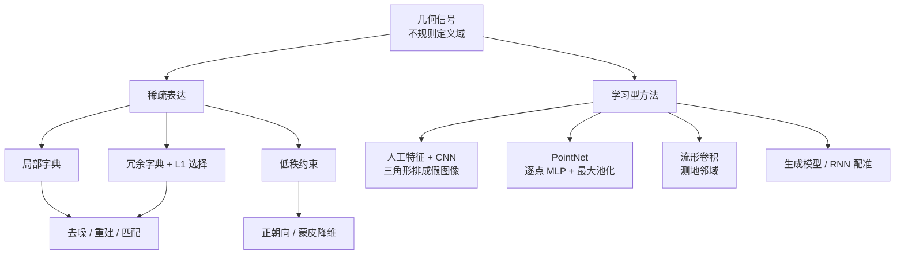

# 第 8 章：基于机器学习的几何处理

- **难度**：★★☆ | **预估学时**：6 小时 | **前置**：第 1—6 章的算子与能量（尤其第 2 章去噪、第 6 章蒙皮）；基础概率与线性代数；神经网络的基本概念

## 学习目标

学完本章，你能：

1. 说清"把几何信号做稀疏表达"为什么比图像难，难在哪一步。
2. 解释 L1 正则为什么会产生稀疏解（不是"因为公式长这样"）。
3. 说明低秩约束为什么可以确定人造模型的正立朝向。
4. 解释 PointNet 为什么对点的输入顺序不敏感，以及它怎么处理旋转。
5. 判断一个几何任务该用手工能量还是学习方法，并说出各自的风险。

## 一句话核心

这一章做的事是**把手写的能量换成了从数据里学出来的先验**：不再由人规定"好的形状应该满足什么"，而是让模型从大量例子里自己总结"什么看起来对"。

## 零基础讲解

### 概念 1：几何信号为什么不好做稀疏表达

图像是定义在规则格点上的信号，所以有天然的基（傅里叶基、小波基），"稀疏"就是"只有少数几个基系数非零"。**几何信号定义在不规则的流形上**——顶点位置不规则、邻接关系不规则，没有一个全局的正交基能像小波那样"局部又紧支撑"。

可行的替代路线有三条：

1. **用 Laplace 特征向量当基**（第 5 章那套）：低频模态近似全局形状，但它们是全局支撑的（一个模态在整个曲面上都非零），所以"局部特征"很难只用少数几个模态表示。
2. **用局部字典**：在每个点附近构造小字典（局部平面、局部二次曲面、局部特征基），让系数稀疏。这就是"局部稀疏"路线。
3. **用不光滑基的冗余字典**：把有限元的线性基、多项式基、甚至"尖锐特征"专用基一起放进字典，让稀疏选择自己挑（书里 8.2.3 就是用这种冗余字典拟合带尖锐特征的曲面）。

### 概念 2：稀疏编码、字典学习、L1、低秩

**稀疏编码**（难度：进阶）。给定字典 D（一堆"原子"向量），把一个信号 y 表示成少数原子的组合：

```
min_x |x|_0   subject to  y ≈ D x
```

`|x|_0` 是"非零元素的个数"。这个目标组合爆炸，不可解，于是换成它的凸松弛：

```
min_x |y − D x|² + λ |x|_1
```

**L1 正则为什么产生稀疏**（难度：高难）。几何直觉：二维平面上，约束 |y − Dx|² ≤ ε 是一个椭圆，惩罚 λ|x|_1 的等值线是一个菱形。椭圆去碰菱形时，最容易碰到的位置是菱形的**尖角**，而尖角正好在坐标轴上——也就是说某个分量为 0。相比之下，L2 的等值线是圆，圆和椭圆相切的位置一般不在坐标轴上，所以 L2 只会让系数"变小"，不会让它们"变没"。

这就是 L1 与 L2 的全部差别。它可以用一个 2 维的例子手算验证：y = (1, 1)，字典是标准基。L2 解为 (0.5, 0.5)（两个都非零）；L1 在 λ 稍大时解为 (1, 0) 或 (0, 1)（一个是 0）。**所以 L1 是"选择"，L2 是"压缩"。**

**字典学习**（难度：高难）。字典本身也未必已知，可以和系数交替优化：

```
交替：固定 D 求 x（稀疏编码） → 固定 x 求 D（最小二乘）
```

这就是 K-SVD 一类算法。几何里的用法是：从一堆形状块里学出"典型局部形状"，再用它们稀疏表示新形状。

**低秩优化**（难度：高难）。要求矩阵 X 的**秩**尽量小。秩小意味着"行与行高度相关"（信息冗余）。几何里的漂亮应用是**模型正朝向**：人造模型（椅子、桌子、车）大多沿坐标轴有对称性，所以当模型摆正时，它在三个坐标平面上的投影图像具有**更低秩**（投影图的每一行几乎相同）。于是"找朝向"就变成"找一个旋转，使三个投影矩阵的秩（的核范数）最小"。这是一个可验证的判断依据，完全不需要训练数据。

**压缩感知**（难度：高难）。如果信号本身在某基下稀疏，那么用远少于维数的随机测量也能恢复它——因为稀疏约束把"无穷多解"压成了唯一解。几何里的应用如"从少量采样恢复曲面细节"：假设细节在某字典下稀疏，用少量点拟合出系数。

### 概念 3：稀疏与低秩在几何处理里的具体用法

书里 8.2 节列了一串应用，它们共享一个套路：**把问题写成"数据项 + 稀疏/低秩正则"，然后解"。**

- **网格去噪**：用边上的微分算子（相邻顶点的差分）作为"稀疏域"，假设噪声在微分域里不稀疏、而真实形状的微分在多数地方接近 0（平坦区域），于是"让微分稀疏"就等于"把噪声当异常值剔除"。这比第 2 章的 Laplacian 光顺更保特征，因为它允许少数地方（棱线）微分很大而不被惩罚。
- **带尖锐特征的曲面重建**：用冗余字典（光滑基 + 不光滑基）稀疏选择，能拟合褶皱、尖点。
- **形状匹配**：把"两张网格的对应"写成稀疏的少数控制点形变（大部分区域不需要形变）。
- **混合蒙皮**：把蒙皮权重矩阵分解成"少数几个姿态基"的组合（低秩），从而能用少量参数表达很多姿态。
- **法向估计**：把法向场分解为"光滑主成分 + 稀疏异常"，异常处就是特征。

### 概念 4：机器学习基础（本章的"工具段"）

书里用一节把机器学习的框架讲了一遍，核心就三段：

1. **任务**：分类（这个三角形属于哪个部位）、回归（预测法向）、生成（造一个新形状）、对应（找点对点关系）。
2. **模型**：多层感知机（MLP，全连接层堆叠）、卷积网络（CNN，局部连接 + 权共享 + 池化）、循环网络（RNN，处理序列）。
3. **方法**：定义损失函数 → 用梯度反传更新参数 → 用验证集选超参数、防过拟合（正则、dropout、数据增广）。

这一节的价值不在深度，而在于它把"几何问题"翻译成了"标准的监督学习问题"，让后面 8.4 节的方法有了共同语言。

### 概念 5：深度学习做几何的四种姿势

**① 把三角形特征排成"假图像"**（难度：进阶）。既然 CNN 只认规则网格，那就硬造一个：给每个三角形算几十个几何特征（曲率、PCA、SDF 值、形状直径、面积等），拼成 600 维向量，再**重排成 30×20 的矩阵**，然后直接套 CNN 做分割/标注。这本质上是用"特征工程 + 排列"绕过不规则性。书里也指出：**排列顺序与矩阵形状对结果有影响**——说明这种"假图像"并不真正尊重网格结构。

**② 点云网络 PointNet**（难度：进阶）。点云是无序集合，网络必须对输入顺序不敏感。PointNet 的做法极其简洁：

- 对每个点独立做 MLP（升维到 1024），得到每点特征；
- 对所有点做**最大池化**（逐维取最大），得到一个全局向量；
- 再拼回每点特征做分类/分割。

为什么对顺序不敏感？因为**最大值与顺序无关**——一排数取最大，你把它重新排列，最大值不变。这就是"对称函数"的作用。

怎么处理旋转？加一个"变换网络"（T-Net）学一个 3×3（或 64×64 特征空间）的矩阵，把输入（或特征）先乘一下再往下传，相当于让网络自己"摆正"输入。书里还强调它同时具有"局部与全局"的性质：逐点 MLP 抓局部，池化抓全局，两者拼接。

**③ 流形上的网络**（难度：高难）。直接在曲面上做卷积：邻域按**测地距离**（沿曲面走的最短距离）定义，卷积核在每个切平面上定义，再把邻域点的特征按"极坐标 (角度, 半径)"分箱聚合（Geodesic CNN 一类）。难点在于：切平面的朝向不唯一（要选一个参考方向），且不同点的局部坐标系要对齐，否则卷积核转一下就失效。

**④ 端到端生成与配准**（难度：高难）。生成模型（VAE/GAN/自编码器）学"形状的分布"，能从随机向量采样出新形状；用 RNN（或点递归网络）做非刚性配准，因为它能一步一步"读取"点云并累积状态。这两类方法的共同点是：**它们不再优化几何能量，而是直接输出结果**，因此速度快，但可控性差（很难保证输出不外翻、不穿模）。

## 图示



看图说明：上半部分是"用数学结构换表达效率"（不需要训练数据），下半部分是"用数据换表达效率"（需要训练数据）。看这张图要抓住本质区别：稀疏/低秩方法有明确的数学保证但表达力有限；学习方法表达力强但可控性和泛化性依赖数据。

## 类比与实例

**类比**：手工能量像"老师给的标准答案"——你按规则算，一定对，但规则之外的情况不会处理；学习方法像"看过一万道题的学生"——遇到新题能凭感觉答，答得可能很妙，也可能离谱。**失效边界**：学生只在"题型分布内"可靠；模型遇到训练集里没有的拓扑（比如带洞的手柄）、不同的尺度、噪声水平时，表现可能骤降。

**实例（L1 的稀疏性手算）**：信号 y = 1（一维），字典 D = 1，惩罚 λ = 0.3。L2 目标 |1 − x|² + 0.3 x²，求导 2(x − 1) + 0.6x = 0 得 x = 2/2.6 ≈ 0.769（非零）。L1 目标 |1 − x|² + 0.3|x|，当 x > 0 时求导 2(x − 1) + 0.3 = 0 得 x = 0.85；当 x < 0 时得 x = 1.15（不可行，取负则解为 0.85 的镜像）。但若 λ 增大到 1.5，正区间解为 x = (2 − 1.5)/2 = 0.25，继续增大到 2 时 x = 0——**解被"压到"零**。这展示了 L1 的"阈值化"行为：小系数直接归零，大系数只减一点。

**实例（低秩正朝向的量化）**：一把椅子摆正时，沿 x 轴方向投影到 yz 平面，每一层（每个 x 切片）的形状几乎一样，所以投影矩阵的秩接近 1；把它旋转 45°，每层形状都在变，秩升高（可能到 5—10）。因此"求使秩最小的旋转"就是求正朝向。秩的凸替代是核范数（奇异值之和），可用 SVD 迭代求解。**这个例子的可验证之处**：你拿一个有轴对称性的模型，手工算两个朝向的投影矩阵的奇异值衰减速度，正朝向一定更快。

## 常见误解

- **别以为"L1 一定比 L2 好"**——实际上 L1 在有相关特征时不稳定（它随机挑一个，丢弃另一个），且对尺度敏感；L2 虽不稀疏但解唯一稳定。选择取决于你要"挑选"还是"平滑"。
- **别以为"把三角形特征排成矩阵喂 CNN 就等价于在网格上做卷积"**——实际上这种排列与网格拓扑无关，交换三角形顺序结果就变（书里也点明了这一点），所以它学不到"邻接关系"这种真正的几何结构。
- **别以为"PointNet 对旋转天然不变"**——实际上最大池化只解决**顺序不变**；旋转要靠 T-Net 学一个变换矩阵来"抵消"，而 T-Net 本身是学出来的，不保证精确抵消（正交性也只是加正则近似保证）。
- **别以为"生成模型能替代物理模拟"**——实际上生成模型学的是"看起来合理的形状分布"，它不保证力平衡、体积守恒、不自交；要做可信的动画仍得靠第 7 章的物理。
- **别以为"深度学习不需要几何算子"**——实际上几乎所有成功的几何网络，输入都是曲率、法向、测地距离、Laplace 特征这些算子算出来的量。网络替代的是"能量设计"，不是"几何计算"。

## 自测题（答案）

1. （单选）L1 正则产生稀疏解的直接原因是什么？
   A. 它是凸函数　B. 它的等值线有尖角，最优点容易落在坐标轴上　C. 它的梯度更大　D. 它等价于 L0
   **答案**：B。**解析**：菱形等值线与数据项椭圆相切处常在尖角，对应某分量为零；L2 的圆形等值线不会。

2. （单选）PointNet 对输入点顺序不敏感，靠的是？
   A. 卷积　B. 循环网络　C. 逐点 MLP + 对称的池化函数（最大池化）　D. 图拉普拉斯
   **答案**：C。**解析**：逐点独立提特征，再用与顺序无关的对称函数聚合。

3. （填空）低秩正朝向方法的核心观察是：人造模型摆正时，其在三个坐标平面上的投影矩阵具有＿＿＿＿，因此可用＿＿＿＿作为可优化的替代目标。
   **答案**：更低的秩（行高度相关）；核范数（奇异值之和，秩的凸松弛）。

4. （简答）为什么几何信号比图像信号更难做稀疏表达？
   **答案要点**：图像定义在规则格点上，有局部紧支撑的正交基（小波）；几何定义在不规则流形上，Laplace 特征向量是全局支撑的，无法表示局部细节，因此需要局部字典或冗余字典，且字典本身往往要学。

5. （简答）在什么情况下你会坚持用手工能量而不是学习方法？
   **答案要点**：需要可解释性、需要严格保证（不翻转、体积守恒、水密、拓扑正确）、训练数据不足或分布外输入多、需要实时可控编辑时。学习方法在"感知类任务"（分割、对应、生成）上更强，在"硬约束类任务"（可打印、可仿真）上不如优化可靠。

## 复习锚点

- 三条稀疏路径：局部字典、冗余字典 + L1 选择、低秩约束；L1 是"选择"，L2 是"压缩"。
- 深度几何的四个姿势：假图像 CNN、PointNet（对称池化）、流形卷积（测地邻域）、生成/递归模型。
- 网络替代的是"能量设计"，几何算子仍是输入；硬约束任务别指望网络保出来。
