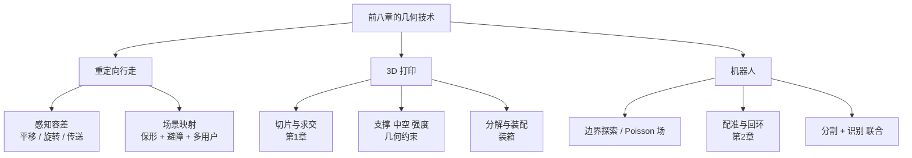

# 第 9 章：新型几何处理应用

- **难度**：★☆☆ | **预估学时**：3 小时 | **前置**：第 2 章的重建、第 3—4 章的网格处理、第 7 章的物理模拟

## 学习目标

学完本章，你能：

1. 说出重定向行走的三类增益，并解释场景映射为什么是一个"保形优化问题"。
2. 列出 3D 打印的四类几何约束，并判断一个模型打印失败的最可能原因。
3. 说明机器人自主扫描为什么要"沿着边界探索"，以及 Poisson 场在这里的作用。
4. 说出"分割 + 识别联合求解"比"先分割再识别"好在哪里。
5. 把前八章的方法映射到这三类真实场景里（哪一章在哪一步被用到）。

## 一句话核心

前三类应用看似互不相干，本质是同一个转变：**从"几何好不好看"变成"几何在真实约束下能不能用"**——人走不过去、打印机装不下、机器人扫不全，这些约束会反过来改写算法目标。

## 零基础讲解

### 概念 1：重定向行走——让人在 3 平方米里走 30 米

VR 里最大的物理限制是房间太小。**重定向行走**（难度：进阶）的思路是：人的视觉与本体感觉（前庭/肌肉感觉）不一致时，在一定范围内大脑会自动纠偏而不察觉。于是可以利用这个"感知容差"做三件事：

- **平移增益**：虚拟里走 1 米，现实里只让你走 0.8 米（增益 1.25）。增益在 0.6—1.6 附近人通常察觉不到差异（个体差异大）。
- **旋转增益**：虚拟里转 30°，现实只转 25°。注意人对旋转更敏感，增益范围比平移窄得多。
- **传送/重新定向**：直接把你"瞬移"到另一处，或用"门户"设计让空间首尾相接。

**场景映射**（难度：高难）。更激进的做法是改造虚拟场景的**几何**，让它在真实场地里走起来不越界。书里把它写成一个带五项约束的优化：

1. **保形**：变形后的虚拟场景要与原来尽量像（用共形扭曲度量，柯西-黎曼方程满足时映射保角）；
2. **局部等距**：不同位置的形变要按需分配（有些区域不能拉，有些可以缩）；
3. **边界约束**：虚拟场景的边界要落在真实场地的可行区域内；
4. **避障**：映射后不能把虚拟障碍物搬到真实障碍物上；
5. **多用户一致**：多个用户同时在场时，要保证他们"在虚拟里相遇"时"在现实里也靠近"。

数学上它是"求一个尽可能保形的映射 + 一组位置相关的缩放"，用优化求解。这一步的巧妙之处在于：**它把"空间不足"从硬件问题变成了几何变形问题**。

### 概念 2：3D 打印——所有约束最终都变成几何问题

3D 打印（难度：进阶）可以粗暴地分成"打印前"和"打印中"，几何处理集中在打印前。

**工艺相关**（难度：进阶）：

- **切片**：把模型切成一层层二维轮廓（等价于求一组水平面与网格的交线，第 1 章的网格求交裁剪在这里出场）。
- **支撑结构**：悬垂面（法向朝下、倾角超过约 45°）需要支撑，否则会塌。生成支撑=在模型下方"种柱子"并保证可拆除。
- **路径规划**：每一层的填充方式（直线、蜂窝、螺旋），影响强度与时间。
- **中空与壁厚**：实体打印太贵，通常做成"外壳 + 内部稀疏填充"。壁厚不能太薄（强度不够），也不能太厚（材料浪费）。

**结构与物理性能**（难度：高难）：

- **站立/旋转稳定**：打印出来的物体要能站稳（重心投影落在支撑多边形内）、旋转时（比如陀螺）要稳定。书里给的写法是一个优化：min 形状偏差 + 到目标重心的投影距离，通过**内部挖空或局部变形**来调重心——注意这里改的是内部结构，外观不变。
- **强度**：打印件的强度有方向性（层间结合弱），所以模型摆放方向、填充方向都要考虑受力方向。
- **大模型分解**：打印空间有限，大模型必须切成几块。切分时要考虑：切口尽量避开外观细节、切块要能装配（加榫卯）、每块都要能放进打印空间、尽量少用支撑。书里提到把外观细节部分贴附到内部凸多面体上的做法，节省材料与时间。
- **装箱/紧凑**：多件一起打印时，如何摆放最省空间（这是三维装箱问题，NP 难，用启发式）。

一个真实判断：**模型打印失败最常见的原因不是"几何有错"，而是"悬垂没支撑"或"壁太薄"**。这两条都能在切片前的几何检查里发现。

### 概念 3：机器人——扫得到、看得懂、抓得准

**自主扫描与重建**（难度：进阶）。机器人拿着深度相机，要在未知环境里把场景扫全。经典做法是**基于边界的探索**：把"已探索的自由区域"与"未知区域"的交界定义为**边界（frontier）**，每步选一个边界作为目标移动过去，因为那里最可能带来新信息。这解决"往哪走"。

书里提到的另一种做法用 **Poisson 场**规划：在已知/未知区域上构造一个势场（未知区域是"势的源"），机器人沿势的梯度走，自然被"吸"向未探索的地方。这比 frontier 更平滑、更适合连续控制。

扫描的几何难点：**位姿漂移**（走一段后累计误差，地图错位）与**闭环**（回到起点要闭合）。解决办法是配准（第 2 章的 ICP）加后端优化（图优化/回环检测）。

**场景理解**（难度：高难）。扫完要"看懂"：把点云分割成物体并识别类别。书里介绍的**联合分割与识别**很关键：不要"先分割再识别"，而是：

- 先过分割（切成很多小块）；
- 对每块算分类似然（这块像椅子还是桌子）；
- 用"区域生长 + 融合"：反复尝试把相邻块合并，如果合并后**整块**的分类似然更高，就合并；直到再合并不提高为止。

为什么这样更好？因为分割边界本身是不可靠的（噪声、遮挡会让边界切错），而"这块整体像不像椅子"是一个更强的信号，可以用它反过来修正边界。这是一个很实用的工程哲学：**当两个子问题互相依赖时，联合求解比流水线稳。**

**机械臂 3D 打印**（难度：进阶）。把打印头装在机械臂上，就能打印超出打印箱尺寸的大物体（机械臂活动范围更大），也能打印"长在现有物体上"的结构。几何难点是：机械臂有可达性约束（姿态、碰撞、奇异位形），所以切片路径必须同时满足"能打印"与"能到达"——这又把问题变成一个带约束的路径规划。

## 图示

看图说明：三类应用都在"消费"前八章的技术。看这张图要抓住一条：**应用章节不是新技术，而是约束的叠加**——同一个重建算法，在机器人场景里多了"实时、漂移、可达"的限制；同一个网格处理，在打印场景里多了"悬垂、壁厚、装得下"的限制。

## 类比与实例

**类比**：这三类应用像"把实验室里的菜端上餐桌"。重定向行走是"盘子太小，把菜重新摆盘"（改场景）；3D 打印是"烤箱太小、有的食材会塌，得改刀工和摆法"（改结构）；机器人是"让服务员自己在陌生厨房里找东西、还得认得出是什么"（改感知与决策）。**失效边界**：实验室里"形状保真"是唯一目标，餐桌上还要考虑成本、时间、安全——这就是为什么本章的方法都以"多目标优化"的形式出现。

**实例（重定向增益的可算）**：房间 4 m × 4 m，虚拟场景要求的行走路径周长 40 m。若只靠平移增益 1.4，最多把 40 m 压缩到 40/1.4 ≈ 28.6 m，仍然远超房间能提供的有效路径（考虑转身和安全距离，实际可用约 12—15 m）。所以必须叠加"传送"或"场景映射折叠"：把虚拟场景在空间上折叠（比如把一条长走廊映射成"绕圈"），才能把 40 m 塞进 4 m 见方的房间。**这个估算能让你立刻判断"单纯调增益够不够"。**

**实例（悬垂角与支撑）**：一个圆锥，锥顶朝上、底面朝下，侧面与水平面夹角 60°（即悬垂角 30°，小于 45°），不需要支撑。把它倒过来（锥顶朝下），侧面变成 60° 悬垂（超过 45°），必须加支撑，否则下面几层会塌。同一形状、两种摆法，支撑需求完全不同——**这就是"打印方向"必须优化的原因**。

## 常见误解

- **别以为"重定向行走只靠调增益就行"**——实际上增益的可容忍范围很窄（旋转尤其窄），大范围位移必须靠传送或场景映射，否则用户会晕或察觉。
- **别以为"3D 打印的几何处理就是切片"**——实际上切片只是最后一步；支撑、中空、强度、分解装配、装箱都在切片之前决定成败。
- **别以为"模型重心稳定只要看几何中心"**——实际上重心与质量分布有关，中空结构、多材料都会改变重心；所以"挖空"既是省料手段，也是调重心手段。
- **别以为"机器人扫描就是多拍几张拼起来"**——实际上位姿漂移会让拼接错位，必须做配准与回环优化；而且"往哪扫"本身是一个决策问题（边界探索）。
- **别以为"先分割再识别是标准流程，所以联合求解是多此一举"**——实际上分割边界依赖识别结果（不知道是椅子就不知道椅子该到哪儿结束），联合求解正是为了解决这个循环依赖。

## 自测题（答案）

1. （单选）重定向行走中，人对哪类增益最敏感（可容忍范围最窄）？
   A. 平移增益　B. 旋转增益　C. 视场角增益　D. 时间增益
   **答案**：B。**解析**：前庭系统对旋转非常敏感，旋转增益的可容忍区间远窄于平移。

2. （单选）3D 打印时"悬垂面"的判定依据是？
   A. 面积大小　B. 法向与竖直方向的夹角（相对水平面倾角小于约 45°）　C. 顶点数量　D. 曲率符号
   **答案**：B。**解析**：悬垂角超过约 45° 时，下方没有材料支撑，必须加支撑。

3. （填空）机器人自主扫描中，把"自由区域"与"未知区域"的交界称为＿＿；用势场规划时，通常把＿＿当作势的源，机器人沿梯度移动。
   **答案**：边界（frontier）；未知区域。

4. （简答）为什么"联合分割与识别"比"先分割再识别"更稳？
   **答案要点**：分割边界在噪声/遮挡下不可靠，而"整块的分类似然"提供全局语义约束；联合求解时，合并相邻块若提升整体似然则合并，等于用语义反过来修正边界，避免把同一物体切碎或把两个物体并成一块。

5. （简答）大尺寸模型打印时，分解成多块要考虑哪些几何因素？
   **答案要点**：每块要能放进打印空间（尺寸约束）；切口要避开外观细节、尽量少支撑；块间要能装配（榫卯/定位特征）；各块的打印方向要利于强度；整体重心与稳定性；材料与时间成本（可把细节贴附到内部凸多面体上省料）。

## 复习锚点

- 三类应用共享一个转变：从"形状保真"到"约束下的可用"。约束（空间、工艺、可达性）会改写优化目标。
- 重定向行走靠感知容差 + 场景变形；3D 打印的成败在切片之前的支撑/壁厚/分解/重心；机器人靠边界探索 + 配准回环 + 联合分割识别。
- 遇到"两个子问题互相依赖"（分割↔识别、扫描↔重建、切片↔可达），优先考虑联合求解而不是流水线。
