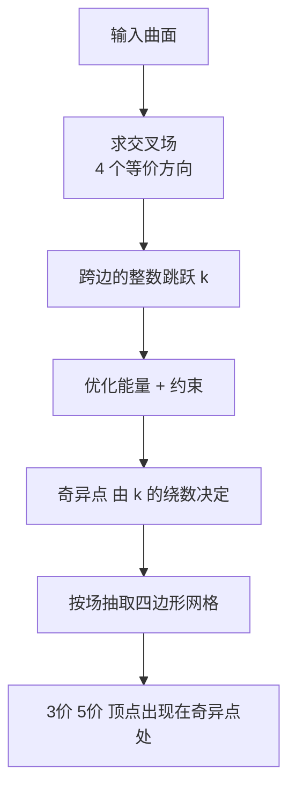

# 方向场、周期跳跃与奇异点

- **难度**：高难 | **涉及章节**：第 4 章

## 一句话定义

在每个顶点给出 4 个等价的正交切向（交叉场），它规定四边形网格往哪铺；跨块时需要"旋转 90° 的整数倍"来对齐，转不回来的点就是奇异点。

## 为什么重要

它是四边形化从"艺术"变成"可计算"的关键：把"网格怎么铺"变成一个可以全局优化、可以证明约束的场。奇异点的分布直接决定四边形网格的质量。

## 图示



看图说明：奇异点不是缺陷，而是场的拓扑必然产物；网格的"五星点"就是它的可视化。

## 详解

**为什么需要 4 个等价方向**（难度：进阶）。四边形网格的一个单元有两族平行边，方向 ±u 与 ±v 都给同一族边。所以场是"无朝向"的：把 u 换成 −u、或把 (u, v) 换成 (v, u)，铺出来的网格一样。这就是 C4 对称（4 阶循环）的来源。

**两种表示**（难度：高难）：

1. **带整数跳跃的表示**。在每条边 e 上记整数 k_e，表示"跨过 e 时方向编号要循环移 k 步"。优化时 k_e 是离散变量，问题变成混合整数规划。
2. **三角函数表示**。把角度乘 4：ξ = (cos 4θ, sin 4θ)。旋转 90° 对应 θ + π/2，乘 4 后是 +2π，三角函数值不变——**整数变量自动消失**，优化变成连续问题。

第二种是主流，因为它把一个离散组合问题变成了普通的向量场光滑问题（最小化 Dirichlet 能量 ʃ|∇ξ|²）。

**奇异点怎么产生**（难度：高难）。绕顶点走一圈，场必须回到原值。在乘 4 的表示里，"回到原值"要求累积转角是 2π 的整数倍。如果累积转角是 2π×m 且 m 非零，这个点就有非零指数。换算回四边形网格，优雅的记账方式是用价 n：

```
index = (4 − n) / 4      3 价 → +1/4，5 价 → −1/4
```

而**Poincaré-Hopf 定理**要求闭合曲面上 Σ index = χ。球面 χ = 2，所以至少需要 8 个 +1/4（即 8 个 3 价顶点），或等价的组合。这就是"四边形球面不可能没有奇异点"的严格理由。

**整数约束的求解**（难度：高难）。带整数变量的能量常用"松弛—取整"策略：先把 k 当连续变量解二次规划，再把最接近整数的固定，优化剩余，反复迭代。书里强调：**一次性全部取整会得到奇异点过多、非常不光顺的场**，逐步取整才有效。

**特征对齐与度量定制**（难度：高难）：

- **对齐**：在特征边上，要求场的方向与该边一致（或成 45°）；边界处要求方向沿边界。
- **密度**：用 2×2 对称正定矩阵 g（度量张量）替代欧氏度量，其特征向量给方向、特征值给密度。约束 g 正定很麻烦，技巧是写 g = exp(G)（G 任意对称），指数映射保证正定，把不等式约束变成无约束。

**数值例子**（可验证）。平面上取"径向 + 切向"场：绕一圈，方向转 360°，而 4 个等价方向只认 90° 的整数倍，360° = 4×90° → 整数，无奇异点（指数 0）。

把场改成一个常数 45° 方向并带一次"扭转"：绕一圈累积 360°，但 45° 不在 4 个等价方向的集合里，累积不是 90° 的整数倍 → 中心必须有奇异点，指数 +1/4（3 价）。**这个对比用一张纸就能画出，是理解周期跳跃的最快方式。**

## 常见误解

- **别以为"奇异点是算法缺陷，应该消除"**——实际上它们的总指数受拓扑下界约束，能做的只有"放到合适的位置、均匀分布"。
- **别以为"乘 4 的表示只是换元，结果一样"**——实际上它改变了优化问题的性质（连续 vs 混合整数），这是可行与不可行的区别。
- **别以为"方向场光滑了网格就好看"**——实际上网格质量还取决于奇异点位置与密度场；奇异点挤在一起会导致局部三角形畸变。
- **别以为"整数取整可以最后一次性做"**——实际上取整顺序影响解的质量，逐步取整才能得到少奇异点的场。

## 在书中出现的脉络

| 章节 | 语境 | 关键结论 |
|---|---|---|
| 4.2.1 | 方向场驱动四边形化 | 周期跳跃、整数相容 |
| 4.2.2 | Morse-Smale | 用标量场替代方向场 |
| 4.3.2 | 标架场 | 三维推广（对称标架的 9 维表示） |

## 相关概念

- 前置：向量场、绕数、欧拉示性数、混合整数优化
- 后续：四边形抽取、标架场、六面体
- 对照：Morse-Smale（用标量场切块）
