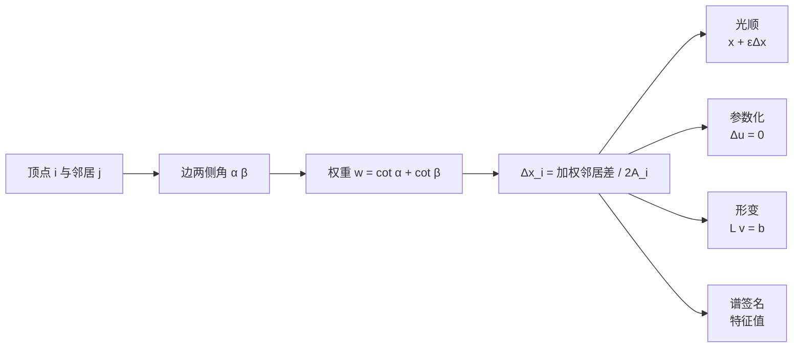

# 离散 Laplace 算子与余切权重

- **难度**：进阶 | **涉及章节**：第 1、2、3、5、6、7 章

## 一句话定义

把"这个顶点比邻居平均高出多少"写成一个可以矩阵化的量：Δx_i = (1/(2A_i)) Σ_j (cot α_ij + cot β_ij)(x_j − x_i)。

## 为什么重要

它是全书复用次数最多的算子。第 2 章的光顺用它，第 3 章的参数化解 Δu = 0，第 5 章的 HKS 用它算特征值，第 6 章的梯度域形变解 L v' = b，第 7 章的物理模拟里 ∇²u = Gᵀ∇g 也是它。学会看懂这一个式子，后面六章的能量函数就不会陌生。

## 图示



看图说明：左边是"权重怎么来"，右边是"用到哪"。要看出的关键点是：所有下游用法都不再重新发明算子，只是换约束和目标。

## 详解

**为什么不是简单平均**（难度：进阶）。最朴素的想法是 Δx_i = (1/deg(i)) Σ_j (x_j − x_i)，即均匀权重。它在规则网格上没问题，但在不规则三角网格上不收敛：把网格细分，均匀权重的结果与真实 Laplace 值差一个只与网格形状有关的因子，误差不消失。

**余切的来历**（难度：高难）。余切权重不是凑出来的，而是从"分片线性函数在三角形上的积分"直接算出来的。推导的骨架是：在三角形上，梯度是常数（分片线性函数），把梯度的内积在三角形上积分，得到

```
ʃ_T ∇φ_i · ∇φ_j dA = −(1/2)(cot θ_k)     （i、j 是 T 的两个顶点，θ_k 是第三顶点处的角）
ʃ_T ∇φ_i · ∇φ_i dA = (1/2)(cot θ_j + cot θ_k)
```

把所有相邻三角形加起来，就得到 Δx_i = (1/2)Σ_j (cot α + cot β)(x_j − x_i)（A_i 归到前面或吸收进权重，取决于约定）。这里 α、β 就是边 (i, j) 两侧对着这条边的两个角。这个推导同时解释了两件事：**为什么系数是 1/(2A)**（面积来自积分），以及**为什么钝角会让权重为负**（钝角的余切为负）。

**数值例子**（可手算）。等边三角形，边长 1，角 60°，cot 60° = 1/√3 ≈ 0.5774。某条内部边两侧各有一个 60°，权重 w = 1.1547。若顶点 i 的混合面积 A_i = 0.4330（单个等边三角形面积 √3/4），则

```
Δx_i = (1/(2×0.4330)) × 1.1547 × Σ_j (x_j − x_i) = 1.333 Σ_j (x_j − x_i)
```

系数 1.333 = 4/3。这不是巧合：对正四面体（每个顶点 3 个邻居、3 个 60° 角），这个值使算子在该网格上精确对应"球面"的离散化。

**混合面积**（难度：进阶）。A_i 不是简单把一圈三角形面积加起来除以 3，而是"每个三角形按其内角是否为钝角来分配"：锐角三角形贡献整面积的 1/3；钝角三角形把面积按"外心位置"分给钝角顶点更多/更少。这一修正让算子在钝角网格上仍然收敛。工程实现里，粗略用"一圈面积和 / 3"也能跑，但收敛阶会降。

**矩阵形式**（难度：进阶）。把所有顶点排成向量 x，Δx = −L x，其中 L 是稀疏矩阵：对角元 L_ii = Σ_j w_ij/(2A_i)，非对角元 L_ij = −w_ij/(2A_i)。L 对称、行和为 0（所以常数向量在核里，平移不改变 Δx）。这两个性质让它成为各种最小二乘的天然矩阵，也是"解 Laplace 方程"能直接用 Cholesky 分解的原因。

## 常见误解

- **别以为"权重只与边长有关"**——实际上余切只与**角度**有关，边长变长角度不变时权重不变。这就是它对尺度不敏感、对形状敏感的原因。
- **别以为"钝角三角形只是精度差一点"**——实际上钝角使权重为负，矩阵可能不再对角占优，求解会出现"负扩散"（相当于反向热传导），表现为光顺时局部鼓起。
- **别以为"Δx 为零就是平面"**——实际上 Δx 为零只说明"等于邻居平均"，球面网格上也有近似为零的地方（顶点在局部近似平面上）。判定平面要看曲率，不看 Δx。

## 在书中出现的脉络

| 章节 | 语境 | 关键结论 |
|---|---|---|
| 1.3.2 | 离散微分几何 | 余切权重算子、平均曲率法向 |
| 2.4 | 曲面光顺 | 显式 Laplacian 光顺与 Taubin |
| 3.1 | 调和参数化 | 内部顶点满足 Δu = 0 |
| 5.1.2 | HKS | 用 L 的特征值/特征向量构造签名 |
| 5.3 | 图割与随机游走 | L 作为图的拉普拉斯 |
| 6.2 | 梯度域形变 | 解 L v' = b |
| 7.1 | 投影动力学 | ∇²u = Gᵀ∇g 的系数矩阵 |

## 相关概念

- 前置：向量的点积、三角形面积、余切的定义
- 后续：离散高斯曲率（角度亏欠）、梯度域形变、HKS
- 对照：均匀权重（简单但不收敛）、重心权重（恒正，适合 Tutte 定理）
