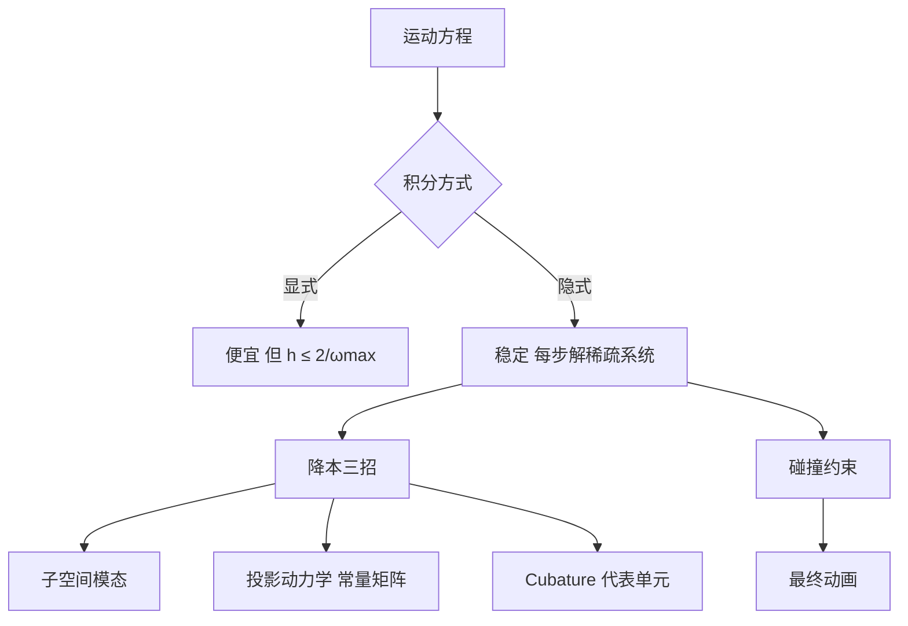

# 弹性模拟：隐式积分、PBD 与子空间

- **难度**：高难 | **涉及章节**：第 7 章

## 一句话定义

按 M ẍ + D ẋ + f_int = f_ext 推进形状；显式积分受"最快振动"限制步长，隐式积分不受但每步要解方程，子空间/Cubature/投影动力学是三种降本手段。

## 为什么重要

它是"形变能量 + 优化"在时间维度上的延伸：第 6 章的能量是静态的，第 7 章让它随时间演化。工程上的布料、软组织、碎裂都靠这一套。

## 图示



看图说明：三条降本路线互相独立、可以叠加；选择哪条取决于瓶颈（自由度、单元数、还是求解次数）。

## 详解

**运动方程的三项**（难度：进阶）：

- M ẍ：惯性（质量 × 加速度）；
- D ẋ：阻尼（Rayleigh：D = α_m M + α_k K）；
- f_int：内力 = −∂E/∂x（E 是弹性势能）。

**显式的稳定性条件**（难度：进阶）。单弹簧 ω = √(k/m)，显式积分稳定要求 h ≤ 2/ω。全系统 ω_max 决定步长，网格加密使 ω_max 上升（刚度随 1/边长 增长），这解释了"细分一倍、代价翻倍"。

**隐式积分**（难度：高难）。用未知的 x_{n+1} 写方程，Newton 迭代每步解稀疏线性系统。无条件稳定，但大步长会引入数值阻尼（看起来"发黏"）。

**子空间**（难度：高难）。线性化后解广义特征值问题 K φ = λ M φ，取最低 K 个模态作基，未知量从 3N 降到 K。失效场景：大幅非线性形变（线性基失效）、局部尖锐碰撞（需要高频模态）。

**PBD**（难度：高难）。三步：预测位置 → 投影约束 → 反推速度。极稳、易实现；刚度靠迭代次数"堆"出来，物理参数不直接。

**投影动力学**（难度：高难）。把内力写成一组投影问题之和，隐式积分每步变成解

```
(M/h² + Σ w_i S_iᵀ S_i) x = b
```

左边恒定 → 预分解一次，每步只回代。收敛时的解与隐式积分一致，速度却接近 PBD。

**Cubature**（难度：高难）。从所有单元里选少量"代表单元"，用训练数据拟合（最小化整体内力误差）。单元计算量降一个数量级，代价是牺牲局部细节。

**碰撞**（难度：进阶）。检测用 BVH（层次包围盒），处理用约束（KKT/投影）。自碰撞要先排除相邻三角形，否则布料会粘住。书里还给了"每个顶点只保留一个碰撞约束"的简化策略（让矩阵变对角，大幅提速）——实验表明视觉上无明显失真。

## 常见误解

- **别以为"隐式积分步长越大越好"**——实际上大步长稳定但精度低、阻尼重，看起来发黏。
- **别以为"弹簧模型和有限元只是实现差别"**——实际上弹簧刚度与网格密度耦合，有限元的材料参数与网格无关。
- **别以为"PBD 迭代多了就等于物理正确"**——实际上它收敛到"约束满足"的解，参数需要标定，中间状态无物理意义。
- **别以为"BVH 建一次就够"**——实际上形变会让包围盒失效，需要每帧重拟合或定期重建。

## 在书中出现的脉络

| 章节 | 语境 | 关键结论 |
|---|---|---|
| 7.1.1 | 弹性运动方程 | 弹簧/无网格/有限元 |
| 7.1.2 | 子空间降维 | 模态分析、Cubature |
| 7.1.3 | 位置与投影加速 | PBD、投影动力学 |
| 7.2 | 碰撞 | BVH、约束处理、自碰撞 |
| 7.3 | 运动编辑 | 旋转-应变空间、材质优化 |

## 相关概念

- 前置：Newton 法、特征值问题、约束优化
- 后续：布料/软组织模拟、运动编辑、材质反演
- 对照：纯几何形变（无形力平衡）
