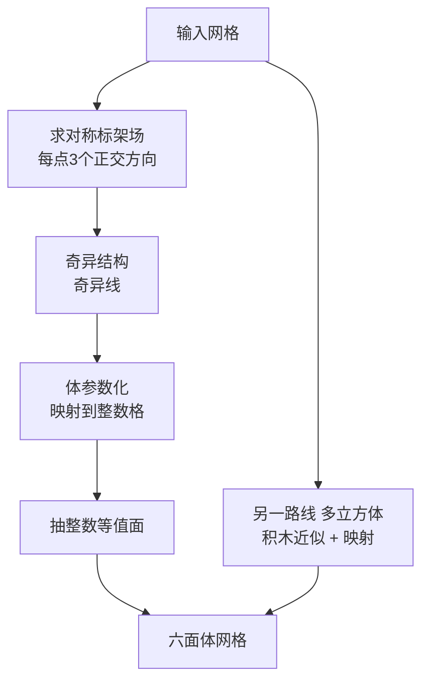

# 标架场与六面体重网格化

- **难度**：高难 | **涉及章节**：第 4 章

## 一句话定义

在每个点给出 3 个互相垂直的方向（标架），用它约束体参数化，再抽整数等值面就得到六面体网格；难在标架有 24 种对称、奇异结构是线而不是点。

## 为什么重要

六面体网格是有限元最想要的单元（精度与收敛速度都好），但自动生成极其困难。标架场路线是"用场约束全局结构"这一思路在三维的代表。

## 图示

看图说明：两条路线的区别在于"全局结构从哪来"——一条从场求解，一条从积木形状强制。

## 详解

**对称性带来的表示难题**（难度：高难）。3 个正交方向，但：

- 三个方向的**顺序**可以任意排列（6 种）；
- 每个方向的正负不重要（8 种）；
- 但"右手系"约束会限制一部分。

总共 24 种等价表示（立方体的旋转群）。所以不能简单存 3 个向量再去插值——插值出来的往往不是正交标架。

**9 维表示**（难度：高难）。经典做法是用**球面调和函数**把对称性编码：把标架展开成 l=0 与 l=4 的球面调和的组合（因为 3 个方向与其相反方向构成的多项式在旋转下不变），得到一个 9 维向量（1 + 4 + 4 或等价的分量数）。在这个空间里：

- 距离可定义（R⁹ 中的欧氏距离），
- 光顺就是最小化相邻标架在 9 维空间中的差，
- 奇异结构从"向量不连续"变成"9 维向量场的拓扑缺陷"。

**奇异结构是线**（难度：高难）。四边形网格的奇异点是孤立点（3 价/5 价顶点），六面体网格的奇异结构是**线**：沿一条线走，周围的六面体拓扑"转不回来"，整条线的邻域都受影响。这导致整数约束的组合爆炸（每条奇异线都是一组约束），求解难度比二维高一档。

**多立方体路线**（难度：进阶）。先用轴对齐的立方体拼出模型（像乐高），得到极其规整的结构，再把这个"积木模型"光滑映射回原形状。优点：

- 全局结构自动规整（每块都是标准六面体）；
- 奇异结构只出现在积木的拐角上，位置可控；
- 求解简单（映射是分段线性的、可用调和映射优化）。

缺点：

- 积木近似会丢失细节（细杆、薄片、弯曲大的部位）；
- 形状与积木差异大时映射扭曲严重；
- 拼装本身是一个组合优化问题。

**晶格与八叉树路线**（难度：进阶）。直接撒规则格子或八叉树格子，边界处裁成贴合体。快，但**边界单元质量差**——有限元在边界处最需要好单元，这是它的结构性缺陷。

## 常见误解

- **别以为"六面体只是四边形加一维"**——实际上三维的奇异结构从点变成线，整数约束的组合复杂度完全不同。
- **别以为"标架场平滑了就一定生成好网格"**——实际上还要求积分性（场可积、能抽出一致的格点），不可积的场会导致抽取失败或单元错位。
- **别以为"多立方体是偷懒做法，质量一定差"**——实际上对建筑类、机械类块状模型它非常合适，代价只出现在细长/薄壁结构上。
- **别以为"八叉树够用"**——实际上边界单元质量是结构性问题，不是调参能解决的。

## 在书中出现的脉络

| 章节 | 语境 | 关键结论 |
|---|---|---|
| 4.3.1 | 基于局部拓扑操作 | 从四边形网格挤出、局部修正 |
| 4.3.2 | 三维标架场 | 球面调和 9 维表示、奇异线 |
| 4.3.3 | 多立方体结构 | 积木近似 + 映射 |
| 4.3.4 | 闭形式多立方体 | 用闭 1-形式保证可积 |

## 相关概念

- 前置：方向场与周期跳跃、球面调和、体参数化
- 后续：六面体网格质量优化、有限元
- 对照：晶格/八叉树（简单但边界差）、多立方体（规整但近似粗）
