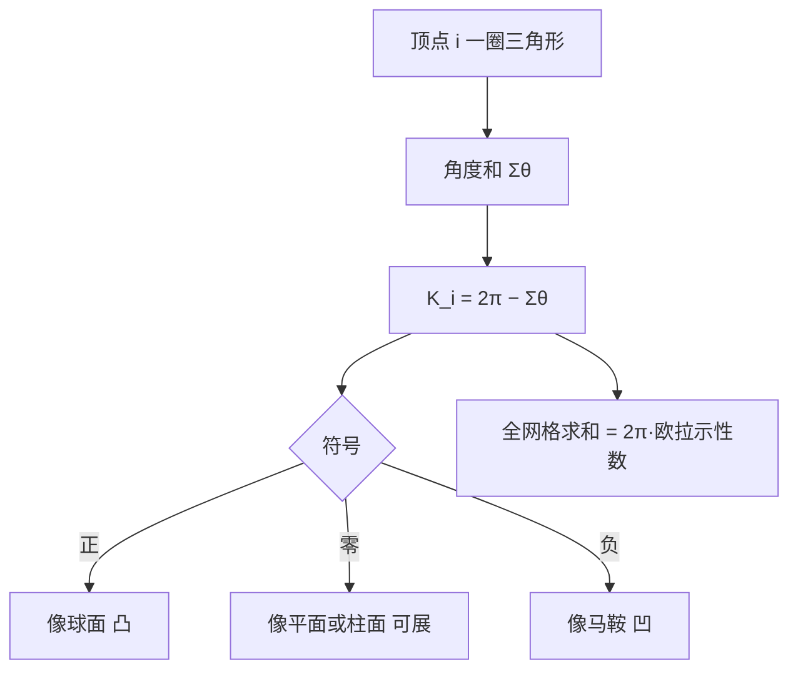

# 离散高斯曲率与角度亏欠

- **难度**：进阶 | **涉及章节**：第 1、2、4、5 章

## 一句话定义

顶点一圈三角形的内角和与 2π 的差，K_i = 2π − Σθ_i，就是该点的离散高斯曲率。

## 为什么重要

它提供了一个"不需要拟合曲面、不需要估法向、只靠角度就能算曲率"的量。第 4 章判断方向场奇异点的分布、第 5 章做曲率聚类分割，都依赖它。更重要的是，它满足**离散高斯-博内定理**（总和恒为 2πχ），这给了我们一个几乎零成本的网格拓扑体检指标。

## 图示



看图说明：看符号就够了——正负直接告诉你局部像球、像平板、还是像马鞍。底下那条恒等式是校验用。

## 详解

**为什么角度和能代表曲率**（难度：进阶）。在平面上绕一点一圈，角度和正好 2π，"没有多也没有少"。放到曲面上，绕一点一圈的角度和相对 2π 的差值，恰好对应"这块曲面比平面多/少了多少面积"——而面积盈余正是高斯曲率的积分。球面上三角形内角和大于 π（超出的部分叫角超，等于该三角形上的高斯曲率积分），所以绕球面一点一圈，角度和不足 2π，亏欠为正；马鞍处角度和超过 2π，亏欠为负。

**数值例子**（可手算）。正四面体（4 顶点、6 边、4 面，全等边）：

- 每个顶点周围 3 个 60° 角，Σθ = 180° = π；
- K_i = 2π − π = π ≈ 3.1416；
- 4 个顶点总计 4π；
- 校验：V − E + F = 4 − 6 + 4 = 2，2πχ = 4π。一致。

再算一个圆柱侧面（可展曲面）：若用规则四边形网格（每个顶点 4 个 90° 角），Σθ = 2π，K = 0。这正符合"柱面高斯曲率为零"。但注意：**柱面在三维空间里是弯的**——它的平均曲率不为零。这就把"高斯曲率"（内在的）与"平均曲率"（外在的）区分开了。

**离散高斯-博内定理**（难度：进阶）。对任意闭合三角网格：

```
Σ_i K_i = 2π (V − E + F) = 2π χ
```

这条式子对任何剖分都成立，与三角形大小、形状无关。所以它是一个**拓扑不变量**，用途有三个：

1. **体检**：算出来的总和不对，说明网格有洞、有重复面、有非流形边；
2. **约束**：在第 4 章的四边形化里，奇异点的总指数必须与 χ 匹配，否则无解；
3. **校验算法**：任何曲率估计方法都应该在闭合网格上满足这条恒等式，不满足说明归一化写错了。

**与平均曲率的关系**（难度：高难）。高斯曲率只依赖内在度量（可以只靠角度算出来），平均曲率依赖外在形状（法向怎么弯）。这就是为什么"角度亏欠"能给出 K，但要算 H 必须用第 1 章的平均曲率法向算子（含顶点位置）。记住这条分界线，可以避免在很多算法里用错量。

## 常见误解

- **别以为"离散曲率必须靠拟合曲面"**——实际上角度亏欠完全不需要拟合，也不需要用顶点坐标（它只用角度）。这是它最实用的地方。
- **别以为"K 为 0 就是平面"**——实际上柱面、锥面（可展面）的 K 也是 0，但它们是弯的。K = 0 只说明"内在平坦"。
- **别以为"单个顶点的 K 可以任意大"**——实际上 K_i 有上界 2π（当 Σθ = 0 时取到），下界取决于顶点价数（价越多，Σθ 可以越大，K 越负）。所以"负曲率可以无限负"是错的，它受局部拓扑限制。
- **别以为"面积加权后的 K 更准确"**——实际上粗略的"角度亏欠 / 混合面积"会放大噪声，工程上常用"角度亏欠直接当顶点曲率、再乘以面积当积分量"的写法，两者用途不同。

## 在书中出现的脉络

| 章节 | 语境 | 关键结论 |
|---|---|---|
| 1.3.2 | 离散算子 | 角度亏欠 = 离散高斯曲率；Gauss-Bonnet |
| 2.4 | 光顺/特征检测 | 用曲率区分特征与噪声 |
| 4.2 | 方向场奇异点 | 指数与曲率/拓扑的对应 |
| 5.1.2 / 5.3 | 描述子、分割 | 曲率作为局部特征与聚类输入 |

## 相关概念

- 前置：主曲率、高斯曲率、欧拉示性数
- 后续：平均曲率法向算子、方向场奇异点指数
- 对照：平均曲率（外在、需位置）、高斯曲率（内在、只需角度）
