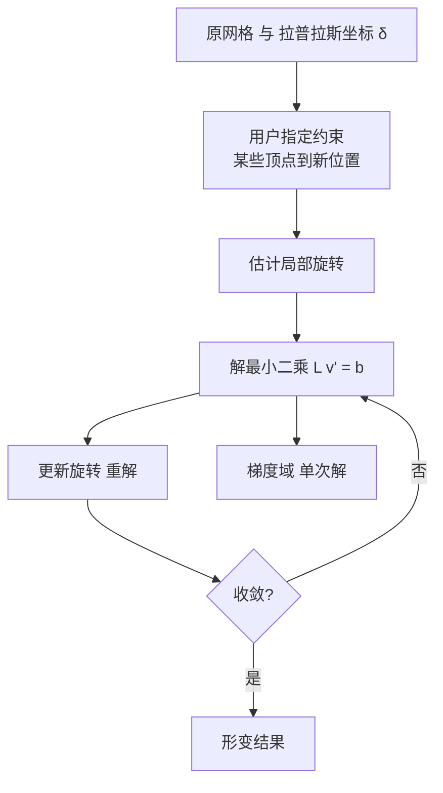

# 梯度域形变与 ARAP

- **难度**：高难 | **涉及章节**：第 6、7 章

## 一句话定义

梯度域形变：保留每个顶点的微分坐标（拉普拉斯坐标），只改少数控制点，再解 Poisson 方程重建全局位置；ARAP：要求每个三角形尽量只旋转不拉伸，用"局部算旋转、全局解位置"交替迭代。

## 为什么重要

它是"局部细节 vs 全局位置"这条分界线的典型运用，也是第 6 章的核心技术、第 7 章投影动力学的前身。学会它，很多网格处理问题都能自己写出能量。

## 图示



看图说明：上面那条循环是 ARAP（旋转与位置交替优化）；如果旋转固定一次不更新，就退化成梯度域的线性解。

## 详解

**拉普拉斯坐标**（难度：进阶）。δ_i = Δv_i 描述"i 比邻居平均高多少"，是局部形状的编码。关键洞察：

- **位置是全局的**：改一个点，所有点的位置都变；
- **δ 是局部的**：平移整个模型，δ 不变；旋转模型，δ 会跟着转（因为它是有方向的量）。

所以形变时"保留 δ"就等于"保留局部形状"。

**最小二乘形式**（难度：高难）：

```
min_{v'}  Σ_i | Δv'_i − T_i δ_i |² + λ Σ_{i∈C} | v'_i − p_i |²
```

T_i 是把原 δ 旋到新姿态的局部旋转（否则形状朝向不对）；第二项是用户约束（C 是受控顶点集，p_i 是目标位置）。对 v' 求导得到

```
(Lᵀ L + λ I_C) v' = Lᵀ (T δ) + λ p
```

L 是 Laplace 矩阵，稀疏，用 Cholesky 或共轭梯度求解。

**为什么是 Poisson**（难度：高难）。连续版本里，目标是求 f 使 ∇f ≈ u（u 是给定的目标梯度场）。但任意 u 未必是某个函数的梯度——它可能含旋转（无散）分量。Helmholtz-Hodge 分解说：

```
u = ∇ψ + ∇×ω + h
```

只有 ∇ψ 部分可积。求 f 使 ∇f 最接近 u，等价于先取旋度为零的部分，即解

```
∇²φ = ∇·u
```

这就解释了"梯度域"这个名字，也解释了为什么这个方法稳定：它把不可能满足的部分（旋转/调和分量）自动投影掉了。

**ARAP**（难度：高难）。能量写成逐三角形：

```
E = Σ_t Σ_{edges (i,j)} (w_ij/2) | (v'_i − v'_j) − R_t (v_i − v_j) |²
```

R_t 是每个三角形自己的最优旋转。求解：

- **局部步**：对每个三角形，把三条边向量作为 3×3 矩阵的列，求使 |E − R S| 最小的 R（Procrustes：SVD 得 R = V Uᵀ，修正 det）；
- **全局步**：固定所有 R_t，解稀疏线性系统求 v'（矩阵恒定，可预分解）。

能量单调下降，收敛到局部极小。

**与梯度域的关系**（难度：高难）。两者都是"局部-全局"，区别在局部量：梯度域用**顶点的一阶微分**（δ）并估计一个旋转；ARAP 用**边的差分**并对每个三角形精确求旋转。ARAP 更准（旋转是真实最优而非估计），代价是每步多一次逐三角形 SVD。

**数值例子（一维）**（难度：进阶）。4 个顶点在 0、1、2、3，δ = (1, 0, 0, −1)。固定首末为 0 和 2，内部 δ 保持 0：

```
2x2 − x1 − x3 = 0,  x1 = 0
2x3 − x2 − x4 = 0,  x4 = 2
→ x2 = 2/3, x3 = 4/3
```

位置均匀分布。若改用"保边长"（ARAP）目标，每条边都要求长度 1，总长 3 塞进长度 2 的区间是矛盾的，最小二乘解给出边长 2/3。**这个对比说明：梯度域保的是二阶结构（均匀性），ARAP 保的是一阶结构（边长）。**

## 常见误解

- **别以为"梯度域形变不会失真"**——实际上它只保局部微分，不保体积和全局尺度，大幅动作会让关节塌陷（需要内部体图或体积约束）。
- **别以为"ARAP 一定收敛到全局最优"**——实际上只保证能量单调下降，可能停在局部极小，结果依赖初值。
- **别以为"局部旋转可以随便估"**——实际上旋转估错，细节就会朝错误方向"翘起"，这正是梯度域不如 ARAP 稳的原因。
- **别以为"Helmholtz 分解只是理论"**——实际上它解释了"为什么直接对向量场积分会失败"，也指导了实现：必须先取散度再解 Poisson，而不是直接积分。

## 在书中出现的脉络

| 章节 | 语境 | 关键结论 |
|---|---|---|
| 6.2.1 | 梯度域 Poisson 编辑 | 解 L v = b，体图防塌陷 |
| 6.2.2 | 基于体图的梯度域 | 内外两层图约束体积与自交 |
| 6.3.1 | 非线性约束优化 | ARAP、骨架约束、体积约束 |
| 6.3.2 | 子空间求解 | 只在少数基上求 |
| 7.1.3 | 投影动力学 | 同一局部-全局结构用于物理 |

## 相关概念

- 前置：拉普拉斯坐标、最小二乘、SVD/Procrustes
- 后续：ARAP、子空间形变、投影动力学
- 对照：LBS（插值，无优化）、FFD（晶格控制）
