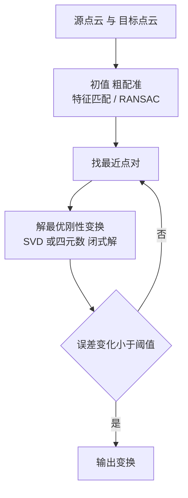

# 点云配准与 ICP

- **难度**：进阶 | **涉及章节**：第 2、9 章

## 一句话定义

求一个变换把两片点云对齐；ICP 的做法是"找最近点"和"解最优变换"交替迭代，直到误差不再下降。

## 为什么重要

扫描、机器人定位、多视角拼接、非刚性注册（人体/表情）都以配准为第一步。它是第 2 章整条重建流水线的入口，也是第 9 章机器人建图（配准 + 回环）的核心。

## 图示



看图说明：注意那条回到 C 的箭头——ICP 的本质是一个循环，误差单调下降但不保证到全局最小。

## 详解

**刚性配准的闭式解**（难度：进阶）。给定对应点对 {x_i} → {y_i}，目标是

```
min_{R,t} Σ |R x_i + t − y_i|²
```

分三步：

1. 求质心 x̄、ȳ，把两边都平移到原点；
2. 算协方差矩阵 H = Σ (x_i − x̄)(y_i − ȳ)ᵀ，做 SVD：H = U Σ Vᵀ，则 R = V Uᵀ（若 det R = −1，把 V 的最后一列取反再算）；
3. t = ȳ − R x̄。

这就是 Kabsch/Procrustes 方法，一步到位，不需要迭代。

**ICP 的两步**（难度：进阶）：

1. 用当前 R、t 变换源点云，为每个点在目标点云里搜最近邻，构成对应；
2. 用上面闭式解更新 R、t。

**为什么只收敛到局部最优**（难度：进阶）。第一步的"最近点"在小变换下是可靠对应，在错误变换下会配错。一旦配错，第二步就把变换拉向"迁就错误对应"的方向，于是进了一个自洽的错误状态。数学上，ICP 每步都减少目标函数（因为两步分别是最优的），所以它一定收敛；但目标函数关于变换是**非凸**的（对应关系随变换变化，目标函数在对应切换处不连续），所以有多个局部极小。

**改进方向**（难度：进阶）：

- **初值**：用特征（FPFH、SHOT）匹配 + RANSAC 找初值；或用 PCA 主轴对齐；或用上一帧的位姿（跟踪场景）。
- **度量**：点到点 → 点到面（用目标点法向，收敛快）；或用 Chen 的"法向交点"作为对应。
- **鲁棒核**：用 Huber/Tukey 核替代平方损失，抑制错误对应（扫描数据必然有局外点）。
- **采样**：不取所有点，取法向变化大的点（信息量高）。

**非刚性配准**（难度：高难）。三类典型：

1. **TPS（薄板样条）**：形变函数由"弯曲能量最小"约束，适合全局平滑的大形变；
2. **锚点约束 + 局部形变**：少量已知对应当锚点（硬约束），其余点由形变场拟合；
3. **拟刚体（ARAP 类）**：局部近似刚体，允许连接处拉伸，这是第 6 章 ARAP 的前身。

**数值例子**（可手算）。目标点云三点：(0,0)、(2,0)、(0,2)。源点云是它们绕原点转 30° 后的位置：(0,0)、(1.732,1)、(−1,1.732)。

- 已知对应时，闭式解直接给出 R = 30°、t = 0，残差 0。
- 若初值是 0°，第一步最近点匹配会把源点 (1.732, 1) 配到目标 (2, 0)（距离 ≈ 1.03，比配到 (0,2) 的 1.9 更近），解出的旋转约 24°；下一步旋转被拉到约 30°。整个过程单调下降。

这个例子说明：小角度偏差能被纠正，但如果源点云整体转了 150°，最近点匹配会把左右关系配反，ICP 就卡在错误解上。

## 常见误解

- **别以为"ICP 收敛就说明答案对"**——实际上它只保证误差不再下降，可能是局部极小。工程上必须做误差验证（比如用 Held-out 点算残差）。
- **别以为"点越多配得越准"**——实际上如果多出来的点是噪声或遮挡边缘，反而会拖坏结果。鲁棒核与采样策略比数量更重要。
- **别以为"非刚性配准就是 ICP 加个形变项"**——实际上形变项必须带正则（否则所有点都能被单独拉过去，变成"每个点一个答案"），TPS/ARAP 都是在提供这种正则。
- **别以为"配准和重建是两件事"**——实际上多视角拼接里，配准误差会直接累积成重建误差；做全局一致的配准（同时优化所有位姿）比两两配准再串起来稳得多。

## 在书中出现的脉络

| 章节 | 语境 | 关键结论 |
|---|---|---|
| 2.1.1 | 刚性配准 | 采样一致性 + ICP |
| 2.1.2 | 非刚性配准 | TPS、锚点约束、拟刚体 |
| 9.3.1 | 机器人扫描 | 位姿配准 + 回环 |
| 6.1 | 蒙皮/骨骼学习 | 同类"对应—求解"结构 |

## 相关概念

- 前置：SVD、旋转矩阵、最近邻搜索
- 后续：非刚性配准、ARAP、回环优化
- 对照：形状描述子匹配（无初值的粗配准）
