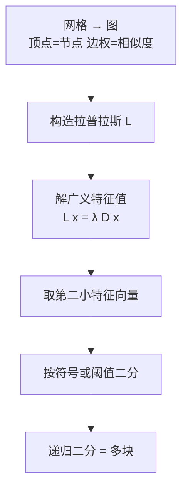

# 网格分割与归一化割

- **难度**：高难 | **涉及章节**：第 5 章

## 一句话定义

把网格切成若干块；归一化割（Ncut）用"切口尽量小 + 每块不能太小"的比值目标代替"切口最小"，其松弛解是一个广义特征值问题。

## 为什么重要

分割是语义分析的第一步。Ncut 的意义超出分割本身：它展示了"约束怎么进目标函数"——如果把"块不能太小"写成硬约束，问题会变组合；写成归一化分母，问题就变成可解的谱问题。

## 图示



看图说明：核心是"把分割变成谱问题"；第二小特征向量（Fiedler 向量）给出最优切分方向。

## 详解

**图的构造**（难度：进阶）。顶点是节点，边权 w_ij 表示"i 与 j 应该在同一块"的程度。常用 w_ij = exp(−d(i,j)²/σ²)，或者结合曲率相似度。切分代价是跨块的边权和：

```
cut(A, B) = Σ_{i∈A, j∈B} w_ij
```

**为什么不能只最小化切口**（难度：进阶）。考虑走廊：切下末端 1 个点，切口是 1；从中间切成两半，切口也是 1。两者 cut 相同，但前者语义荒谬。归一化把"块的大小"纳入分母：

```
Ncut(A, B) = cut(A, B)/assoc(A, V) + cut(B, A)/assoc(B, V)
```

assoc(A, V) 是 A 与全图的连接总量（约等于 A 的"体积"）。于是切下 1 个点得 1/1 + 1/99 ≈ 1.01，从中间切得 1/50 + 1/50 = 0.04。**前者被惩罚。**

**谱解**（难度：高难）。把 Ncut 写成矩阵形式，最小化它等价于求

```
(D − W) x = λ D x
```

的第二小特征值对应的特征向量（D 是度矩阵，W 是权重矩阵）。这个向量在每个顶点给一个实数，按符号（或按 0 阈值）二分就得到切分。递归二分就得到多块。

**其他分割方法**（难度：进阶）：

- **区域增长/分水岭**：靠曲率极值线当边界，快但不稳；
- **聚类**：按曲率特征 k 均值，简单但不保证连通；
- **随机游走**：解 Laplace 方程，等价于"从每个点出发先碰到哪个标记"；
- **交互式**：用户刷几笔当硬约束，其余由优化补齐；
- **协同分割**：多个模型联合优化，使对应部位切法一致。

**数值例子**（可手算，1D）。一条 4 个顶点的链，边权都为 1。度矩阵 D = diag(1, 2, 2, 1)，W 是相邻为 1 的矩阵。L = D − W 的第二小特征向量（Fiedler 向量）在该链上近似线性变化（约为 (−0.5, −0.5, +0.5, +0.5) 的形态），按 0 切正好从中间分开——与"直觉最优切法"一致。这个例子说明谱方法不是玄学，它确实给"最均衡的切法"。

## 常见误解

- **别以为"Ncut 只是加了个分母"**——实际上这个分母让问题从组合优化变成谱问题，是"可解"的关键。
- **别以为"分割越碎越准"**——实际上过分割是常态，工程上要再加合并（按相似度与语义似然）。
- **别以为"谱方法一定给连通块"**——实际上特征向量的符号区域可能不连通，需要后处理（连通化）。
- **别以为"分割和识别可以分开做"**——实际上两者互相依赖（第 9 章），联合求解更稳。

## 在书中出现的脉络

| 章节 | 语境 | 关键结论 |
|---|---|---|
| 5.3.1 | 全自动分割 | 区域增长、聚类、Ncut、随机游走 |
| 5.3.2 | 交互式分割 | 笔刷约束 + 优化 |
| 5.3.3 | 协同分割 | 联合特征/联合图割 |
| 9.3.2 | 场景理解 | 分割 + 识别联合 |

## 相关概念

- 前置：图、拉普拉斯矩阵、特征值
- 后续：协同分割、语义标注
- 对照：分水岭（几何驱动）、Ncut（谱驱动）
