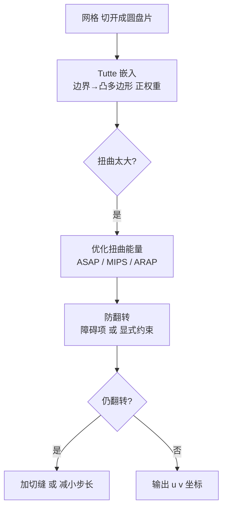

# 参数化：调和、共形与防翻转

- **难度**：高难 | **涉及章节**：第 3、4 章

## 一句话定义

给曲面上每个顶点一个平面坐标 (u, v)，要求这个映射是一一对应（不重叠、不撕裂、不翻转）；做法是解一个带约束的优化，从 Tutte 嵌入起步，再优化扭曲能量。

## 为什么重要

纹理贴图、曲面拟合、四边形化（第 4 章的全局参数化法）都以它为前提。它还是"最小二乘 + 局部-全局迭代"这套方法在二维的样板，第 6 章 ARAP 就是它的三维版本。

## 图示



看图说明：Tutte 只保证"不翻"，不保证"不扭"；后面所有工作都是在"减少扭曲但保持不翻"之间走钢丝。

## 详解

**调和参数化**（难度：进阶）。要求内部顶点满足 Δu = 0、Δv = 0（离散下就是"坐标等于邻居加权平均"）。写成方程组：

```
Σ_j w_ij (u_j − u_i) = 0,   w_ij = cot α_ij + cot β_ij
```

边界坐标固定，于是内部坐标是唯一解。**Tutte 定理**保证：边界凸 + 权重全正 → 映射是双射。注意余切权重可能为负（钝角），所以严格按 Tutte 用时得换成正权重（均匀权重或重心权重），代价是扭曲更大。

**扭曲从哪来**（难度：高难）。摊平必然扭曲，两类：

- **角度扭曲（共形）**：三角形被"剪歪"但面积按比例缩放；
- **面积扭曲**：角度保持但大小被改变。

数学上，映射的 Jacobian J 的奇异值 σ1、σ2 描述一切：σ1 = σ2 表示共形（相似变换），σ1 σ2 = 1 表示保面积，两者都满足就是等距（只有可展面能做到）。所以扭曲能量都是在惩罚"σ1 与 σ2 的差异"或"σ1 σ2 偏离 1"。

**ASAP**（难度：高难）。能量 E = Σ_t A_t |J_t − Z_t|²，其中 Z_t 是"与 J_t 最接近的相似变换"（把 J 做 SVD 后取 σ̄ = (σ1+σ2)/2 重构）。求解交替：

- 固定 Z，对顶点坐标解最小二乘（稀疏系统）；
- 固定坐标，对每个三角形重算 Z（SVD，逐三角形独立）。

**MIPS**（难度：高难）。能量用 σ1/σ2（比值），比值趋于 ∞ 表示三角形退化。它的杀手级优点是：**翻转时有向面积为负，能量趋于无穷**，所以优化永远不会跨过翻转状态（自带防翻转）。代价是收敛慢、需要好的初值。

**显式防翻转**（难度：高难）。把"每个三角形有向面积 > 0"当不等式约束，用内点法或障碍函数（如 log det）处理。好处是能配合任意能量；坏处是非凸、容易卡在局部解，且靠近边界时步长极小。

**多片与切缝**（难度：进阶）。复杂拓扑必须先切成圆盘。切缝选择的原则：沿曲率大的脊线切（切口藏在视觉不敏感处）、切缝总长度尽量短、避免穿过特征。

**渐进参数化**（难度：高难）。从 Tutte 起步时扭曲可能极大，而能量非凸。做法是构造一串"中间参考三角形"，使"当前结果与参考之间"的扭曲有界、参考逐步靠近原网格——把一个大跳跃拆成很多小步，避免一开始就陷在坏解里。

**数值例子**（可手算）。正方形网格，4 个角固定为 (0,0)、(1,0)、(1,1)、(0,1)，内部只有一个中心顶点，与四角相连，权重都取 1。中心顶点方程：

```
4 u_c − (0 + 1 + 1 + 0) = 0  →  u_c = 0.5
4 v_c − (0 + 0 + 1 + 1) = 0  →  v_c = 0.5
```

中心落在正中。若把某个角的权重加大（模拟该处三角形更"尖"，余切更大），中心会被拉向那个角。这就是"参数化结果依赖权重、权重依赖三角形状"的最小例子。

## 常见误解

- **别以为"参数化就是投影"**——实际上投影在有回折的曲面上会重叠，不是双射；参数化必须解全局方程。
- **别以为"Tutte 一定不翻转"**——实际上定理要求正权重 + 凸边界，余切权重在钝角处为负时会翻。
- **别以为"保角和保面积能同时最优"**——实际上只有可展面能等距，一般曲面必须取舍。
- **别以为"扭曲能量是凸的，所以一定能求全局最优"**——实际上含奇异值/比值的能量非凸，工程解法都依赖好的初值与渐进策略。

## 在书中出现的脉络

| 章节 | 语境 | 关键结论 |
|---|---|---|
| 3.1.1 | 单/多片参数化 | Tutte 起步、切缝 |
| 3.1.2 | 局部防翻转 | 障碍函数、显式约束 |
| 3.1.3—3.1.4 | 局部到整体、渐进 | 分片缝合、渐进参考 |
| 4.2 | 四边形化 | 全局参数化 + 整数格点 |

## 相关概念

- 前置：离散 Laplace、SVD、Tutte 定理
- 后续：四边形化、纹理映射、ARAP
- 对照：调和（角度偏保）、LSCM（共形）、ARAP（局部刚体）
