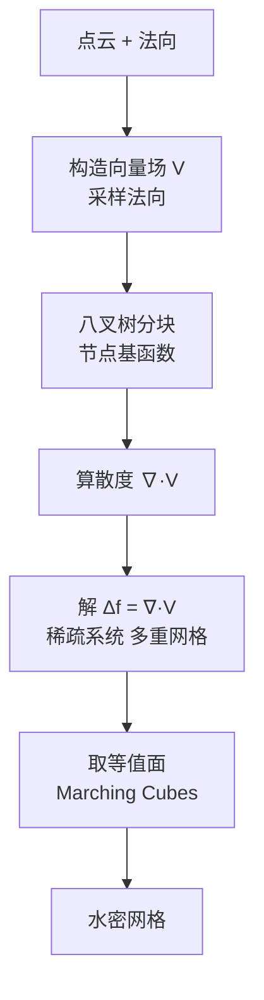

# Poisson 曲面重建

- **难度**：高难 | **涉及章节**：第 2 章

## 一句话定义

把"曲面在哪"变成"求一个指示函数 f，使它的梯度尽量等于采样法向场"，解出来就是 Poisson 方程 Δf = ∇·V，再挖它的等值面。

## 为什么重要

它是工程上最稳的隐式重建方法：对噪声容忍度高、全局一致、能处理不均匀采样，是扫描数据重建的常用默认选择。它同时是"梯度域"思想在重建上的第一次出现，与第 6 章的形变、第 7 章的模拟共用同一套数学。

## 图示



看图说明：整条链路的关键是"不直接拟合距离，而拟合梯度"。梯度对常数偏移不敏感，所以不需要知道精确距离。

## 详解

**为什么拟合梯度**（难度：高难）。如果 f 是"内部 1、外部 0"的指示函数，那么 ∇f 在曲面处是指向内法向的脉冲，在别处为 0。反过来，已知法向场 V，要解

```
min_f  ʃ |∇f − V|²
```

正规方程（变分）就是 Δf = ∇·V。这有两个好处：

1. **不需要符号距离**：SDF 要求"知道离曲面多远"，这个量在噪声数据里很难估；梯度没有这个问题。
2. **全局一致**：所有采样点共同决定一个 f，噪声被平均，不会局部乱跳。

**离散实现**（难度：高难）。关键是选基函数。Octree 每层用"盒式滤波的 m 次卷积"（即 B-样条基的近似），得到一个局部支撑、平滑的节点函数。于是：

- 每个采样点只影响它所在叶子节点及邻域（稀疏）；
- 散度向量稀疏，系统稀疏；
- 层次结构天然支持**多重网格**（粗层解完给细层当初值），解几百万未知量也可行。

**筛选 Poisson**（难度：高难）。原版 Poisson 有一个偏差：它不是插值，而是最小二乘拟合梯度，所以曲面会偏离采样点（整体"胀"或"缩"）。Screened Poisson 加一项"f 在采样点处要等于 0.5（或其他等值）"：

```
min_f  ʃ |∇f − V|² + λ Σ_i (f(p_i) − c)²
```

这一项把细节拉回来，λ 小则平滑、大则贴合。这是工程上最常用的版本。

**数值例子**（一维，可手算）。设采样法向场在一维上为：内部区间的梯度为 +1（从 0 到 L），两端之外为 0。则散度 ∇·V 是两个脉冲（在 0 处 −1、在 L 处 +1）。解 Δf = ∇·V 得 f 是一个"梯形"：0 到 L 线性上升，两端平坦。取 f = 0.5 的等值点，正好落在 0 和 L——即曲面的位置。这个一维例子把"梯度积分回位置"讲清楚了。

**局限**（难度：进阶）：

- 会平滑掉小于最细八叉树层的细节（薄壁、细杆容易被糊掉）；
- 对法向质量高度敏感（法向错了，梯度就错了）；
- 非封闭、有遮挡的扫描会补出"假面"（因为 f 在缺口处没有约束，解会自己延伸）。

## 常见误解

- **别以为"Poisson 是最先进的重建，所以都该用它"**——实际上它牺牲细节换稳定；要求拓扑精确、特征尖锐时，Cocone 或"稀疏选择重建"（第 8 章）更合适。
- **别以为"解 Poisson 一定要全局稠密矩阵"**——实际上八叉树基函数让它稀疏，配合多重网格可以处理千万级点云。
- **别以为"结果一定是水密的"**——实际上只有采样覆盖完整才水密；有洞时 Marching Cubes 会在无约束区域自己补面，这既是优点（得到封闭体）也是缺点（补错）。

## 在书中出现的脉络

| 章节 | 语境 | 关键结论 |
|---|---|---|
| 2.3.3 | 隐式重建 | 八叉树基函数 + 多重网格 |
| 2.4 | 与光顺的关系 | 重建后再光顺，顺序不能反 |
| 6.2 | 梯度域形变 | 同一数学：∇f = V 的最小二乘 |
| 7.1 | Projective Dynamics | ∇²u = Gᵀ∇g 的同类结构 |

## 相关概念

- 前置：散度、Laplace 算子、稀疏线性系统
- 后续：筛选 Poisson、Marching Cubes
- 对照：RBF（稠密、插值）、SDF+MLS（局部的）
