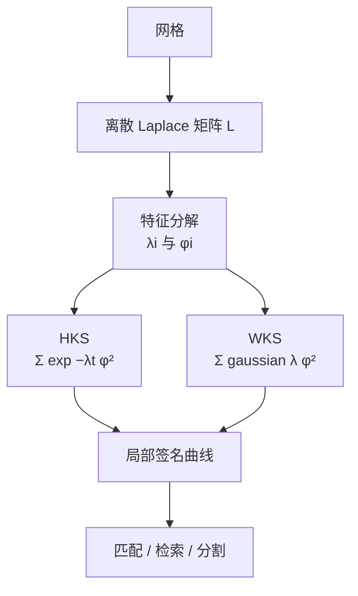

# 形状描述子与谱签名（HKS / WKS）

- **难度**：高难 | **涉及章节**：第 5、8 章

## 一句话定义

把形状（或形状的局部）压成一个向量/曲线，让"像不像"可计算；谱签名是用 Laplace 算子的特征值/特征向量构造的、与坐标无关的局部签名。

## 为什么重要

检索、对应、分类、配准的粗筛全都依赖它。HKS 的"等距不变"是几何处理里最漂亮的性质之一：它让人体的不同姿势仍能对应上同一部位。

## 图示



看图说明：同一个特征分解，换一种"对特征值的加权方式"就得到不同签名（热的核 vs 波的核）。

## 详解

**HKS 的定义与含义**（难度：高难）：

```
HKS(x, t) = Σ_i exp(−λ_i t) φ_i(x)²
```

它等于"在 x 放一滴单位热量，t 时刻在 x 处剩余的热量"（热核的对角元）。两点性质：

- **等距不变**：热扩散只依赖内在度量（沿曲面距离），弯曲纸面不改变它；
- **多尺度**：t 小看局部（近似与曲率有关），t 大看全局（趋于常数）。

**WKS**（难度：高难）。把 exp 换成对 log 特征值的 Gaussian 窗（g(λ)）= exp(−(log λ − log λ_c)²/(2σ²)），相当于"在某个频段上做滤波"。好处是对尺度差异更稳、且能量集中在指定频段。

**球面的可算例子**（难度：进阶）。单位球面：λ_l = l(l+1)，重数 2l+1，φ 均匀 → φ_i(x)² 平均为 1/(4π)。于是

```
HKS(t) = Σ_l (2l+1)/(4π) exp(−l(l+1)t)
```

t=1 时：l=0 项 0.0796、l=1 项 0.0323、l=2 项 0.001、更高阶可忽略，合计约 0.113。t=10 时只剩 0.0796（几乎为常数）。**这说明"单一 t 值没有信息，必须用一条曲线"。**

**其他描述子**（难度：进阶）：

- **D2**：随机采样点对的距离分布。对旋转不敏感，但丢空间信息；
- **球谐**：把形状展开到球面频率基；要求先球参数化；
- **Spin Image**：以法向为轴的圆柱坐标投影直方图，对法向误差敏感；
- **学习型**：把上述人工特征输入小网络，学出更判别性的向量（第 5 章 EdgeNet、第 8 章 PointNet）。

## 常见误解

- **别以为"HKS 旋转不变就万能"**——实际上是等距不变，分不开镜像（左右手），也分不开"凸起"与"凹陷"。
- **别以为"描述子维度越高越好"**——实际上高维特征在数据少时更容易过拟合、对噪声更敏感；粗筛阶段低维反而稳。
- **别以为"谱签名计算很贵，不实用"**——实际上只需算前几十个特征对（稀疏矩阵的部分特征分解），几千顶点的模型在秒级完成。
- **别以为"D2 无用"**——实际上它在"没有对应、没有参数化"的粗筛阶段非常可靠，是级联检索的第一层。

## 在书中出现的脉络

| 章节 | 语境 | 关键结论 |
|---|---|---|
| 5.1.1 | 全局描述子 | D2、球谐、光场 |
| 5.1.2 | 局部描述子 | Spin Image、HKS、WKS |
| 5.2 | 学习型描述子 | 人工特征 + 网络 |
| 5.4 | 检索 | 多描述子融合 |
| 8.4 | 深度几何 | 端到端学习替代手工 |

## 相关概念

- 前置：Laplace 特征值、热扩散、球面调和
- 后续：匹配、分割、协同分割
- 对照：D2（统计）、Spin Image（局部几何）、PointNet（学习）
