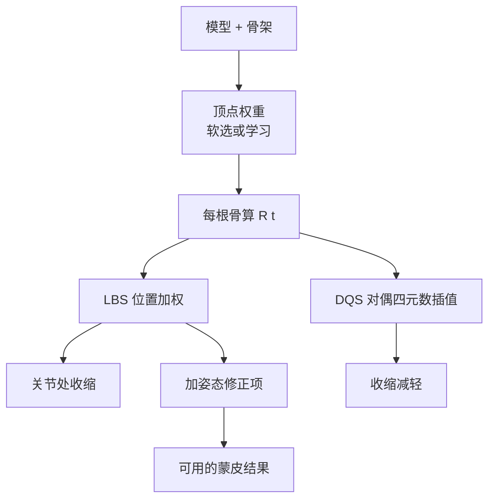

# 蒙皮：LBS、DQS 与骨骼学习

- **难度**：进阶 | **涉及章节**：第 6 章

## 一句话定义

把表面顶点绑定到若干根骨头上（权重），骨头一动、顶点按权重混合各家变换跟过去；LBS 是"位置加权平均"，DQS 是"旋转加权平均"。

## 为什么重要

它是动画工业的默认方案，也是"插值重构"这一类形变的代表。理解 LBS 的结构性缺陷（糖纸收缩），才能理解为什么第 6 章后面要搞梯度域和 ARAP。

## 图示



看图说明：LBS 的缺陷是原理性的，修法要么换成"旋转插值"，要么叠一个学出来的修正项。

## 详解

**LBS 公式**（难度：进阶）：

```
v' = Σ_j w_ij (R_j v + t_j),   Σ_j w_ij = 1
```

**糖纸收缩的可算例子**（难度：进阶）。设一个顶点距肘关节 r = 1，权重 0.5/0.5。前臂骨绕关节转 90°：

- 在前臂骨坐标系下：位置 P1 = R(90°)v，到关节距离仍为 1；
- 在上臂骨坐标系下：位置 P0 = v，到关节距离 1；
- LBS 结果 (P0 + P1)/2，到关节距离 = |P0 + P1|/2 = √(1² + 1²)/2 = 0.707。

**关节处长度缩为 0.707 倍**，看起来像糖纸被拧紧。这就是 candy-wrapper 效应。权重越接近 0.5/0.5、旋转角越大，收缩越严重（可以验证：转 180° 时新位置到关节距离为 0——完全塌到关节）。

**DQS**（难度：高难）。把每根骨的变换表示成对偶四元数（旋转 + 平移），对这些四元数做**归一化的线性插值**（可以先平均再归一化），再作用到顶点。它插值的是"运动"而不是"位置"，因此糖纸现象大幅减轻。代价是可能出现"凸起"（bulge），以及对非刚性变换表达力有限。

**骨骼学习**（难度：高难）。手工绑骨很贵，于是从动画序列里自动学：

1. 用均值漂移（mean shift）把顶点按运动轨迹聚类，每个簇当一根"骨头"；
2. 每簇的仿射变换用最小二乘从顶点运动里拟合；
3. 拟合出的 3×3 矩阵不一定是旋转（可能含缩放/剪切），要**投影回 SO(3)**（用 SVD：R = U Vᵀ）才符合骨骼语义；
4. 平移部分用最小二乘求。

书里 6.1 节用的就是这套（聚类半径 h 控制骨骼数量，h 越大骨骼越少、精度越低）。

**权重与修正**（难度：进阶）。工业实践里还有两层：

- **权重平滑**：让权重在网格上平滑过渡，避免关节处出现硬折；
- **姿态修正（pose space deformation）**：为每个关节姿态学一个"修正位移"，把被压扁的部分撑回来。这相当于"用数据修补 LBS 的物理错误"。

## 常见误解

- **别以为"LBS 精度差只是权重没调好"**——实际上位置平均 ≠ 旋转平均，这是数学结构问题，任何权重都无法完全消除。
- **别以为"DQS 完全解决了收缩"**——实际上它换成"凸起"问题，且对大幅非刚性形变仍不理想。
- **别以为"骨骼越多越好"**——实际上骨骼多意味着权重更局部、更硬，关节过渡反而更生硬，且计算与美术成本上升。
- **别以为"学出来的骨骼一定有物理意义"**——实际上它只是运动模式的聚类，可能与真实解剖结构不对应（这对动画可用、对医学仿真不可用）。

## 在书中出现的脉络

| 章节 | 语境 | 关键结论 |
|---|---|---|
| 6.1.1 | 蒙皮技术 | LBS、权重、骨骼学习 |
| 6.1.2 | 自由形变 | FFD 作为对照 |
| 6.3 | 形变能量 | ARAP 修 LBS 的细节丢失 |
| 8.2.6 | 混合蒙皮 | 用字典学习降低权重矩阵秩 |

## 相关概念

- 前置：旋转矩阵、四元数、最小二乘
- 后续：ARAP、姿态修正、材质优化
- 对照：FFD（晶格驱动）、梯度域（保微分）
