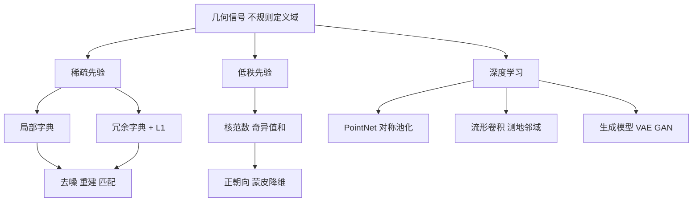

# 稀疏、低秩与深度几何学习

- **难度**：进阶 | **涉及章节**：第 8 章

## 一句话定义

用"少数原子线性组合"（稀疏）或"信息高度重复"（低秩）作为先验，把几何问题写成可解的优化；深度学习则把手写先验换成从数据里学的先验。

## 为什么重要

它是"数据驱动"这一路的总纲：第 5 章的学习型描述子、第 8 章的去噪/重建/配准/生成都落在这里。理解 L1 与低秩的几何直觉，就能判断一个论文里的能量到底在约束什么。

## 图示

看图说明：上半是"数学先验"（无需训练），下半是"数据先验"（需要训练）。两者在任务上重叠，但保证不同。

## 详解

**L1 为什么稀疏**（难度：高难）。凸优化的几何直觉：数据项 |y − Dx|² ≤ ε 是一个椭圆，L1 惩罚 λ|x|₁ 的等值线是菱形。椭圆与菱形相切的位置多半在菱形的尖角（坐标轴上）→ 某分量为 0。L2 的等值线是圆，切点一般不在坐标轴上 → 只缩小不归零。

**一维手算**（难度：进阶）。y = 1、D = 1、λ = 2：L2 解 x = 1/(1+λ/2) = 0.5（非零）；L1 解 x = max(1 − λ/2, 0) = 0（**被阈值化到零**）。这就是"软阈值"的来历。

**低秩正朝向**（难度：高难）。观察：人造模型沿坐标轴有对称性，摆正时它在三个坐标平面上的投影矩阵行与行高度相似 → 秩低。于是求"使三个投影矩阵秩之和最小"的旋转。秩的凸替代是核范数（奇异值之和）。这是一个**完全无监督**的方法，不需要训练数据。

**压缩感知**（难度：高难）。若信号在基下稀疏，则用远少于维数的测量也能唯一恢复（把无穷多解压成唯一解）。几何里用它做"从少量采样恢复细节"。

**几何信号的特殊困难**（难度：进阶）。图像有局部紧支撑的正交基（小波），几何没有：Laplace 特征向量是全局支撑的，无法表示局部细节。所以要么用局部字典，要么用冗余字典 + L1 选择，要么让网络自己学基。

**深度几何的四种姿势**（难度：进阶）：

1. **假图像 CNN**：给每个三角形算 600 维特征、重排成 30×20 矩阵，套 CNN。书里明确指出"排列顺序与矩阵形状影响结果"——它并不真正尊重拓扑。
2. **PointNet**：逐点 MLP + 全局最大池化。顺序无关来自最大池化的对称性；旋转靠 T-Net 学一个变换矩阵（只是近似抵消）。
3. **流形卷积**：按测地距离定义邻域，在切平面上按极坐标 (角度, 半径) 分箱聚合。难点是局部坐标系对齐。
4. **生成/递归模型**：VAE/GAN 学形状分布、RNN 做非刚性配准。可控性差（难保证不自交/不翻转）。

## 常见误解

- **别以为"L1 总比 L2 好"**——实际上 L1 在有相关特征时随机挑一个、丢弃另一个，不稳定；L2 解唯一、稳定。
- **别以为"把三角形特征排成矩阵就是尊重拓扑"**——实际上排列与邻接无关，换顺序结果就变。
- **别以为"PointNet 天然旋转不变"**——实际上它只保证顺序不变，旋转靠学出来的变换层近似抵消。
- **别以为"生成模型能替代物理模拟"**——实际上它不保证力平衡、体积守恒、不自交；硬约束任务仍要靠优化。
- **别以为"深度学习不需要几何算子"**——实际上成功模型的输入几乎都是曲率、法向、测地距离、Laplace 特征这些算子算出来的量。

## 在书中出现的脉络

| 章节 | 语境 | 关键结论 |
|---|---|---|
| 8.1 | 压缩感知与稀疏学习 | 稀疏编码、字典、L1、低秩 |
| 8.2 | 几何处理应用 | 去噪、重建、匹配、蒙皮、正朝向 |
| 8.3 | 机器学习基础 | MLP、CNN、损失与训练 |
| 8.4 | 深度几何 | 假图像 CNN、PointNet、流形卷积、生成模型 |

## 相关概念

- 前置：线性代数、概率、凸优化
- 后续：数据驱动重建、端到端配准
- 对照：手工能量（可解释、可保证）vs 学习先验（表达力强、可控性弱）
