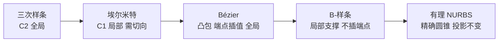

# 样条家族：从三次样条到 NURBS

- **难度**：进阶 | **涉及章节**：第 1、3 章

## 一句话定义

用多段低次多项式拼出光滑曲线的一套约定：连续阶、局部性、能否精确表示圆锥曲线，是三种样条（三次样条、Bézier/B-样条、有理样条）互相区别的三条坐标轴。

## 为什么重要

CAD 工业的标准表示是 NURBS，第 1 章把它作为"参数曲面"的代表；第 3 章的参数化（把网格摊开）在数学上是同一类"参数映射"，理解样条就理解了"参数域 → 空间"这个映射的基本性质（连续性、局部性、凸包性）。

## 图示



看图说明：沿这条链看，每一步都在解决上一步的一个缺陷（不局部 → 局部；不插端点 → 可控；不能精确画圆 → 有理化）。

## 详解

**三次样条**（难度：进阶）。n+1 个控制点、n 段三次多项式，要求接缝处函数值、一阶、二阶导连续。未知数 4n，方程 2n（插值）+ 2(n−1)（接缝）= 4n−2，缺 2 个，用边界条件（自然边界：首末二阶导为 0）补齐。解一个三对角线性系统，O(n)。

优点：C² 光滑、插值所有控制点。
缺点：**全局耦合**，改一点要全部重算；且三次多项式在控制点之间可能产生不期望的振荡（虽然比高次多项式好得多）。

**埃尔米特样条**（难度：进阶）。给每点位置 + 切向，段内用四个基函数插值：

```
p(u) = p_k h00(u) + p_{k+1} h01(u) + d_k h10(u) + d_{k+1} h11(u)
h00 = 2u³ − 3u² + 1, h01 = −2u³ + 3u²
h10 = u³ − 2u² + u,  h11 = u³ − u²
```

完全局部（每段只依赖自己两端的数据）。检查一下基函数：u=0 时 h00=1、h10=0、h01=0、h11=0，所以 p(0)=p_k；对 u 求导在 u=0 时 h00'=0、h10'=1，所以 p'(0)=d_k。这就是"插值位置和切向"的含义。缺点是用户很难直接给出切向。

**Bézier**（难度：进阶）。p(u) = Σ p_k B_{k,m}(u)，B 是 Bernstein 多项式。三条性质必须记住：

- **端点插值**：u=0 得 p_0，u=1 得 p_m；
- **凸包性**：所有 B 非负且和为 1，所以曲线落在控制点凸包内（这保证不会乱跑，CAD 里非常重要）；
- **变差缩减**：曲线与任意直线的交点个数不超过控制多边形的交点个数（不会比控制多边形更"波动"）。

数值上用 de Casteljau（反复取分点）而不是直接算幂，因为它数值稳定。

**B-样条**（难度：进阶）。把 Bernstein 基换成"局部支撑"的基函数（用节点向量定义），于是改变一个控制点只影响局部几段；代价是曲线不插端点（除非用重节点技巧）。B-样条是"分段多项式空间"的标准基，阶数 k 时连续性为 C^{k−2}。

**NURBS**（难度：高难）。p(u) = Σ w_k p_k B_k(u) / Σ w_k B_k(u)。两个决定性优势：

1. **精确表示圆锥曲线**：圆的有理表示是标准的（用权重 (1, √2/2, 1) 的三点二次有理 Bézier 可以精确画出 90° 圆弧）。这是多项式样条做不到的——多项式只能逼近圆，误差不可能为零。
2. **投影不变**：有理形式在透视投影下仍然是有理形式，所以 CAD 里"透视视图与模型一致性"能得到保证。

工业标准 IGES/STEP 都用 NURBS，原因就在这里。

## 常见误解

- **别以为"样条次数越高越光滑越好"**——实际上次数越高越容易振荡（龙格现象），工程上三次是最常用的折中。
- **别以为"Bézier 曲线穿过所有控制点"**——实际上只穿过首末两点，中间点是"吸引"而非"插值"，这正是它易于交互设计的原因。
- **别以为"B-样条是 Bézier 的简单推广，性质一样"**——实际上 B-样条牺牲了端点插值和凸包性的一部分（凸包变成局部凸包），换来了局部性。
- **别以为"有理样条只是加了权重，没什么本质区别"**——实际上"有理"意味着它属于有理函数空间而非多项式空间，这正是它能精确表示圆、并在投影下封闭的根本原因。

## 在书中出现的脉络

| 章节 | 语境 | 关键结论 |
|---|---|---|
| 1.2.1 | 三次样条 | C² 连续，全局耦合 |
| 1.2.2 | Bézier | 凸包性、de Casteljau |
| 1.2.3 | B-样条 | 局部支撑 |
| 1.2.4 | 有理样条 | 精确圆锥、投影不变 |
| 3.1 | 参数化 | 同属"参数域→空间"的映射 |

## 相关概念

- 前置：多项式、导数、凸包
- 后续：参数曲面、NURBS 曲面、网格参数化
- 对照：多边形网格（离散、任意拓扑）vs 样条（连续、受拓扑限制）
