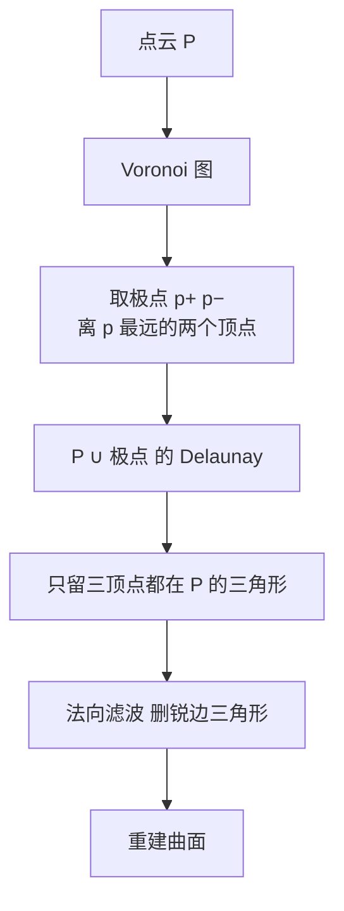

# Voronoi / Delaunay 与 Crust 系列重建

- **难度**：高难 | **涉及章节**：第 1、2 章

## 一句话定义

用"每个点的最近邻地盘"（Voronoi）和它的对偶三角剖分（Delaunay），从点云里挑出真正属于曲面的三角形；Crust/Power Crust/Cocone 是这条路线上的三代算法。

## 为什么重要

它是唯一能给"理论保证"的显式重建路线：采样足够密、噪声足够小时，输出与真实曲面同胚。理解它，就理解了"为什么显式方法怕噪声"这个结论的来历。

## 图示

看图说明：核心动作是"用极点把中轴附近的边挤走"，剩下的边就贴着表面；法向滤波是最后的清理。

## 详解

**Delaunay 的四条性质**（难度：进阶）：

1. 二维下唯一（无四点共圆时）；
2. 三角剖分的外边界是点集的凸包；
3. 每个三角形的外接圆内不含采样点（空圆性质）；
4. 最小角最大化（最接近正三角形）。

性质 4 是它在网格生成里不可替代的原因；性质 3 是 Crust 类算法能"筛边"的依据。

**Crust 的直觉**（难度：高难）。把 Voronoi 顶点加入采样集后重算 Delaunay：Voronoi 顶点位于中轴（到两个采样点等距的地方），它们"抢走"了那些穿过物体内部的边，于是剩下的边集中在表面附近。二维时这个论证是严格的（Amenta 等 1998）。

**三维要加极点**（难度：高难）。三维 Voronoi 单元形状复杂，靠全部 Voronoi 顶点不可靠。所以只取每个点的两个**极点**：Voronoi 单元里离 p 最远的两个顶点，它们通常分居表面两侧（一个在外、一个在内）。极点向量 (p⁺ − p) 近似垂直于表面——这就是能用它做**法向滤波**的原因：与极点方向差太多的三角形，说明它斜穿表面，丢掉。

**Power Crust / Cocone**（难度：高难）：

- **Power Crust** 用带权 Voronoi（Power 图）处理**采样密度不均**：给每个点一个权重（半径），边界处的稀疏采样不会把曲面"拉歪"。
- **Cocone** 用**锥形条件**：三角形的对偶 Voronoi 边必须落在以极点方向为轴、半角约 (π/2 − 采样角) 的锥内。这个条件直接保证"输出是流形、法向收敛"，是三代里理论最漂亮的。

**代价**（难度：进阶）。三维 Delaunay 三角化的复杂度高（最坏 O(n²)，实际 O(n log n)—O(n^{4/3})），实现复杂（需要精确谓词处理退化情形）。而且对噪声敏感：噪声改变点位置 → 改变 Delaunay 结构 → 筛出的三角形错位。所以工程上"高噪声数据"通常直接跳过这条路线，用 Poisson（见另一篇概念页）。

## 常见误解

- **别以为"点越密越好"**——实际上理论保证要求"局部特征尺度上的采样密度"，薄壁两侧的点如果混在一起，Delaunay 会把两壁连成一片。
- **别以为"Crust 不需要法向"**——实际上三维 Crust 一定要法向滤波，否则输出不是流形、会出现"纸片"。
- **别以为"理论保证就意味着工程可用"**——实际上保证的前提（无噪声、无缺失、采样密度足够）在真实扫描里几乎不成立，所以显式方法主要用于"高质量点云"或"理论分析"。

## 在书中出现的脉络

| 章节 | 语境 | 关键结论 |
|---|---|---|
| 1.4.2 | 计算几何基础 | Voronoi/Delaunay 定义与性质 |
| 2.2.1—2.2.4 | 显式重建 | Crust/Power Crust/Cocone |
| 2.3 | 与隐式方法对比 | 干净数据用显式，脏数据用隐式 |

## 相关概念

- 前置：Voronoi、Delaunay、中轴
- 后续：Poisson 重建（隐式路线）、重网格化（Delaunay 撒点）
- 对照：RBF/Poisson（隐式，不怕噪声）
