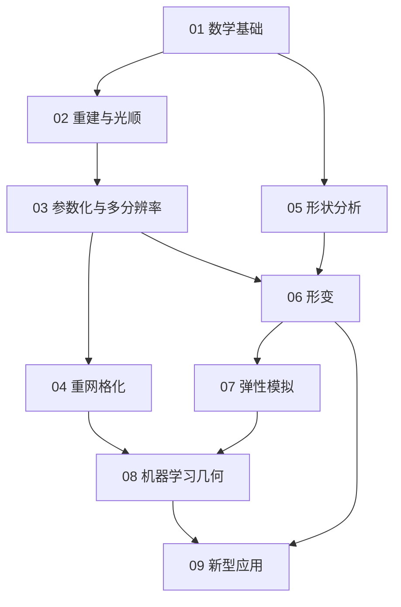

# 学习路径：九章通关（零基础起点）

面向"数学只到高中向量与导数、没做过几何处理"的读者。全程约 40—55 小时，按九步推进，每步有检查点，卡住了就回对应的概念页。

## 路径总览

看图说明：主线是 01→02→03→04，另一条支线 01→05 可以提前走（形状分析只吃第 1 章的曲率与谱）。两条线在 06 汇合，之后 07→08→09。**唯一安全的跳读是 01→05**，其余跳读都会在 06 卡住。

## 步骤 1：几何处理的数学基础

**目标**：能把一个三角网格当成曲面来算——写出余切权重、算出角度亏欠、说出优化问题在解什么。

**阅读**：`chapters/ch01-数学基础.md`，配合概念页 `discrete-laplace.md`、`gauss-curvature.md`、`splines.md`。

**检查点**：ch01 自测 ≥ 3/4；能手算正四面体每个顶点的 K = π。

**复习**：抽认卡标签 `曲率`、`Laplace`、`优化`。

## 步骤 2：点云曲面重建和光顺

**目标**：面对一份扫描点云，能选对重建路线并说明理由。

**阅读**：`ch02-重建与光顺.md`，概念页 `icp-registration.md`、`voronoi-crust.md`、`poisson-reconstruction.md`。

**检查点**：能讲清 ICP 两步交替为什么单调下降、为什么只到局部最优；能说出"干净数据用显式、脏数据用隐式"的理由。

## 步骤 3：参数化与多分辨率

**目标**：把网格摊平到平面而不翻转，并能做可控误差的简化。

**阅读**：`ch03-参数化与多分辨率.md`，概念页 `parameterization.md`、`qem-progressive-mesh.md`。

**检查点**：能解释 Tutte 的两个前提；能手算中心顶点 (0.5, 0.5)；能说明 QEM 误差为什么可累加。

## 步骤 4：重网格化

**目标**：理解"四边形/六面体网格是怎么被算出来的"。

**阅读**：`ch04-重网格化.md`，概念页 `cross-field.md`、`frame-field-hex.md`。

**检查点**：能画出方向场奇异点与 3/5 价顶点的对应；能说明球面至少 8 个 3 价顶点。

## 步骤 5：三维形状分析

**目标**：能选描述子、能解释 Ncut 为什么不切碎片。

**阅读**：`ch05-形状分析.md`，概念页 `shape-descriptor.md`、`mesh-segmentation.md`。

**检查点**：能说出 HKS 的等距不变性来自哪里、局限在哪；能算出 4 顶点链的 Ncut 直觉切法。

## 步骤 6：网格曲面的形变

**目标**：能写出梯度域的最小二乘形式，能解释 LBS 为什么收缩。

**阅读**：`ch06-曲面形变.md`，概念页 `skinning-lbs.md`、`gradient-domain-arap.md`。

**检查点**：能手算 0.707r；能手算 1D 梯度域（x2=2/3、x3=4/3）；能说明 Helmholtz 分解为什么必要。

## 步骤 7：弹性运动模拟

**目标**：能判断一个模拟该用哪种积分器与哪种加速手段。

**阅读**：`ch07-弹性模拟.md`，概念页 `elastic-simulation.md`。

**检查点**：能算出 k=100、m=0.01 时 h ≤ 0.02 s；能解释投影动力学为什么"左边恒定"。

## 步骤 8：基于机器学习的几何处理

**目标**：能判断一个"学习型几何方法"到底在用什么先验、保证在哪。

**阅读**：`ch08-机器学习几何.md`，概念页 `sparse-and-deep.md`。

**检查点**：能用菱形/圆解释 L1 与 L2；能说出 PointNet 的顺序不变来自哪一步。

## 步骤 9：新型几何处理应用

**目标**：能把前八章的方法套到 VR、3D 打印、机器人三类真实约束里。

**阅读**：`ch09-新型应用.md`。

**检查点**：能列出 3D 打印四类几何约束；能说明联合分割识别的合并准则。

## 学完全程后

- 你能：拿到一份点云或网格，判断它该走哪条处理链路（重建/参数化/重网格/形变/模拟），并为每一步给出方法选择理由与可复核的数值指标。
- 你能：看懂一篇几何处理论文的"能量 + 求解"结构，判断它的假设与失效场景。
- 综合检验：完成 `quiz.md` 的最终检验项目（任选一个模型跑完整链路 + 技术报告）。
